<h1 align="center">PVT-Tolerant Ring Amplifier with Deadzone Regulation in IHP SG13G2</h1>

<p align="center">
Nithin Purushothama &nbsp;·&nbsp; <a href="https://nithinpuru.com">nithinpuru.com</a><br>
</p>

<p align="center">


</p>

<details>
<summary><b>Contents</b></summary>

- [Abstract](#abstract)
- [How to reproduce](#how-to-reproduce)
- [I. Introduction](#i-introduction)
- [II. Background](#ii-background)
- [III. Prior Art and Motivation](#iii-prior-art-and-motivation)
- [IV. Circuit Implementation in IHP SG13G2](#iv-circuit-implementation-in-ihp-sg13g2)
- [V. Simulation Results](#v-simulation-results)
  - [E. Cross-corner waveforms (Bode, three-phase settling, step responses)](#e-cross-corner-waveforms)
  - [F. Monte Carlo: process variation and mismatch](#f-monte-carlo-process-variation-and-mismatch)
- [VI. Layout](#vi-layout)
  - [D. Post-layout simulation](#d-post-layout-simulation)
- [VII. Comparison with Prior Art](#vii-comparison-with-prior-art)
- [VIII. Conclusion, Limitations and Next Steps](#viii-conclusion-limitations-and-next-steps)
- [References](#references)
- [Appendix: Repository Structure](#appendix-repository-structure)

</details>

---

## Abstract

Ring amplifiers (ringamps) replace the operational transconductance amplifier of switched-capacitor (SC) circuits with
three inverter-based gain stages whose output stage is biased at a very low quiescent current $I_Q$ by a *deadzone*.
Because the deadzone bias is referred to transistor threshold voltages, $I_Q$, and with it the loop
gain-bandwidth product, moves strongly with process, supply and temperature. This repository implements the
deadzone regulation circuit of Venkatachala [2], [3] — a replica of the second stage and two error amplifiers that hold
$I_Q$ at a multiple of a reference current — in the open IHP SG13G2 130-nm process with a 1.65-V supply and a 50-pF load.
The original xschem design reaches 76.7 dB loop gain, 17.5 MHz unity-gain frequency and 66° phase margin, but loop-gain
analysis of its *internal* loops shows that both regulation loops are unstable or marginal (phase margin −27° and 11°)
and that its ideal common-mode-feedback amplifier cannot be simulated in transient.

A layout-ready version built only
from PDK devices and one external 1-µA reference (77.3 dB, 18.8 MHz, 61.6°) stabilises these loops (≥ 81°), and over
five process corners, −40 °C to 125 °C and $V_{DD}$ ± 5 % holds $I_Q$ within 3.99–5.82 µA, whereas the same amplifier
with the deadzone frozen at its typical value spans 0.003–32.7 µA; the unity-gain-frequency spread shrinks from 860× to
6×, and the small-signal settling error of an SC amplifier 250 ns after a step falls from up to 82 % to at most 1.6 %
(≤ 0.25 % everywhere except at 125 °C in the fast-NMOS corners). A compact matched layout of 83 µm × 44 µm
(0.0037 mm²; multi-finger devices with shared diffusions, ABBA pairs, interdigitated mirrors, the 2-pF capacitors over
the circuit) is clean in the IHP DRC and antenna decks and matches the schematic in LVS. Post-layout simulation with the
extracted capacitances still costs phase margin (61.6° → 44.4° at TT, 27 °C; the buffer oscillates at SS, −40 °C),
mainly through the 19 fF of routing on the high-impedance stage-1 output. A Monte Carlo analysis with the PDK's
statistical models shows that the regulation removes global process variation ($I_Q$ = 4.18–4.26 µA, 5th–95th
percentile, against 0.6–10 µA with fixed bias) but not local mismatch: with the minimum-size stage-2 inverters of the
original design, $I_Q$ spreads over more than five decades with or without the loop. The remaining weaknesses — a 33-dB supply rejection
and a 1.5 % common-mode-dependent gain error caused by the transistor-level CMFB, and the residual temperature
dependence of the transconductance at constant $I_Q$ — are quantified and traced to their causes.

**Index Terms** — Ring amplifier, deadzone, PVT variation, replica biasing, switched-capacitor amplifier,
common-mode feedback, loop-gain analysis, layout matching, common centroid, DRC, LVS, parasitic extraction,
post-layout simulation, Monte Carlo, IHP SG13G2, open-source PDK.

---

## How to reproduce

Everything in this report is regenerated by scripts in the repository; nothing is edited by hand after generation.

```bash
export PDK_ROOT=<directory that contains ihp-sg13g2>
python3 layout/gen_schematics.py        # RAMP_LR xschem cells
python3 sim/ramp_pvt.py                 # PVT simulations, 3.5 min*
python3 sim/internal_loops.py           # Table II
python3 sim/cmfb_experiment.py          # Table VII
python3 sim/montecarlo.py               # Monte Carlo, 3 sets x 2 biases x 500 samples, 35 min*
PYTHON=<python with klayout module> layout/run_checks.sh   # layout, DRC, LVS
layout/run_pex.sh                       # parasitic extraction (magic) + netgen LVS
python3 sim/postlayout.py               # schematic vs. post-layout, 4 min*
python3 sim/make_figures.py             # result figures
python3 layout/make_layout_figures.py   # layout figures
docs/export_schematics.sh               # schematic images (X display)
python3 docs/make_diagrams.py           # Fig. 12
python3 docs/make_composites.py         # multi-panel figures
python3 docs/audit_readme.py            # check paths, figures, references
```

<sub>* on a 16-thread desktop; the ngspice jobs run in parallel, one thread each.</sub>

**Tested environment.** Fedora Linux; IHP-Open-PDK (ciel version `22f2a25f`), xschem 3.4.8 (schematics saved by
3.4.6), ngspice-46 with the PSP103 OSDI models, KLayout 0.30.8 (layout, DRC, LVS), magic 8.3.637 and netgen 1.5.323
(extraction) and the `klayout` Python module
0.30.12 for the IHP `run_drc.py`/`run_lvs.py` wrappers, Python 3.14 with NumPy 2.4 and Matplotlib 3.10.
ngspice must load the IHP OSDI models (the PDK's `.spiceinit`).

**Opening the designs.** Start xschem from `Design Files/RAMP` (it picks up the project `xschemrc`, which loads the
IHP setup and makes all symbol paths relative): `cd "Design Files/RAMP" && xschem RAMP-Test/RamP_tb1_CP_FB.sch` for the
original design or `xschem RAMP-LR/tb_RAMP_LR.sch` for the layout-ready one. Open the layout with
`klayout -e layout/RAMP_LR.gds` and the IHP technology.

**Troubleshooting.** *“ngspice did not converge: orig_ss_27”* is expected (Section IV-C). If the DRC/LVS wrappers fail
with `ModuleNotFoundError: klayout`, install it in a virtual environment (`pip install klayout docopt`) and pass that
interpreter as `PYTHON`. The IHP LVS runner prints “Status PASS” even when KLayout aborts; `layout/run_lvs.sh` therefore
reads the comparison result from the `.lvsdb` file itself.

---

## I. Introduction

The ring amplifier was introduced by Hershberg *et al.* [1] as a scalable, power-efficient replacement for the
operational transconductance amplifier (OTA) in SC circuits. In steady state it is a three-stage amplifier whose first
two stages boost the transconductance of the output stage; the output stage is biased at a very low quiescent current,
which places the dominant pole at the output and stabilises the loop (Fig. 1). When a step arrives, the first two
stages behave like digital inverters and turn the output stage fully on, so the load is charged almost like an RC
network, and the amplifier returns to its low-current state as the error vanishes [2]. Ringamps are now used for residue
amplification in pipelined and SAR-assisted ADCs [4]–[9] and as the error amplifier of fast-transient LDOs [10].

<p align="center">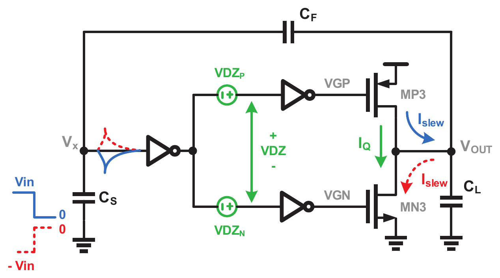</p>
<p align="center"><b>Fig. 1.</b> Basic ring amplifier in an SC feedback loop: two inverter stages with a deadzone
voltage <i>V<sub>DZ</sub></i> drive the output inverter MP3/MN3, which conducts a small quiescent current <i>I<sub>Q</sub></i> at rest and a large
slewing current <i>I<sub>slew</sub></i> during a step. Reproduced from [2, Fig. 1.1].</p>

The first concern about ringamps listed in [2] is their sensitivity to process, voltage and temperature (PVT): the
deadzone that sets $I_Q$ is a voltage, $I_Q$ depends exponentially or quadratically on the threshold voltage of the
output devices, and the loop bandwidth follows $I_Q$. In a 65-nm design example, a deadzone tuned at the typical corner
gives a gain-bandwidth product of 9 MHz at the slow corner and 1500 MHz at the fast corner [2], [3]. The remedy proposed
in [2], [3] is a *deadzone regulation circuit*: a replica of the second stage and two error amplifiers servo the
deadzone control voltages so that the output-stage gate voltages equal those of diode-connected replicas of the output
devices biased by a constant current.

This work studies that technique in an open process, where the whole flow — schematics, simulation, layout and
physical verification — can be shared and reproduced. Its contributions are:

1. a portable xschem implementation of the current-starved ringamp with deadzone regulation in IHP SG13G2 (Section IV),
   and a loop-gain analysis of its *internal* loops, which finds that the regulation loops and the ideal
   common-mode-feedback (CMFB) loop of the original schematic are unstable (Section IV-C);
2. a layout-ready redesign that keeps the topology but uses only PDK devices and one external reference current, with
   stable internal loops (Section IV-D);
3. a PVT characterisation — five corners, −40 °C to 125 °C, $V_{DD}$ ± 5 % — of the regulated amplifier against the same
   amplifier with a fixed deadzone, including an SC charge-transfer test and settling measured against the true final
   value (Section V);
4. a matched, DRC-, antenna- and LVS-clean layout generated from the same design description as the schematics
   (Section VI), and a comparison with the published deadzone biasing schemes (Section VII).

Section II reviews ringamp operation, Section III the deadzone biasing problem and prior art, and Section VIII
concludes with the limitations of this work.

---

## II. Background

### A. Operation and the deadzone

Fig. 2(a) shows the single-ended ringamp with deadzone control voltages $V_{DZP}$ and $V_{DZN}$ at the second stage.
The first two stages map the virtual-ground voltage $V_X$ to the output-stage gate voltages $V_{GP}$ and $V_{GN}$
(Fig. 2(c)); around $V_X = 0$ both output devices are nearly off, which produces the flat region of the overall I–V
characteristic in Fig. 2(b) — the input-referred deadzone. Its slope sets the small-signal transconductance; outside it
the large-signal transconductance $G_m$ rises steeply [2].

<p align="center">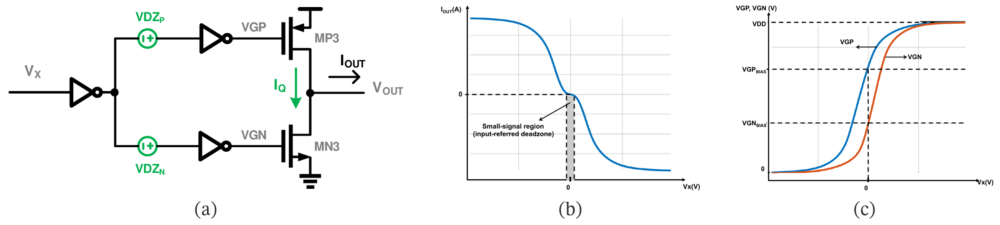</p>
<p align="center"><b>Fig. 2.</b> (a) Single-ended ringamp with deadzone control voltages <i>V<sub>DZP</sub></i>,
<i>V<sub>DZN</sub></i>; (b) I–V characteristic of the whole amplifier, with the input-referred deadzone around
<i>V<sub>X</sub></i> = 0; (c) transfer characteristic of the first two stages to <i>V<sub>GP</sub></i>, <i>V<sub>GN</sub></i>.
Reproduced from [2, Figs. 2.9–2.11].</p>

### B. Three settling phases

A large step drives $V_{GP}$ or $V_{GN}$ close to a rail, so the output device behaves like a resistor $R_{ON}$ and the
load is charged with a decaying, RC-like current (time constant $\tau_L = R_{ON} C_{out}$). When the output approaches
its final value the feedback pulls the gate back and a large-signal phase governed by $G_m$ follows; the last part of
the settling is linear, at the small-signal time constant $\tau_S = 1/\mathrm{GBW}$ (Fig. 3) [2]. Fig. 4 is the same
sequence measured in the IHP design of this work; an empirical study of
ringamp settling in pipelined ADCs is given in [13].

<p align="center">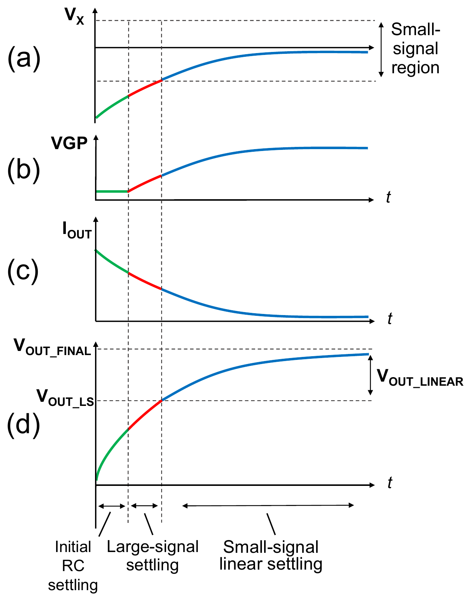</p>
<p align="center"><b>Fig. 3.</b> Ringamp step response: (a) virtual ground, (b) second-stage output
<i>V<sub>GP</sub></i>, (c) output current, (d) output voltage, divided into initial RC settling, large-signal settling and
small-signal linear settling. Reproduced from [2, Fig. 2.12] (the thesis caption labels the panels a, b, b, c).</p>

<p align="center">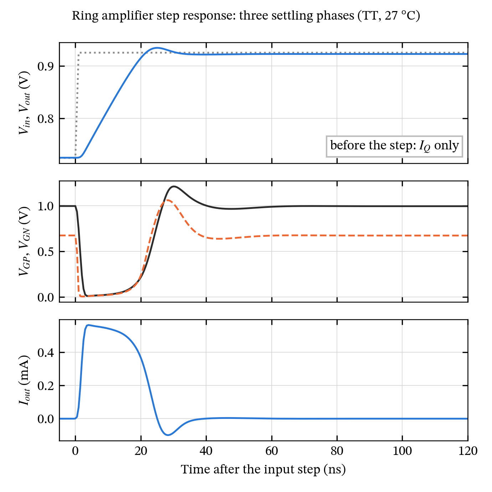</p>
<p align="center"><b>Fig. 4.</b> The three phases in the layout-ready IHP design (TT, 27 °C, 200-mV buffer step,
<i>C<sub>L</sub></i> = 50 pF), animated from the simulation. Left: output, stage-3 gate voltages and the currents
of MP3 and of <i>C<sub>L</sub></i>, traced in time and shaded by phase. Right: the output stage at the same instant,
with the gate voltages <i>V<sub>GP</sub></i> and <i>V<sub>GN</sub></i>, the device currents (shading ∝ log current) and the
direction and size of the current into <i>C<sub>L</sub></i>.
The phase boundaries are detected from the data: a gate within 0.25 V of a rail (RC), |<i>I<sub>C<sub>L</sub></sub></i>| above
20 <i>I<sub>Q</sub></i> (large signal), then until the output is within 0.1 % (small signal).</p>

### C. Small-signal model and design equations

With the non-dominant poles neglected, the closed-loop response of the ringamp in an SC amplifier of gain
$G = C_S/C_F$ is that of a single-pole system [2, eqs. (2.23)–(2.28)]:

$$A_{CL}(s) = -G\,\frac{L(0)}{1+L(0)}\,\frac{1-s/z}{1+s/p},\qquad L(0)=\beta A_1A_2A_3,\qquad \beta=\frac{C_S}{C_S+C_{in1}+C_F},$$

$$\mathrm{GBW}=\beta\,\frac{A_1A_2\,g_{m3}}{C_{out}},\qquad C_{out}=C_L+(1-\beta)C_F,\qquad z=\frac{g_{m3}}{c_{gd3}}.$$

The output-stage transconductance $g_{m3}$ is set by $I_Q$, so the GBW follows the deadzone bias; the right-half-plane
zero $z$ lies close to the GBW because $g_{m3}$ is small, and it costs phase margin. To keep the noise at or below that
of a single-stage OTA, the first stage must satisfy $g_{m1} \ge A_1A_2\,g_{m3}$ [2, eq. (2.55)], and the dynamic error
after a time $t$ is $\varepsilon = e^{-t/\tau}$, i.e. 1.44 bits per time constant [2, eq. (2.18)]. Fig. 5 is the
three-stage small-signal model behind these expressions.

<p align="center">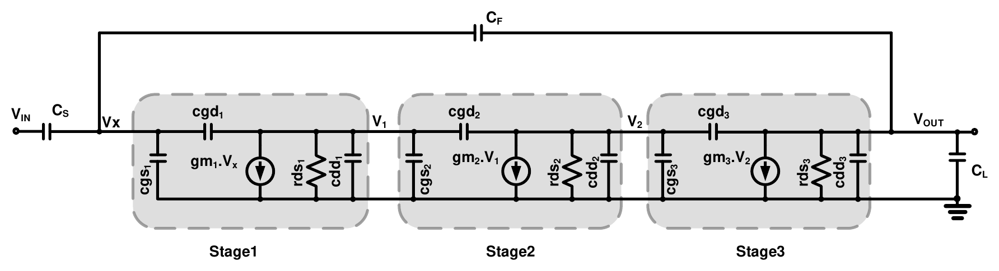</p>
<p align="center"><b>Fig. 5.</b> Small-signal model of a ringamp during the charge-transfer phase of an SC
amplifier. Reproduced from [2, Fig. 2.18] (the thesis prints the caption of its Fig. 2.19 under this figure).</p>

### D. Ways of setting the deadzone

The original ringamp applies an external deadzone voltage at the input of the second stage (Fig. 6(a)) [1]; later
designs use an on-chip resistor at the second-stage output [4], [5] (Fig. 6(b)) or current-starved second-stage
inverters whose starving devices are driven by control voltages $V_{CTRLP}$, $V_{CTRLN}$ (Fig. 6(c)) [6]. In all three
the steady-state gate voltages of MP3/MN3, and therefore $I_Q$, are set relative to threshold voltages [2]. The design
in this repository uses the current-starved structure.

<p align="center">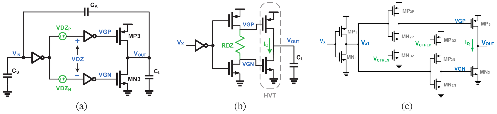</p>
<p align="center"><b>Fig. 6.</b> Deadzone biasing structures: (a) external deadzone voltage <i>V<sub>DZ</sub></i>
[1]; (b) resistor <i>R<sub>DZ</sub></i> at the second-stage output [4]; (c) current-starved inverters controlled by
<i>V<sub>CTRLP</sub></i>, <i>V<sub>CTRLN</sub></i> [6]. Reproduced from [2, Figs. 3.1–3.3].</p>

---

## III. Prior Art and Motivation

**The PVT problem.** In the 65-nm, 1.2-V design example of [2], [3] — a current-starved ringamp in an SC amplifier with
gain 4, $C_S$ = 2 pF, $C_F$ = 0.5 pF, $C_L$ = 0.7 pF, 125 MS/s and a 0.05 % settling target — the deadzone voltages that
give $I_Q$ = 3.5 µA at TT ($V_{CTRLP}$ = 795 mV, $V_{CTRLN}$ = 390 mV) give the GBW and phase margins in the upper half of
Table I; at the slow corner the amplifier misses the settling target by more than an order of magnitude.

**Deadzone regulation.** The circuit of Fig. 7(a) [2], [3] generates reference gate voltages $V_{GP,REF}$ and
$V_{GN,REF}$ with diode-connected replicas of MP3/MN3 carrying a constant current $I_{BIAS}$, so the references track the
threshold voltages. A replica of the second stage, driven at the same input common-mode voltage as the real one, is
placed in a feedback loop with two error amplifiers that adjust $V_{CTRLP}$ and $V_{CTRLN}$ until the replica outputs
equal the references; the same control voltages bias the real second stage, so the real output stage carries
$I_Q = k\,I_{BIAS}$ for an output stage $k$ times wider than the replicas. Because the loop is a DC bias network outside
the signal path, an error-amplifier gain of about 30 dB is enough [2]. The lower half of Table I and Fig. 7(b), (c) show
the result in 65 nm.

<p align="center">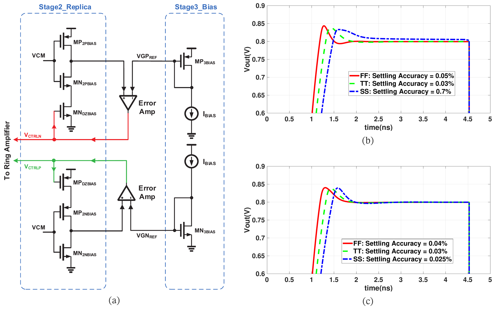</p>
<p align="center"><b>Fig. 7.</b> (a) Deadzone regulation circuit for the current-starved ringamp;
transient response of the 65-nm design with (b) the deadzone fixed at its TT value and (c) the regulation circuit
(800-mV output step; settling accuracy at FF/TT/SS 0.05/0.03/0.7 % and 0.04/0.03/0.025 %). Reproduced from
[2, Figs. 3.6, 3.5, 3.7].</p>

<p align="center">TABLE I<br>GBW AND PHASE MARGIN OF THE 65-nm DESIGN EXAMPLE OF [2], [3]</p>

| Deadzone bias | | SS | TT | FF |
|:--|:--|--:|--:|--:|
| fixed at the TT values [2, Table 3.1] | GBW (MHz) | 9 | 415 | 1500 |
| | PM (deg) | 85 | 68 | 53 |
| deadzone regulation [2, Table 3.2] | GBW (MHz) | 475 | 415 | 380 |
| | PM (deg) | 61 | 68 | 72 |

**Other approaches and their limits.** Lim and Flynn bias the deadzone with an on-chip resistor (self-biased ringamps)
[4], [5]; Leuenberger *et al.* use current-starved inverters with a dynamic deadzone [6]; ElShater *et al.* combine low-
and high-threshold devices in a dual-deadzone output stage for smooth large-signal behaviour [7]; Lagos *et al.*
degenerate the deadzone [8]; Megawer *et al.* give a gm/Id design procedure for class-AB ringamps [11]; Cao *et al.*
propose a dead-zone that is insensitive to process and supply voltage and verify it in simulation [12]. The quiescent
point of the resistor and current-starved structures is a function of the output-stage threshold voltages [2]; [12] does
not describe its mechanism in the abstract; [2], [3] report the regulation technique in simulation at three process
corners only, without temperature or supply variation, and without a layout. The questions this work answers are
therefore: does the technique carry over to a different (open) process, how does it behave over temperature and supply,
what does a buildable implementation look like, and what does it cost in area and power?

---

## IV. Circuit Implementation in IHP SG13G2

### A. Original design

The design (`Design Files/RAMP`) uses the 1.2-V low-voltage (lv, $L_{min}$ = 0.13 µm) and 3.3-V high-voltage (hv,
thick-oxide, $L_{min}$ = 0.45/0.40 µm) MOS devices of SG13G2 [17] at $V_{DD}$ = 1.65 V. The top level (Fig. 8) is the
single-ended current-starved ringamp of Fig. 6(c): a resistively loaded first stage with local CMFB (Fig. 9(a)), whose
common-mode reference $V_{1,CM}$ is the switching point of a replica of the second-stage inverters (`STG1-CM`, Fig. 9(b));
the current-starved second stage (Fig. 9(c)); the hv output stage MP3/MN3 (4 × 4.5/0.5 µm and 4 × 2.3/1 µm); and the
regulation loop (`STG2_Replica`, Fig. 10), whose reference diodes MP_R/MN_R are single units of the output devices fed by
1 µA, so that $I_Q \approx$ 4 µA. Note that the pin named `plus` is the *inverting* input of the amplifier (the output is
fed back to it).

<p align="center">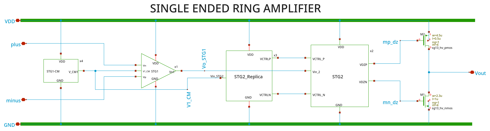</p>
<p align="center"><b>Fig. 8.</b> Top level of the original single-ended ring amplifier
(<code>Fully-Diff-RAMP/RAMP.sch</code>): stage-1 CM reference, stage 1, stage-2 replica (regulation loop), stage 2 and the
output stage MP3 (M2) / MN3 (M1).</p>

<p align="center">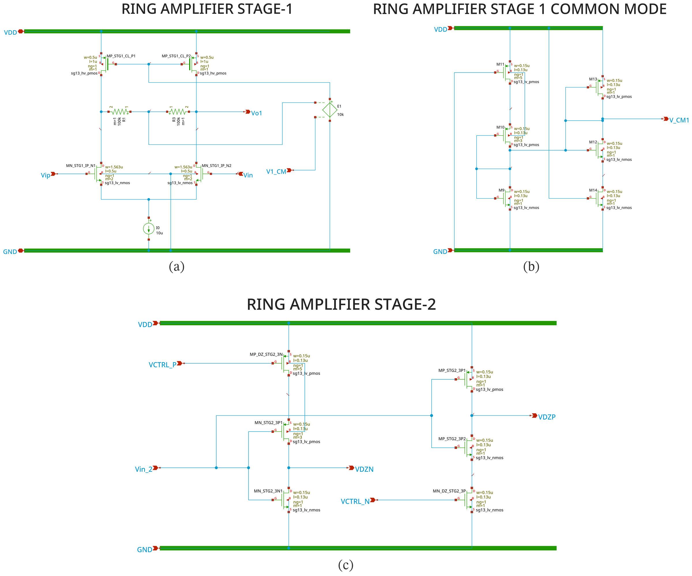</p>
<p align="center"><b>Fig. 9.</b> (a) Stage 1: lv NMOS pair (2 × 1.563/0.5 µm per side), hv PMOS loads,
100-kΩ common-mode sensing resistors, an ideal 10-µA tail and an ideal CMFB amplifier E1 (gain 10⁴); (b) trip-point
replica that generates <i>V<sub>1,CM</sub></i>; (c) stage 2: two current-starved inverters of minimum-size lv devices,
starved by MP_DZ (×5, <i>V<sub>CTRL_P</sub></i>) and MN_DZ (<i>V<sub>CTRL_N</sub></i>).</p>

<p align="center">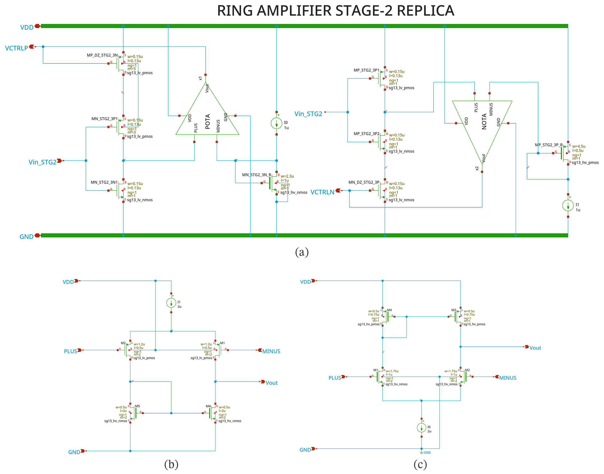</p>
<p align="center"><b>Fig. 10.</b> Deadzone regulation loop: (a) <code>STG2_Replica.sch</code> — stage-2 replica driven
at <i>V<sub>1,CM</sub></i>, reference diodes MN_STG2_3N_R and MP_STG2_3P_R fed by ideal 1-µA sources, and the two error
amplifiers; (b) POTA, which sets <i>V<sub>CTRLP</sub></i>; (c) NOTA, which sets <i>V<sub>CTRLN</sub></i> (both with ideal 2-µA tails).</p>

### B. Test bench and loop-gain measurement

The test bench (Fig. 11) is a unity-gain buffer with a 50-pF load at an input common mode of 0.825 V, the configuration
in which the design was sized for a 20-MHz bandwidth and a settling time below 250 ns. The loop gain is measured by
breaking the feedback with a series voltage source and a shunt current source and running two AC analyses
(Middlebrook's double injection [15], [16]); with the injected-voltage response $v_1$ at the break point and the
current-injection response $i_2$ through the break, $T = 1/(v_1 + i_2) - 1$, which is exact for a unilateral loop and
independent of where the break sits. The same probe is used for every loop in this report.

<p align="center">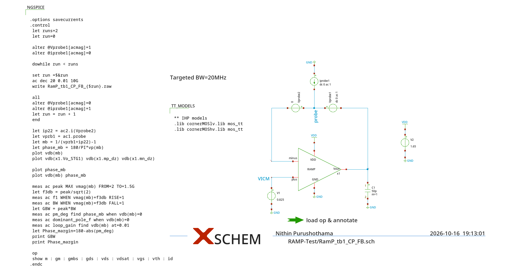</p>
<p align="center"><b>Fig. 11.</b> Loop-gain test bench <code>RAMP-Test/RamP_tb1_CP_FB.sch</code>:
<i>V<sub>probe1</sub></i> (voltage injection), <i>I<sub>probe1</sub></i> (current injection) and <i>V<sub>probe2</sub></i>
(current sense) break the feedback from the output to the inverting input.</p>

### C. Stability of the internal loops

The main loop of the original design is well behaved: 76.7 dB loop gain, 17.5-MHz unity-gain frequency (UGF) and 66.0°
phase margin at TT (Table V). But the circuit contains three more loops that the main-loop measurement does not break:
the two deadzone regulation loops (error amplifier → starving-device gate in the replica → replica output → error
amplifier) and the stage-1 CMFB loop. Their loop gains, measured with the same probe, are listed in Table II.

<p align="center">TABLE II<br>LOOP GAIN OF THE INTERNAL LOOPS AT 27 °C (<code>sim/internal_loops.py</code>)</p>

| Design | Loop | DC gain at TT (dB) | UGF at TT (MHz) | PM at TT | PM at SS | PM at FF |
|:--|:--|:--:|:--:|:--:|:--:|:--:|
| original | regulation, $V_{CTRLN}$ | 54.3 | 531 | **−27.1°** | no OP | **−24.7°** |
| original | regulation, $V_{CTRLP}$ | 43.8 | 376 | **10.6°** | no OP | **19.9°** |
| original | stage-1 CMFB (ideal E1) | 115.3 | > 100 GHz¹ | – | no OP | – |
| layout-ready | regulation, $V_{CTRLN}$ | 53.5 | 7.9 | 83.2° | 81.5° | 84.9° |
| layout-ready | regulation, $V_{CTRLP}$ | 43.4 | 3.8 | 88.2° | 88.0° | 88.7° |
| layout-ready | stage-1 CMFB (transistor) | 35.1 | 106 | 68.4° | 74.2° | 62.6° |

<sub>¹ 66.7 dB of loop gain is left at 100 GHz. "no OP": ngspice finds no operating point for the original design at SS.</sub>

The error-amplifier outputs of the original regulation loop see only the gate capacitance of the minimum-size starving
devices (a few fF), so there is no dominant pole and the $V_{CTRLN}$ loop has a negative phase margin. In a transient
simulation at constant input, $V_{CTRLN}$ oscillates with 580 mV peak-to-peak at 275 MHz; the main loop suppresses most
of it, which is why the AC analysis of the main loop looked healthy. The ideal CMFB amplifier E1 has no bandwidth limit,
and its feed-forward through the gate–drain capacitance of the PMOS loads leaves the CMFB loop with 66.7 dB of gain at
100 GHz: in transient, E1's output runs away to kilovolts within 10–20 ns and ngspice aborts. At the SS corner ngspice finds no
operating point for the original design at all. The ringamp itself is not at fault — these are bias loops — but the
deadzone regulation cannot be demonstrated in the time domain with the original schematic.

### D. Layout-ready redesign (RAMP_LR)

The redesign keeps the topology and the device sizes of the signal path and changes what cannot be built or does not
work (Table III). It is described once, in `layout/ramp_lr_design.py`, from which both the xschem cells
(`Design Files/RAMP/RAMP-LR`) and the layout are generated, so the LVS netlist and the simulated netlist are the same
file. Fig. 12 shows the resulting architecture.

<p align="center">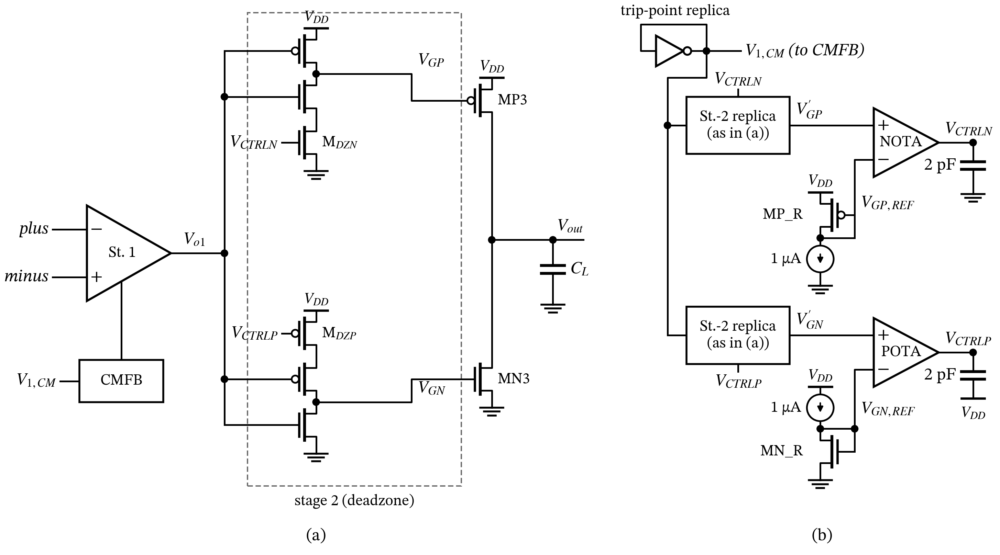</p>
<p align="center"><b>Fig. 12.</b> Architecture of the layout-ready ring amplifier RAMP_LR. (a) Signal path:
stage 1 with transistor CMFB referenced to <i>V<sub>1,CM</sub></i>; stage 2 as two current-starved inverters whose
deadzone devices M<sub>DZN</sub> (MN_DZ_STG2_3P) and M<sub>DZP</sub> (MP_DZ_STG2_3N, ×5) are controlled by
<i>V<sub>CTRLN</sub></i> and <i>V<sub>CTRLP</sub></i>; output stage MP3/MN3 driving <i>C<sub>L</sub></i> = 50 pF.
(b) Deadzone regulation: the trip-point replica sets <i>V<sub>1,CM</sub></i>; replicas of the two stage-2 inverters
driven by <i>V<sub>1,CM</sub></i> give <i>V′<sub>GP</sub></i> and <i>V′<sub>GN</sub></i>, which NOTA and POTA compare
with the gate voltages of the reference diodes MP_R and MN_R at 1 µA. MP3 and MN3 are four times MP_R and MN_R, so
<i>I<sub>Q</sub></i> = 4 <i>I<sub>BIAS</sub></i>; 2-pF MIM capacitors decouple the control voltages. All bias currents
are mirrored from one external <i>I<sub>BIAS</sub></i> = 1 µA (not shown).</p>

<p align="center">TABLE III<br>CHANGES FROM THE ORIGINAL SCHEMATIC TO RAMP_LR</p>

| Original | RAMP_LR | Reason / effect |
|:--|:--|:--|
| ideal current sources (10 µA, 2 × 2 µA, 2 × 1 µA) | one external $I_{BIAS}$ = 1 µA, NMOS/PMOS mirrors of 0.5/8-µm units | buildable; with 2-µm-long units the 1-µA branches were 24–28 % off (DIBL in weak inversion), with 8 µm ≤ 4 % ($I_Q$ = 4.22 µA vs 4.10 µA) |
| ideal CMFB amplifier E1 (gain 10⁴, no pole) | NMOS pair MC1/MC2 with diode loads MPC1/MPC2 mirrored 1:1 into the loads; loads m = 2 instead of 1 | stable (Table II); the loads needed more width for headroom |
| ideal 100-kΩ resistors | rhigh poly, 0.5 × 33.7 µm (10 series segments of 3.37 µm in layout) | buildable |
| — | 2-pF MIM capacitors on $V_{CTRLP}$ (to $V_{DD}$) and $V_{CTRLN}$ (to GND) | dominant pole of the regulation loops: PM −27°/11° → 83°/88° |
| — | MOS gate capacitors MCN/MCP on $V_{CTRLN}/V_{CTRLP}$ | antenna rule: MIM plate area / gate area of the 0.15 × 0.13-µm gates was ≈ 35 000 (limit 20 000) |
| body of MP_STG2_3P2 (×2) and M12 tied to their sources | body to GND | a standard SG13G2 NMOS sits in the common p-substrate |
| input pair W = 1.563 µm | 1.56 µm | 5-nm manufacturing grid |
| — | 33 dummy fingers in `DUMMY_LR` | matching; excluded from LVS with `lvs_ignore` because the IHP deck purges shorted devices on the layout side |

The single-stage transistor CMFB is the one compromise of the redesign. With the main loop closed, the stage-1 output
$V_{o1}$ is held by the feedback, so the other drain sees the 200-kΩ sensing path to a fixed node and the common-mode
"plant" has only about 35 dB of gain; the ideal E1 contributed the missing 80 dB. Cascoding the loads does not help (the
limit is the sensing path, not the load resistance), and a two-stage CMFB amplifier needs about 20 pF of compensation to
be stable; both were tried and are not used. The consequences are quantified in Section V-H.

---

## V. Simulation Results

All results below are for RAMP_LR unless stated otherwise, at $V_{DD}$ = 1.65 V, $C_L$ = 50 pF, $I_{BIAS}$ = 1 µA. The
*fixed-bias* reference is the same netlist with the regulation loop removed and $V_{CTRLP}/V_{CTRLN}$ held at the values
the loop produces at TT, 27 °C (0.831 V / 0.822 V) — the experiment of [2, Table 3.1]. The MOS corners are those of the
IHP models (TT, SS, FF, SF, FS); resistors and capacitors use their typical/worst/best sections with the matching MOS
corner. Data: `sim/results/pvt_summary.csv` (109 rows). Section V-E shows the Bode plots and step responses
of all five corners at each temperature (Figs. 19–21), Section V-F the Monte Carlo analysis.

### A. Loop gain

Fig. 13 compares the main loop of the original and the layout-ready design at TT. The redesign is within 1 dB in gain,
1.3 MHz in UGF and 4.4° in phase margin of the original; the gain margin is 24.5 dB.

<p align="center">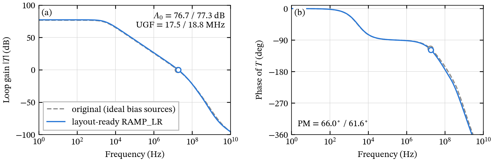</p>
<p align="center"><b>Fig. 13.</b> Loop gain of the unity-gain buffer at TT, 27 °C: (a) magnitude,
(b) phase. Grey dashed: original design with ideal bias sources; blue: RAMP_LR. Circles mark the unity-gain
frequency.</p>

### B. Quiescent current over process and temperature

Fig. 14 is the central result. With the deadzone frozen at its TT value, $I_Q$ spans 0.03 µA (SS, −40 °C) to 29 µA
(FF, 125 °C) at nominal supply — three orders of magnitude, because the output stage sits in weak inversion where the
current depends exponentially on the threshold voltage. With the regulation loop the spread is 4.06–5.04 µA over the
same 15 corner/temperature points; the loop achieves it by moving $V_{CTRLP}$ between 0.78 and 0.92 V and $V_{CTRLN}$
between 0.74 and 0.88 V (Fig. 14(c)). Including the supply corners, the ranges are 0.003–32.7 µA (fixed) and 3.99–5.82 µA (regulated).

<p align="center">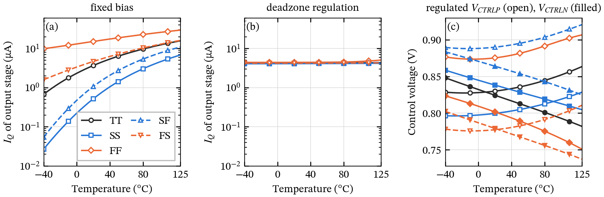</p>
<p align="center"><b>Fig. 14.</b> Output-stage quiescent current versus temperature for the five process
corners: (a) fixed deadzone bias, (b) deadzone regulation (same logarithmic axis); (c) control voltages produced by the
regulation loop (open markers <i>V<sub>CTRLP</sub></i>, filled <i>V<sub>CTRLN</sub></i>).</p>

<p align="center">TABLE IV<br>QUIESCENT CURRENT, UGF AND PHASE MARGIN AT 27 °C, V<sub>DD</sub> = 1.65 V</p>

| Corner | $I_Q$ fixed (µA) | UGF fixed (MHz) | PM fixed (°) | $I_Q$ regulated (µA) | UGF regulated (MHz) | PM regulated (°) |
|:--:|--:|--:|--:|--:|--:|--:|
| TT | 4.22 | 18.8 | 61.6 | 4.22 | 18.8 | 61.6 |
| SS | 0.67 | 6.5 | 76.8 | 4.09 | 21.7 | 48.1 |
| FF | 15.84 | 30.7 | 54.9 | 4.40 | 13.7 | 74.6 |
| SF | 1.37 | 8.7 | 76.8 | 4.23 | 19.3 | 60.6 |
| FS | 5.17 | 20.7 | 59.1 | 4.21 | 18.3 | 61.7 |

As in [2], the regulated UGF is not perfectly constant: the slow corner is now the fastest, because $A_1A_2$ is larger
there (Section II-C), and its phase margin is the lowest — the trade-off described in [2, Sec. 3.5].

### C. Unity-gain frequency and phase margin over PVT

<p align="center">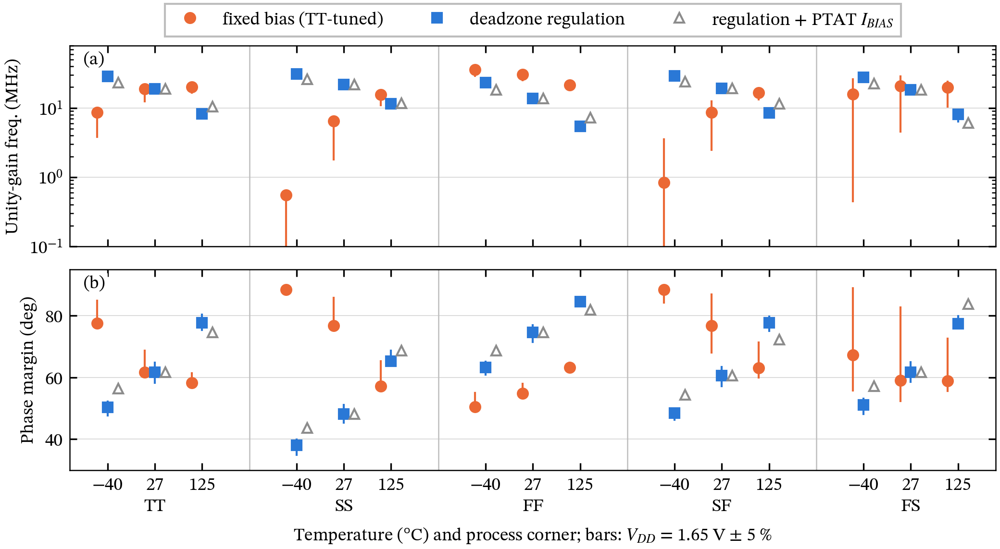</p>
<p align="center"><b>Fig. 15.</b> (a) Unity-gain frequency and (b) phase margin over process corner and
temperature; markers at 1.65 V, bars over 1.5675–1.7325 V. Orange: fixed bias; blue: deadzone regulation; grey
triangles: regulation with an ideal PTAT reference current (Section V-G). The fixed-bias SS and SF bars at −40 °C
continue below 0.1 MHz at the low supply.</p>

Over all 45 PVT points the UGF spans 0.04–35.9 MHz with fixed bias (860×) and 5.4–32.4 MHz with regulation (6×). The
remaining spread is mostly temperature: at constant $I_Q$, $g_{m3} = I_Q/(n U_T)$ falls with absolute temperature in weak
inversion, and the stage gains $A_1A_2$ (the DC loop gain falls from 80.5 to 71.0 dB at TT) fall as well, so the UGF
drops from 28.8 MHz at −40 °C to 8.2 MHz at 125 °C (TT). The phase margin moves the other way, from 50° to 78°; the
lowest value, 35° at SS, −40 °C and low supply, is where the gain is highest.

### D. Step response and settling

**Three phases.** Fig. 16 shows the rising edge of a 200-mV step in the buffer at TT. During the first 20 ns both
second-stage outputs are pulled to ground, MP3 is fully on and the load is charged with about 0.55 mA — 130 times
$I_Q$; the gates then return, the current reverses briefly (6 % overshoot) and the output settles linearly.

<p align="center">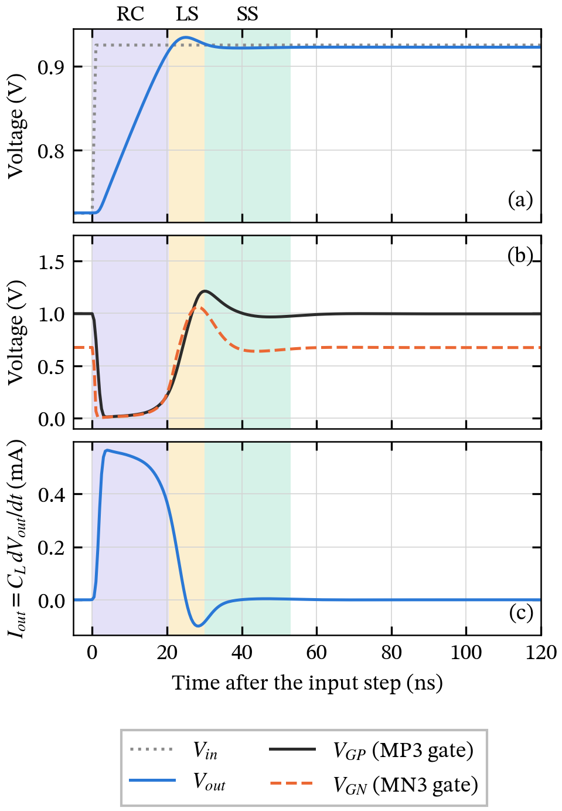</p>
<p align="center"><b>Fig. 16.</b> Rising 200-mV step of the unity-gain buffer, TT, 27 °C: (a) input and
output, (b) stage-3 gate voltages, (c) load current <i>C<sub>L</sub></i>·d<i>V<sub>out</sub></i>/d<i>t</i>; shading marks the
RC, large-signal (LS) and small-signal phases.</p>

**Switched-capacitor test.** In the application of [2] the amplifier inputs sit at a virtual ground. The SC test
(`sc_deck` in `sim/ramp_pvt.py`) therefore uses an inverting charge-transfer amplifier with $C_S = C_F$ = 5 pF,
$C_L$ = 50 pF and a 1-GΩ DC feedback resistor; it applies two 4-mV steps (small signal, inside the deadzone) and then two
200-mV steps (large signal). Errors are measured against the *ideal* charge transfer $-\frac{C_S}{C_F}\Delta V_{in}$,
so a response that stops inside the deadzone, or a finite loop gain, counts as error.

<p align="center">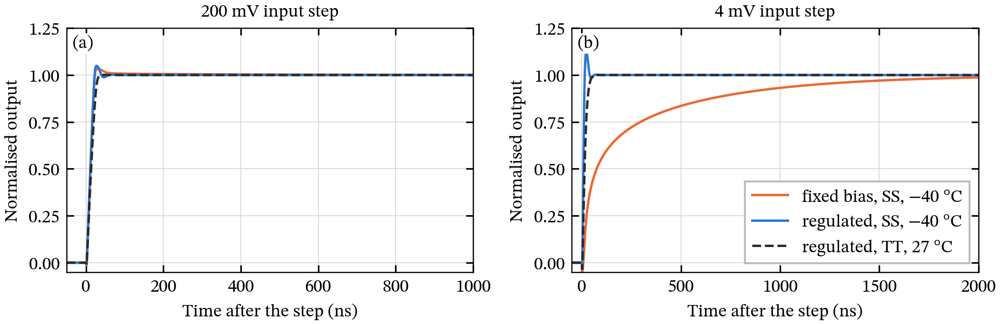</p>
<p align="center"><b>Fig. 17.</b> Normalised SC step responses: (a) 200-mV and (b) 4-mV input step, for the
fixed-bias and the regulated amplifier at SS, −40 °C, and the regulated amplifier at TT, 27 °C.</p>

Fig. 17 reproduces, in IHP, the failure mode of Fig. 7(b): with fixed bias at SS, −40 °C ($I_Q$ = 0.03 µA) the 4-mV
step is still 28 % short of its final value after 250 ns and has not settled after 2 µs, while the regulated amplifier
settles in 80 ns. The 200-mV step hides the problem — it drives the amplifier out of the deadzone, where the speed is set
by the RC phase and not by $I_Q$ — which is why a large-signal test alone is not a sufficient check of the deadzone bias.

<p align="center">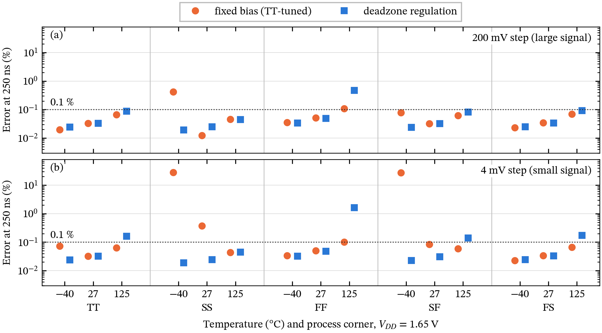</p>
<p align="center"><b>Fig. 18.</b> Error 250 ns after (a) a 200-mV and (b) a 4-mV step in the SC test, over
process corner and temperature at 1.65 V.</p>

<p align="center">TABLE V<br>SUMMARY OVER ALL 45 PVT POINTS (5 CORNERS × −40/27/125 °C × V<sub>DD</sub> = 1.5675/1.65/1.7325 V)</p>

| Quantity | Fixed bias | Deadzone regulation | Regulation + PTAT $I_{BIAS}$ (1.65 V only) |
|:--|:--:|:--:|:--:|
| $I_Q$ (µA) | 0.003 – 32.7 | 3.99 – 5.82 | 3.20 – 6.08 |
| Unity-gain frequency (MHz) | 0.04 – 35.9 | 5.4 – 32.4 | 6.1 – 26.1 |
| Phase margin (deg) | 50.5 – 89.5 | 34.9 – 85.2 | 43.7 – 83.8 |
| DC loop gain (dB) | 66.0 – 85.4 | 65.3 – 83.2 | 66.2 – 82.4 |
| SC error at 250 ns, 4-mV step (%) | 0.02 – **82** | 0.02 – **1.6** | 0.02 – 1.2 |
| SC error at 250 ns, 200-mV step (%) | 0.008 – 2.0 | 0.02 – 0.47 | 0.02 – 0.51 |
| points with small-step error > 0.1 % | 16 of 45 | 12 of 45 (all at 125 °C) | 3 of 15 (all at 125 °C) |
| Supply current (µA) | 56 – 201 | 84 – 252 | 97 – 222 |

At TT, 27 °C the SC amplifier settles to 0.1 % of a 200-mV step in 40 ns and of a 4-mV step in 70 ns; the error after
250 ns is 0.033 %. With regulation, every corner at −40 °C and 27 °C stays below 0.1 % after 250 ns; the points above it
are all at 125 °C, where the UGF has dropped to 5–12 MHz, with the worst case FF, 125 °C (1.6 %), whose DC loop gain of
66 dB also leaves a 0.1-% static error at the feedback factor of 0.5.

### E. Cross-corner waveforms

Figs. 19–21 overlay the five process corners at −40, 27 and 125 °C (1.65 V): the fixed-bias amplifier in the upper
half of each figure, the regulated amplifier in the lower half; Figs. 22 and 23 break the large-step
response into its three settling phases. They are the waveforms behind the summary plots of
Figs. 15 and 18 (data: `sim/results/loop_{fix,reg}_<corner>_<T>.dat` and `sc_{fix,reg}_<corner>_<T>.dat`).

<p align="center">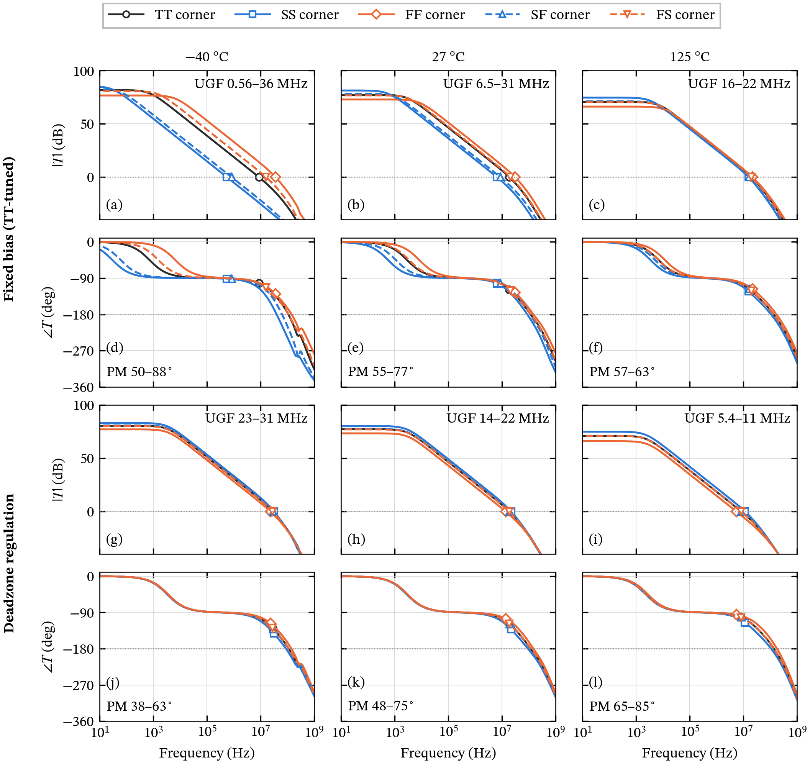</p>
<p align="center"><b>Fig. 19.</b> Loop gain of the unity-gain buffer for the five process corners at −40, 27 and
125 °C, 1.65 V. Fixed bias: (a)–(c) magnitude, (d)–(f) phase; deadzone regulation: (g)–(i) magnitude, (j)–(l) phase.
Markers: unity-gain frequency and the phase there; the ranges printed in each panel are over the five corners.</p>

With fixed bias the dominant pole, set by $C_L$ and the output resistance of the weak-inversion output stage, which
scales as $1/I_Q$, moves by two decades between the SS and FF corners at −40 °C, and the unity-gain frequency moves with
it, from 0.56 to 36 MHz (Fig. 19(a), (d)). At 125 °C the fixed-bias corners are close together again (16–22 MHz), but
every one of them then runs at 1.6 to 7 times the TT current (6.8–29 µA). With regulation the phase curves of the five
corners lie on top of each other up to 1 MHz, and at each temperature the unity-gain frequencies stay within a factor
of 1.3–2.1 (Fig. 19(g)–(l)). What remains is the common shift with temperature discussed in Section V-C and the lowest
phase margin, 38° at SS, −40 °C.

<p align="center">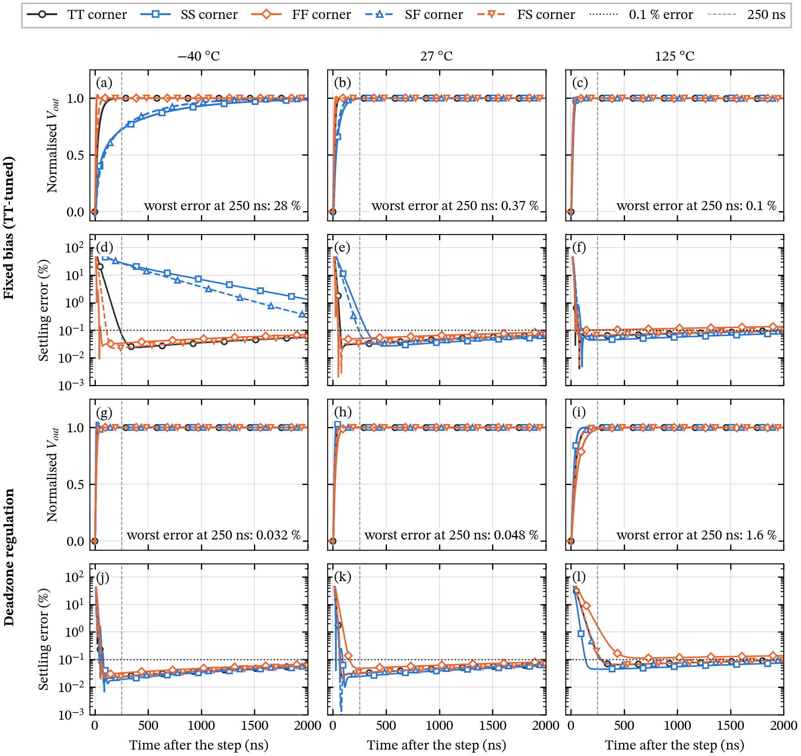</p>
<p align="center"><b>Fig. 20.</b> SC response to a 4-mV input step (inside the deadzone) for the five process corners
at −40, 27 and 125 °C, 1.65 V. Fixed bias: (a)–(c) normalised output, (d)–(f) settling error; deadzone regulation:
(g)–(i) normalised output, (j)–(l) settling error. The error is taken against the ideal charge transfer.</p>

<p align="center">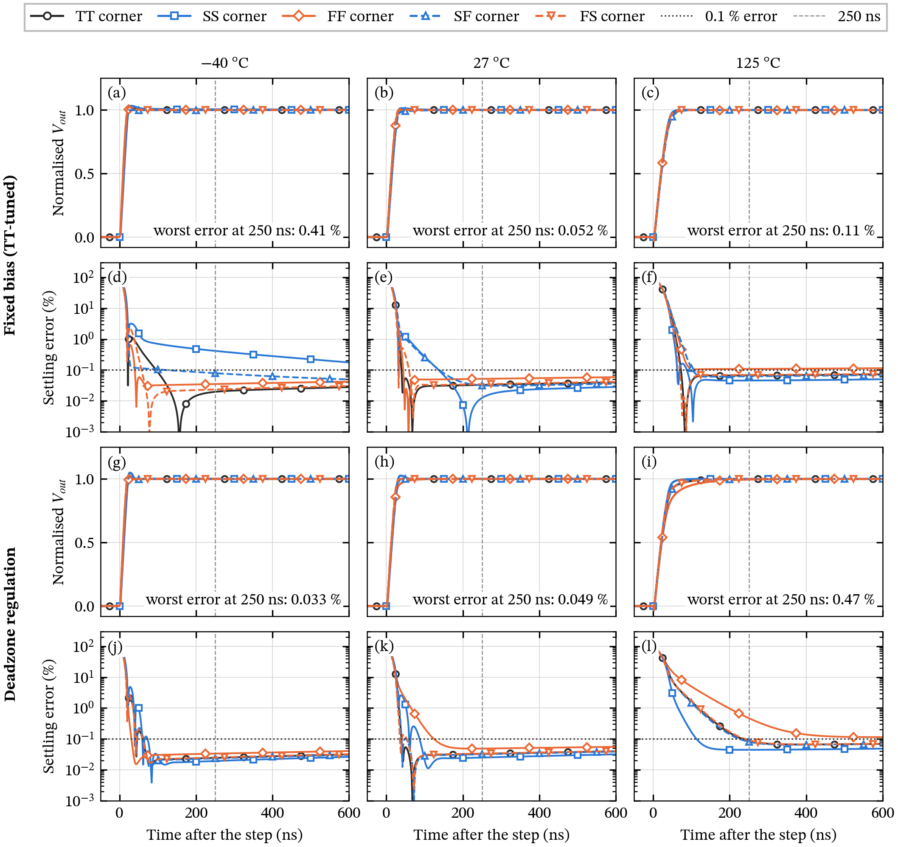</p>
<p align="center"><b>Fig. 21.</b> As Fig. 20 for a 200-mV input step (large signal).</p>

Fig. 20 extends Fig. 17(b) to all corners. With fixed bias the SS and SF amplifiers at −40 °C ($I_Q$ = 0.03 and
0.05 µA) settle along one slow exponential and are still 1.3 % and 0.34 % from the final value 2 µs after the step
(Fig. 20(d)); at 27 °C the same two corners take 240–320 ns to reach 0.1 %. With regulation every corner at −40 °C and
27 °C settles to 0.1 % in 53–157 ns. At 125 °C the regulated corners take 137–290 ns, and FF does not reach 0.1 % at
all: its 66-dB loop gain leaves a static error of about 0.1 % (Section V-D). For the 200-mV step (Fig. 21) the RC and
large-signal phases do most of the work and the corners are much closer: the worst fixed-bias case, SS at −40 °C,
reaches 0.1 % after 830 ns, against 31–124 ns for the regulated amplifier at −40 °C and 27 °C. The slow rise of the
residual error over the 2-µs window of Fig. 20 is the 1-GΩ DC feedback resistor discharging $C_F$
($\tau = R_F C_F$ = 5 ms), not the amplifier.

**Three-phase settling.** Fig. 22 repeats Fig. 16 at the two ends of the PVT space, and Fig. 23 gives the
duration of the three phases at every corner and temperature (buffer, 200-mV step, as in Fig. 16). The phases are taken
from the waveforms: RC while one stage-3 gate is within 0.25 V of a rail, large signal while the load current exceeds
84 µA (20 × the nominal $I_Q$, about 15 % of the peak), small signal until the output is within 0.1 % of its final
value. The RC phase lasts 16–26 ns at every point and both biases: it is set by the size of the output devices, which
slew the load with about 0.5 mA, not by $I_Q$. The large-signal phase adds 4–17 ns. The spread is in the small-signal
phase. With fixed bias at SF, −40 °C ($I_Q$ = 0.05 µA) it takes 262 ns, ten times as long as at TT, whereas with
regulation every point at −40 °C and 27 °C settles to 0.1 % within 40–84 ns. At 125 °C the SS and FS corners have a
slow small-signal tail (120–190 ns) with both biases, so it is not set by $I_Q$. As in the SC test, the large step
hides most of the fixed-bias problem.

<p align="center">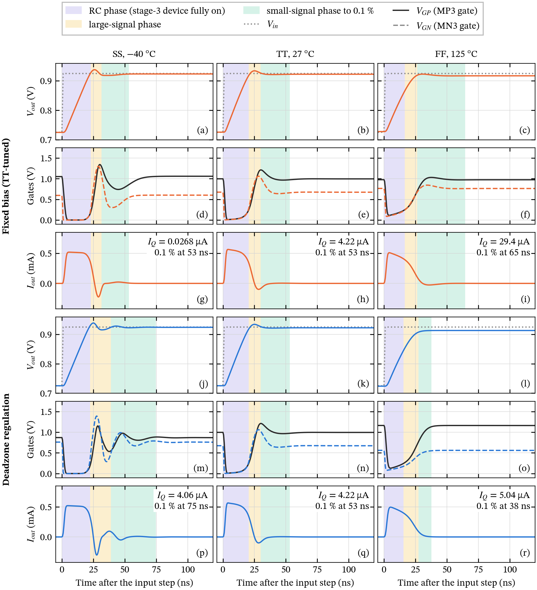</p>
<p align="center"><b>Fig. 22.</b> Rising 200-mV step of the buffer at SS, −40 °C, TT, 27 °C and FF, 125 °C: output,
stage-3 gate voltages and load current <i>C<sub>L</sub></i>·d<i>V<sub>out</sub></i>/d<i>t</i>, (a)–(i) with fixed bias,
(j)–(r) with deadzone regulation; shading marks the RC, large-signal and small-signal phases.</p>

<p align="center">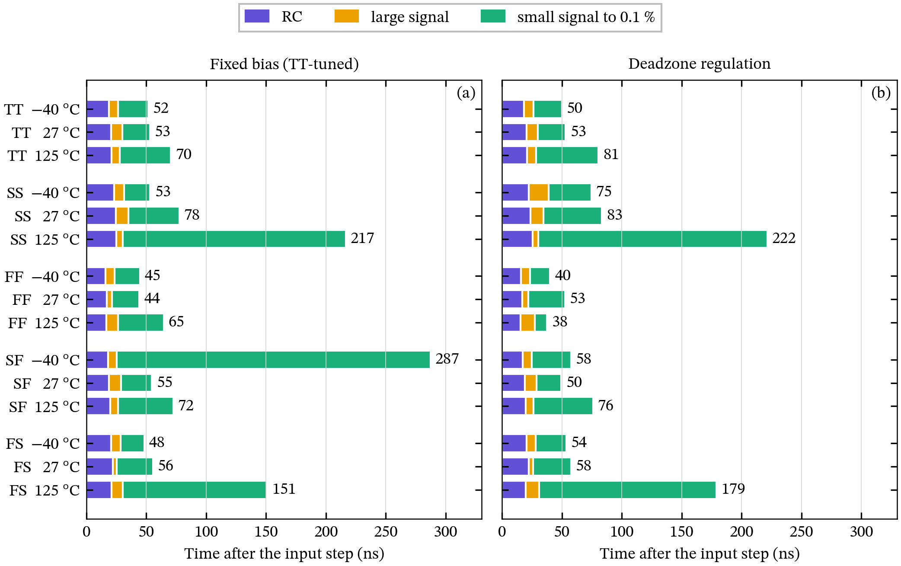</p>
<p align="center"><b>Fig. 23.</b> Duration of the RC, large-signal and small-signal (to 0.1 %) phases of the 200-mV
buffer step at every corner and temperature, 1.65 V: (a) fixed bias, (b) deadzone regulation. Numbers: time to 0.1 %
in ns.</p>

### F. Monte Carlo: process variation and mismatch

The IHP models come with statistical sections: `*_stat` varies the model parameters of all devices of a type together
(global, die-to-die variation), `*_mismatch` gives every device its own threshold, mobility, width and length offset,
scaled with $1/\sqrt{WL}$ (local variation) [23]. For the 0.15/0.13-µm stage-2 devices σ($V_{th}$) is 28 mV (NMOS) and
16 mV (PMOS), for one finger of the stage-1 input pair 3.1 mV. `sim/montecarlo.py` runs 500 samples for each of three
sets — global, local, and both (the `_stat` parameters with the mismatch model files) — for the regulated and the
fixed-bias amplifier at TT, 27 °C, 1.65 V. Every sample is a separate ngspice process with its own seed, so the run is
reproducible. Table VI summarises the results.

<p align="center">TABLE VI<br>MONTE CARLO, 500 SAMPLES PER ROW (TT, 27 °C, 1.65 V; <code>sim/results/mc_summary.csv</code>)</p>

| Variation | Bias | $I_Q$, 5th–95th percentile (µA) | $I_Q$ within ± 25 % of 4.2 µA | UGF median (5th pct.) (MHz) | UGF below 1 MHz | PM, 5th pct. | σ(offset) | 4-mV SC error at 250 ns > 0.1 % |
|:--|:--|:--:|:--:|:--:|:--:|:--:|:--:|:--:|
| global | **regulated** | **4.18 – 4.26** | **100 %** | 18.6 (16.8) | 0 % | 57° | 1.0 mV | **0 %** |
| global | fixed | 0.61 – 10.3 | 23 % | 18.5 (4.4) | 1 % | 49° | 2.3 mV | 13 % |
| local | **regulated** | **0.0003 – 153** | **5 %** | 19.0 (0.001) | 30 % | 17° | 8.0 mV | **46 %** |
| local | fixed | 0.007 – 100 | 6 % | 17.6 (0.04) | 21 % | 18° | 7.9 mV | 40 % |
| both | regulated | 0.0004 – 155 | 3 % | 14.2 (0.001) | 30 % | 18° | 9.0 mV | 49 % |
| both | fixed | 0.003 – 93 | 4 % | 19.2 (0.01) | 22 % | 19° | 8.9 mV | 42 % |

<p align="center">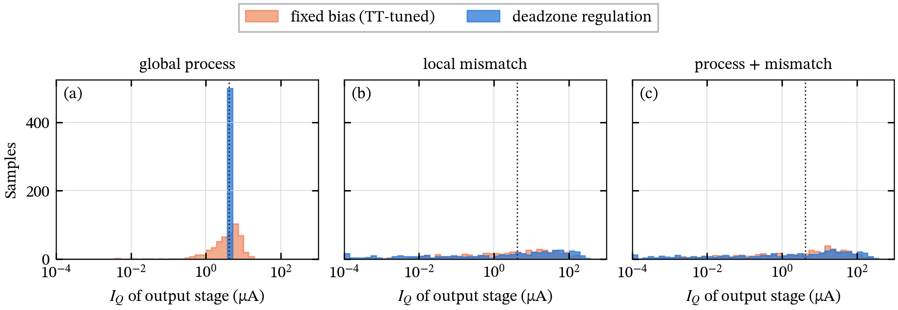</p>
<p align="center"><b>Fig. 24.</b> Monte Carlo distribution of the output-stage quiescent current, fixed bias and
deadzone regulation, 500 samples each: (a) global process variation, (b) local mismatch, (c) both. Dotted: nominal
4.2 µA; values below 10<sup>−4</sup> µA are counted in the first bin.</p>

Global variation is what the regulation was designed for, and it removes it: $I_Q$ stays within 4.18–4.26 µA
(σ = 0.6 %) and every sample settles to 0.1 % within 250 ns, while with fixed bias $I_Q$ spreads over 0.6–10 µA and 13 %
of the samples miss 0.1 % (Fig. 24(a)). Local mismatch is a different matter (Fig. 24(b), (c)). The deadzone is
the difference between the trip points of the two stage-2 inverters, and with minimum-size devices each trip point moves
by tens of millivolts from device to device. The loop regulates the replica, not the signal path: mismatch between the
replica and the signal-path inverters, between MP_R/MN_R and MP3/MN3, and the offsets of NOTA and POTA all pass
straight into the deadzone of the signal path. $I_Q$, which depends exponentially on it in weak inversion, then spreads
over more than five decades whether or not the loop is closed; 30 % of the regulated samples have a unity-gain
frequency below 1 MHz (the output stage is practically off), others draw more than 100 µA, and almost half miss 0.1 %
after 250 ns (Figs. 25 and 26). The buffer offset, σ = 8–9 mV, has the same origin.

<p align="center">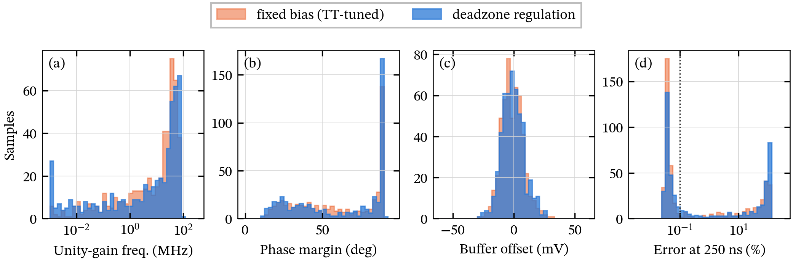</p>
<p align="center"><b>Fig. 25.</b> Global + local Monte Carlo, 500 samples each: (a) unity-gain frequency,
(b) phase margin and (c) offset of the unity-gain buffer, (d) error of the SC amplifier 250 ns after a 4-mV step
(dotted: 0.1 %). Values outside the axis range are counted in the end bins.</p>

<p align="center">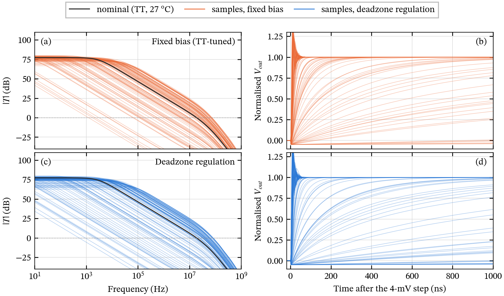</p>
<p align="center"><b>Fig. 26.</b> Loop gain and SC response to a 4-mV step of the first 100 global + local
samples: (a), (b) fixed bias; (c), (d) deadzone regulation. Black: nominal loop gain.</p>

The regulation is therefore no substitute for matching. The devices that define the deadzone — stage 2, its replica,
the reference diodes and the error-amplifier input pairs — have to be sized for mismatch (σ($V_{th}$) ∝ $1/\sqrt{WL}$),
which the minimum sizes taken over from the 65-nm design [2] are not. Larger stage-2 devices also load the stage-1
output, the node that limits the post-layout phase margin (Section VI-D), so this is a design trade-off and not only a
layout task.

### G. Temperature: constant current is not constant transconductance

Regulating $I_Q$ to a constant current fixes the process dependence but not the temperature dependence of $g_{m3}$; [2]
notes that a constant-gm reference would be the natural $I_{BIAS}$. As a first test, $I_{BIAS}$ was made ideally
proportional to absolute temperature (1 µA at 27 °C, `ptat` rows of the results). This narrows the temperature spread of
the UGF at TT from 3.5× to 2.2× and the total spread from 6× to 4.3× (grey triangles in Fig. 15), but the hot corners
remain the slowest because $A_1A_2$ also falls with temperature, and the small-step error at 125 °C is not
reduced (up to 1.2 %, Table V). A complete solution must compensate the first two stages as well.

### H. Supply rejection, common-mode error and headroom

Table VII lists the figures that the layout-ready redesign made worse; all three follow from the 35-dB transistor CMFB
(Section IV-D) and the 1.2-V source-gate drop of the hv PMOS loads of stage 1.

<p align="center">TABLE VII<br>FIGURES DEGRADED BY THE TRANSISTOR-LEVEL CMFB (TT, 27 °C, 1.65 V UNLESS NOTED; <code>sim/cmfb_experiment.py</code>)</p>

| Quantity | Original (ideal E1) | RAMP_LR | Same, ideal CMFB in RAMP_LR |
|:--|:--:|:--:|:--:|
| DC PSRR of the buffer (dB) | 93.0 | 32.9 | 89.6 |
| buffer gain error over a ±100-mV input step | 0.016 % | 1.46 % | 0.014 % |
| output offset of the buffer | −0.02 mV | −1.13 mV | 0.00 mV |
| output offset at 125 °C, 1.5675 V, worst corner | – | 44 mV (FS) | – |

In the buffer the input common mode moves with the signal; the CMFB lets the second stage-1 drain drift by 19 mV over the
±100-mV range while the main loop holds $V_{o1}$, and this drift, divided by the low first-stage gain (≈ 7.6, set by the
100-kΩ loads), appears as input-referred error. A supply change shifts the common mode in the same way. In the SC test
the inputs stay at the virtual ground and the effect disappears from the settling results above, but the supply
rejection applies to every configuration. At 125 °C and low supply the CMFB also runs out of headroom and the buffer
gains only 0.67–0.92 across the corners. Fig. 27 shows the PSRR versus frequency.

<p align="center">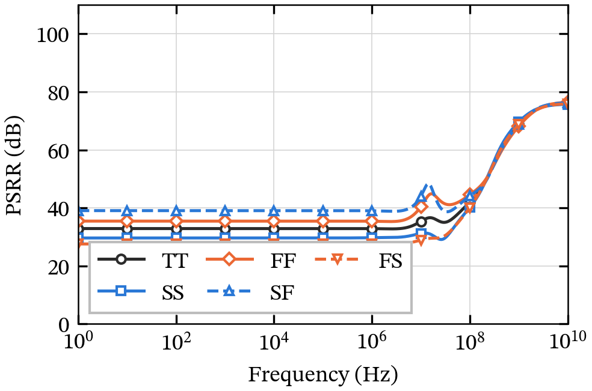</p>
<p align="center"><b>Fig. 27.</b> Power-supply rejection of the closed-loop buffer (RAMP_LR, regulated,
27 °C) for the five corners.</p>

### I. Power

The amplifier draws 156 µA (257 µW) at TT, 27 °C (Fig. 28). The output stage itself takes only 4.2 µA; most of the
current flows through the minimum-size inverters biased at their switching point — stage 2 (38 µA), its replica in the
regulation loop (≈ 38 µA of the 41 µA of that block) and the trip-point replica that generates $V_{1,CM}$ (47 µA). The
regulation loop as a whole costs 27 % of the supply current. Scaling the replica inverters down (longer channels) is the
largest available power saving; the signal-path inverters of stage 2 set the second-stage gain and pole and need to be
traded against them.

<p align="center">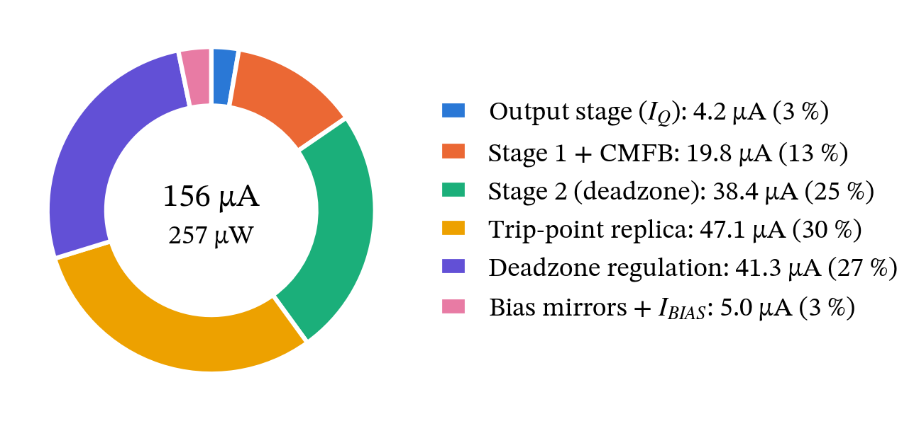</p>
<p align="center"><b>Fig. 28.</b> Supply current by block at TT, 27 °C, 1.65 V, amplifier at rest
(total in the centre).</p>

---

## VI. Layout

### A. Floor plan and routing

The layout (`layout/RAMP_LR.gds`, Fig. 29) is generated by `layout/gen_layout.py` in KLayout from the IHP PCells
[17], [20]; the placement is described in `layout/ramp_lr_design.py` (`STRIPS`, `BANDS`). It measures
83.1 µm × 44.0 µm (0.0037 mm²). The circuit is built from 15 *strips*, rows of transistor fingers of one kind and W/L.
Each strip consists of multi-finger PCells whose fingers share their source and drain diffusions; which diffusion
carries which net is solved from the device pins, so a strip only lists its fingers (A B B A for a differential pair).
Diffusion breaks separate groups that cannot share a diffusion, dummy fingers close every group, and a substrate or
well tie closes each strip end: 140 fingers, 33 of them dummies, in 43 PCells.

The rows follow the signal and the supply. At the bottom are four rows of the NMOS bias mirror, whose 0.5/8-µm units
take most of the active area; above them the PMOS bias mirror and the POTA load; then the NMOS signal row (NOTA input
pair, rhigh sensing resistors, stage-1 and CMFB pairs, stage-2 NMOS, output NMOS) and the PMOS signal row (POTA input
pair, NOTA load, stage-1 loads, stage-2 PMOS, output PMOS), aligned so that every stage sits over its NMOS half and
the path from stage 1 to stage 3 runs left to right. Neighbouring rows are mirrored so that they share a routing
channel: the gate contacts of a row face one channel and its source/drain contacts the other. In each channel a
constrained left-edge router assigns horizontal Metal2 tracks — nets share a track where their spans do not overlap,
and a pin coming from above never crosses one coming from below — and Metal1 stubs connect the contacts. Only nets
that change channel get a vertical Metal3 column, placed next to their pins: 42 tracks in eight channels and 24
columns. VDD and GND run on Metal3 columns at both block edges and on full-width Metal2 tracks. The two 2-pF MIM
capacitors (Metal5/TopMetal1) cover the circuit; their bottom plates reach $V_{CTRLN}/V_{CTRLP}$ through short Metal4
straps, their top plates the GND/VDD edge columns through TopMetal1 straps. The first version of this layout, with
single-finger units in two columns around a 27-column Metal3 spine, measured 109 µm × 183 µm; the compact layout needs
5.5 times less area and, as Section VI-D shows, carries less than half the routing capacitance on the critical nets.

<p align="center">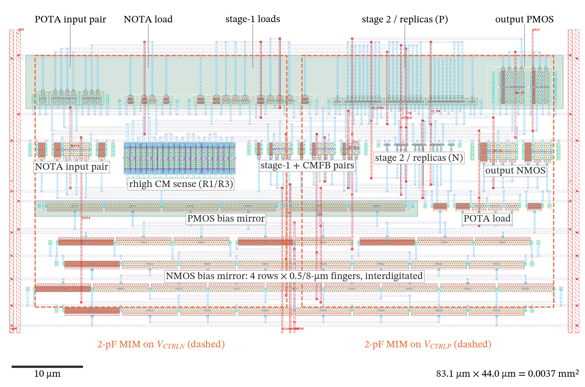</p>
<p align="center"><b>Fig. 29.</b> Layout of RAMP_LR in IHP SG13G2 with Metal4 and above hidden; the dashed
outlines are the two 2-pF MIM capacitors, which cover the circuit. Bottom: NMOS bias mirror (four rows); middle: PMOS
bias mirror and POTA load, NMOS signal row; top: PMOS signal row. Ports on Metal3 at the bottom (IBIAS, minus, plus,
GND) and top (Vout, VDD) edges.</p>

### B. Matching

Fig. 30 shows the matched groups. The techniques used are:

- **Common centroid in a shared diffusion for differential pairs.** The stage-1 pair, the CMFB pair and both
  error-amplifier input pairs are placed ABBA in one diffusion with the common tail between A and B, so linear
  gradients cancel to first order and both devices see the same diffusion edges (Fig. 30(b), (f), (g)).
- **Loads and diodes.** The stage-1 loads and the CMFB diodes are ABBA with shared VDD sources (Fig. 30(c)).
- **Bias mirror.** The 25 units of 0.5/8 µm sit in four rows; the 10-unit tails T and C come in finger pairs that share
  their drain, every row is symmetric about its centre, and the reference R is in the middle of the last row
  (Fig. 30(a)). The arrangement is interdigitated rather than a full two-dimensional common centroid; the mirror
  accuracy is set by the long channels (Table III).
- **Replica next to the device it copies.** MP_R and MN_R share the diffusion of MP3 and MN3 (Fig. 30(d), (e));
  the stage-2 replica and the trip-point replica are laid out as identical chains next to the signal-path chain
  (Fig. 30(h)).
- **Dummies and identical surroundings.** Every group ends in dummy fingers, all fingers of a strip have the same
  orientation, and every strip has a tie at both ends.
- **Resistors.** Each 100-kΩ rhigh resistor is ten 3.37-µm segments interleaved ABBA ABBA …, under merged implant and
  silicide-block layers.

<p align="center">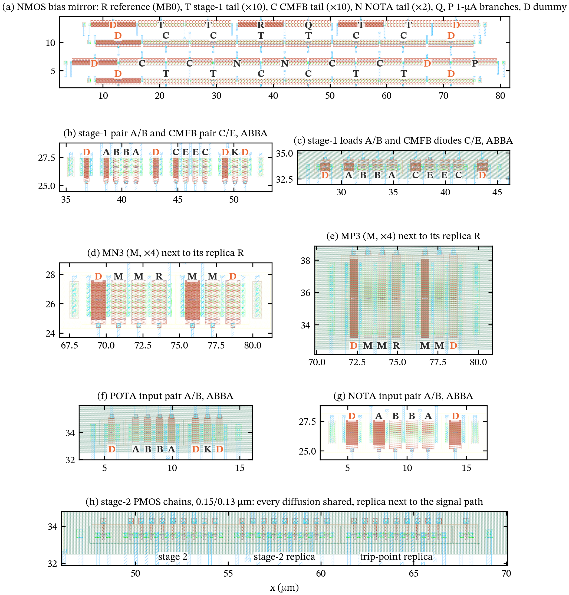</p>
<p align="center"><b>Fig. 30.</b> Matched structures (Metal2 and above hidden). (a) NMOS bias mirror: R reference
(MB0), T stage-1 tail (×10), C CMFB tail (×10), N NOTA tail (×2), Q and P the 1-µA branches, D dummy. (b) Stage-1 pair
A/B and CMFB pair C/E, K the gate capacitor MCN. (c) Stage-1 loads A/B and CMFB diodes C/E. (d), (e) Output devices M
next to their replicas R. (f), (g) POTA and NOTA input pairs. (h) Stage-2 PMOS chains of the signal path, the
regulation-loop replica and the trip-point replica, every diffusion shared.</p>

### C. Physical verification

<p align="center">TABLE VIII<br>PHYSICAL VERIFICATION WITH THE IHP SG13G2 KLAYOUT DECKS (<code>layout/run_checks.sh</code>)</p>

| Check | Deck / option | Result | Report |
|:--|:--|:--|:--|
| DRC | main deck incl. extended rules, `--no_density` (862 rule categories) | **0 violations** | `layout/reports/drc_main.txt` |
| Antenna | `--antenna_only` | **0 violations** | `layout/reports/drc_antenna.txt` |
| Density | `--density_only` | global Activ/GatPoly/metal density not met (block not filled; fill is inserted at chip level) | `layout/reports/drc_density.txt` |
| LVS | `run_lvs.py` vs. flat xschem netlist | **match**: 53 device pairs, 33 nets, 0 mismatches | `layout/reports/lvs.txt` |
| LVS of the extraction | magic netlist vs. xschem netlist, netgen (`layout/run_pex.sh`) | **match** | `layout/reports/pex.txt` |

Four details were needed for a clean LVS: the PCell width parameter, which is the total width of all fingers of a
multi-finger device, the MIM terminal order (bottom plate on the control voltage), grid-aligned widths, and the dummies, which the IHP deck removes from the layout netlist (`purge_devices` on devices whose terminals
share one net) and which are therefore marked `lvs_ignore` in the schematic.

### D. Post-layout simulation

The layout was extracted with magic [21] and the IHP SG13G2 extraction rules (`layout/run_pex.sh`): all devices as
drawn, plus the area, fringe and coupling capacitance of every net above 0.01 fF — 913 capacitors, 0.52 pF in total.
A netgen [22] LVS of the extracted device netlist against the schematic matches. Wire resistance was not extracted:
the critical nets are high-impedance nodes (≥ 100 kΩ) on which tens of ohms of metal do not matter, but the IR drop on
the supply and output rails during slewing is not covered. The layout generator labels the internal nets with their
schematic names (text only), so the extracted netlist is readable. For simulation (`sim/postlayout.py`) the ammeter
VIQ of the schematic is inserted in the source connection of the four MP3 fingers inside the extracted cell (MP_R and
the dummies in the same diffusion stay on VDD), and the 20 nodes that touch only capacitors (the bodies of the rhigh
segments) are tied to ground through 1 TΩ, without which the DC matrix is singular. With all parasitic capacitors
removed the extracted netlist agrees with the schematic to 0.1° and 1.3 % (61.5°, 19.0 MHz at TT, 27 °C), so the
differences below are caused by the parasitics. Table IX summarises the comparison.

<p align="center">TABLE IX<br>SCHEMATIC VERSUS POST-LAYOUT (REGULATED, 1.65 V; <code>sim/results/postlayout_summary.csv</code>)</p>

| Quantity | Schematic | Post-layout |
|:--|:--:|:--:|
| $I_Q$ / supply current at TT, 27 °C (µA) | 4.22 / 155.8 | 4.22 / 155.8 |
| DC loop gain / DC PSRR / buffer offset at TT, 27 °C | 77.3 dB / 32.9 dB / −1.13 mV | 77.4 dB / 33.0 dB / −1.12 mV |
| Unity-gain frequency at TT, 27 °C (MHz) | 18.8 | 17.2 |
| Phase / gain margin at TT, 27 °C | 61.6° / 24.5 dB | **44.4° / 14.1 dB** |
| Buffer 200-mV step at TT, 27 °C: overshoot / 0.1-% settling | 5.8 % / 53 ns | 15 % / 128 ns |
| SC 4-mV step: error 250 ns after the step / 0.1-% settling, TT, 27 °C | 0.032 % / 70 ns | 0.032 % / 111 ns |
| Phase margin over the 15 corner/temperature points | 38–85° | **16–80°** |
| Unity-gain frequency over the 15 points (MHz) | 5.4–31.2 | 5.5–26.1 |
| Points with phase margin below 45° | 1 of 15 | **8 of 15** |
| Points where the buffer does not settle to 0.1 % within 500 ns | 0 of 15 | 1 of 15 (oscillation at SS, −40 °C) |

The DC behaviour is unchanged — bias currents, gain, supply rejection and offset agree to three or four digits — but
the extracted capacitances move the non-dominant poles down: the unity-gain frequency falls by up to 16 % and the phase
margin by 5–22° (Figs. 31 and 33), most at low temperature where the margin was smallest to begin with. At
SS, −40 °C the 38° of the schematic become 16° and the buffer oscillates after a step; at TT it rings for about 100 ns
(Fig. 32). The SC amplifier, whose feedback factor is 0.5, settles at every point, and its static gain error is
that of the schematic: the feedback input `plus` and the output no longer couple (below the 0.01-fF extraction
threshold; 7 fF in the first layout, which showed up as a 0.14 % gain error).

**Why the buffer oscillates at SS, −40 °C.** The post-layout loop is stable in the small-signal sense but has almost no
reserve: 16° of phase margin and 4.8 dB of gain margin, with the loop phase crossing −180° at 36 MHz (schematic: 38°,
15 dB, 84 MHz). A 2-mV step therefore decays. Any step of 10 mV or more ends in the same sustained oscillation, 64 mV
peak to peak at 43 MHz, whatever the step size — a limit cycle. In each cycle the stage-3 gates leave the deadzone and
MP3 conducts up to 430 µA, a hundred times $I_Q$; the output-stage transconductance, and with it the loop gain near
the crossover, rises by more than the 4.8 dB of gain margin, so the oscillation sustains itself at an amplitude where
the average large-signal gain is just one. This is the cold, slow corner because the regulated output stage keeps its
$g_m$ while the stage gains $A_1A_2$ are highest there, which already gives the schematic its lowest margin (Fig. 15).
Rerunning the 200-mV step with the parasitic capacitances of one net group removed shows which ones matter: without
those of `Vo_STG1` (19 fF) the oscillation disappears, without any other group it persists (55–62 mV). A stage-1
output that tolerates its routing capacitance, or large-signal damping as in [2, Ch. 4], [14], is therefore required;
the buffer configuration, with feedback factor 1, is the worst case for both.

<p align="center">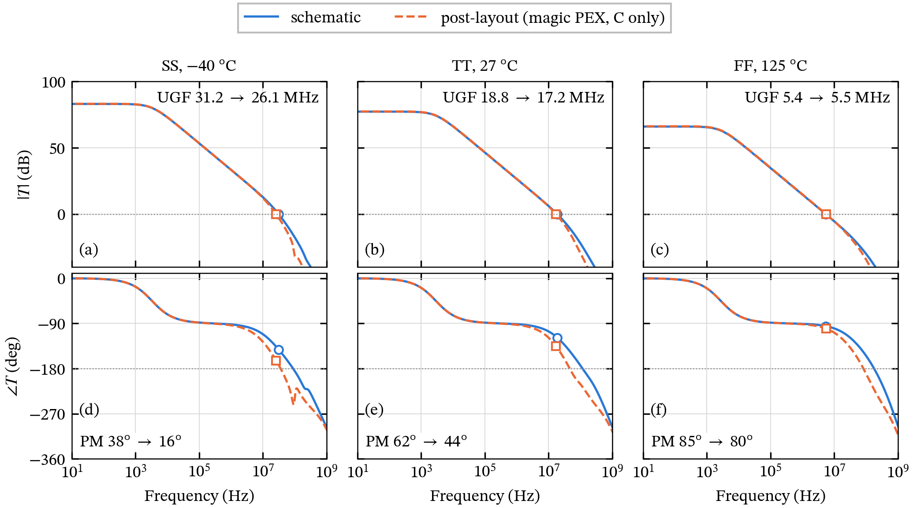</p>
<p align="center"><b>Fig. 31.</b> Loop gain of the buffer, schematic (blue) and post-layout (orange, dashed), at
SS, −40 °C, TT, 27 °C and FF, 125 °C: (a)–(c) magnitude, (d)–(f) phase. Markers: unity-gain frequency.</p>

<p align="center">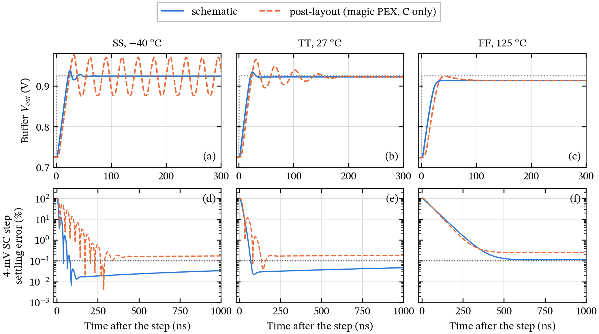</p>
<p align="center"><b>Fig. 32.</b> Schematic versus post-layout step responses at the same three points:
(a)–(c) buffer, 200-mV input step (grey dotted: input); (d)–(f) settling error of the SC amplifier after a 4-mV step
(dotted: 0.1 %).</p>

<p align="center">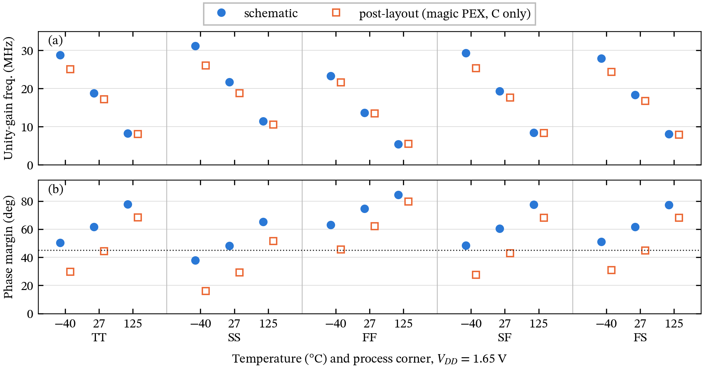</p>
<p align="center"><b>Fig. 33.</b> (a) Unity-gain frequency and (b) phase margin of the schematic and the
post-layout netlist over process corner and temperature at 1.65 V (dotted: 45°).</p>

**Which parasitics.** The sensitivity run of `sim/postlayout.py` removes the extracted capacitances of one net group
at a time (Fig. 34). The stage-1 output `Vo_STG1` matters most: its 19 fF (44 fF in the first layout) sit on a
node whose resistance is set by the 100-kΩ rhigh loads, and removing them restores 11–14° of phase margin. The stage-2
outputs `mp_dz` and `mn_dz` (14 and 10 fF, 21 and 36 fF before) come second with 2–5°; the control voltages (2–3°)
and the trip-point replica output (below 1°) matter less. `Vo_STG1` has to reach the stage-1 drains in the middle channel and the stage-2 gates
on both sides of the signal rows, so a 20-µm Metal3 column is the shortest route this floor plan allows. Giving the
three critical nets a track of their own with empty neighbours, and twice the column spacing (option `CRIT` in
`gen_layout.py`), cuts their capacitance by a further 24–42 % and gains about 5° (49° at TT, 20° at SS, −40 °C), but
costs 17 % of area and still leaves the slow, cold corner unstable; the compact layout is kept.

<p align="center">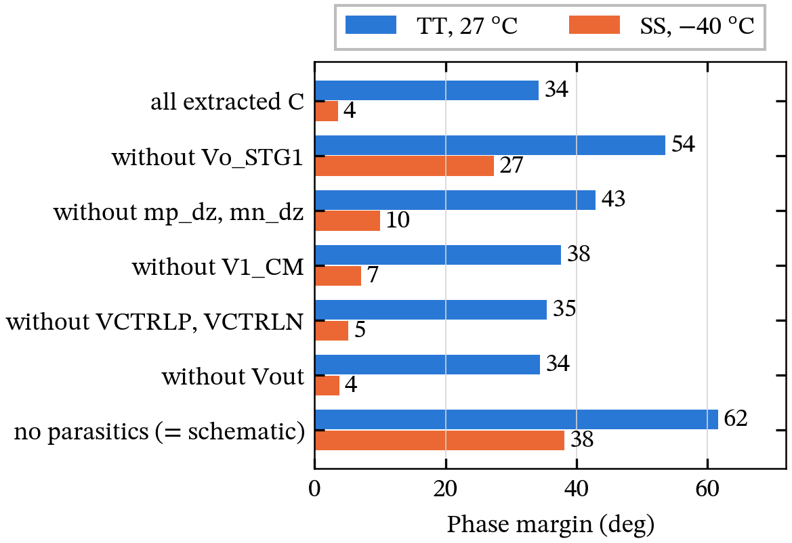</p>
<p align="center"><b>Fig. 34.</b> Phase margin of the post-layout netlist with the extracted capacitances of one net
group removed, at TT, 27 °C and SS, −40 °C.</p>

The post-layout margin is therefore limited by the circuit rather than by the routing: a 100-kΩ stage-1 output that
cannot tolerate 20 fF is too sensitive for any layout. Lower stage-1 load resistance (with more stage-1 current), a
compensation zero at the stage-1 output, or the passive compensation of [2, Ch. 4], [14] are the candidates; each
changes the design and has to be re-verified over PVT and Monte Carlo.

---

## VII. Comparison with Prior Art

<p align="center">TABLE X<br>DEADZONE BIASING SCHEMES</p>

| | [1] | [4] | [6] | [12] | [2], [3] | **This work** |
|:--|:--:|:--:|:--:|:--:|:--:|:--:|
| Deadzone set by | external voltage $V_{DZ}$ | on-chip resistor | current-starved inverters | P/V-insensitive dead-zone (mechanism not in abstract) | current-starved + replica feedback | current-starved + replica feedback |
| $I_Q$ independent of $V_{th}$ shifts |  |  |  |  claimed |  |  |
| Verified over temperature |  n/r |  n/r |  n/r |  n/r |  no |  −40…125 °C |
| Verified over supply |  n/r |  n/r |  n/r |  |  no |  ± 5 % |
| Evidence |  not checked |  silicon (ADC) |  silicon (ADC) |  simulation |  simulation |  simulation incl. post-layout and Monte Carlo + DRC/LVS-clean layout |
| $I_Q$ held under device mismatch (Monte Carlo) |  n/r |  n/r |  n/r |  n/r |  n/r |  checked: no (Section V-F) |
| Design data and scripts public |  |  |  |  |  |  |

<p align="center">TABLE XI<br>FIGURES OF MERIT OF THE TWO DEADZONE-REGULATION STUDIES</p>

| | [2], [3] | **This work** |
|:--|:--:|:--:|
| Technology ($L_{min}$ of the core devices) | 65-nm CMOS | IHP SG13G2 130-nm BiCMOS (lv 0.13 µm, hv 0.40/0.45 µm) |
| Supply | 1.2 V | 1.65 V |
| Configuration, load | SC, gain 4, $C_L$ = 0.7 pF, 125 MS/s | buffer and SC (gain 1), $C_L$ = 50 pF, 20-MHz target |
| Bias generation | constant current source (not specified) | external 1 µA, transistor mirrors |
| PVT space | SS/TT/FF | 5 corners × −40/27/125 °C × ± 5 % $V_{DD}$ |
| GBW/UGF spread, fixed bias, process only | 9–1500 MHz (167×) | 6.5–30.7 MHz (4.7×) at 27 °C |
| GBW/UGF spread, regulated, process only | 380–475 MHz (1.25×) | 13.7–21.7 MHz (1.59×) at 27 °C |
| UGF spread, regulated, full PVT | n/r | 5.4–32.4 MHz (6×; fixed bias 860×) |
| $I_Q$ spread, regulated, full PVT | n/r | 3.99–5.82 µA (fixed bias 0.003–32.7 µA) |
| Phase margin, regulated | 61–72° | 48–75° at 27 °C, 35–85° full PVT (schematic); 29–62° at 27 °C after layout (C extraction) |
| $I_Q$ under global / local variation (Monte Carlo, 5th–95th pct.) | n/r | 4.18–4.26 µA / 0.0003–153 µA |
| Settling, regulated | ≤ 0.05 % (800-mV step, 4 ns) | ≤ 0.1 % at 250 ns for −40/27 °C; ≤ 1.6 % at 125 °C (4-mV step, SC) |
| Power / area | n/r / no layout | 257 µW / 0.0037 mm² |

*n/r: not reported in the abstract or the text consulted for this report; not checked: the paper itself was not consulted for this row.* The two studies are not an apples-to-apples
comparison: [2], [3] use a 65-nm process with about half the minimum channel length of the SG13G2 core devices and a
GBW twenty times higher, and their fixed-bias spread is larger mainly because their output stage is more sensitive to
the threshold voltage at its bias point. The comparable figure is the *ratio* between the fixed-bias and the regulated
spread, which is large in both, and which this work extends to temperature and supply.

---

## VIII. Conclusion, Limitations and Next Steps

The deadzone regulation of [2], [3] carries over to IHP SG13G2: over five process corners, −40 °C to 125 °C and ± 5 %
supply it holds the output-stage quiescent current of a current-starved ringamp within 3.99–5.82 µA where a fixed
deadzone allows 0.003–32.7 µA, cuts the unity-gain-frequency spread from 860× to 6× and removes the cold, slow-corner
settling failure (small-step error after 250 ns 28 % → 0.02 % at SS, −40 °C). The study also showed that the bias loops
of a ringamp need the same stability analysis as the signal loop: in the original schematic, the regulation loops had
−27° and 11° of phase margin and the ideal CMFB loop could not be simulated, while the main-loop AC analysis looked
healthy. A layout-ready version with stable internal loops has a compact, matched, DRC-, antenna- and LVS-clean
layout of 0.0037 mm². Two findings limit what the design can do as it stands. Post-layout simulation shows that the
100-kΩ stage-1 output cannot absorb even the 19 fF of a compact layout (phase margin 61.6° → 44.4° at TT, oscillation at
SS, −40 °C), and Monte Carlo shows that the regulation, which removes global process variation completely, does not
help against local mismatch of the minimum-size stage-2 devices, which spreads $I_Q$ over more than five decades.

**Limitations.**

1. *Post-layout stability.* The post-layout netlist (capacitance only, no wire resistance) loses 5–22° of phase
   margin and oscillates in the buffer configuration at SS, −40 °C (Section VI-D); the stage-1 output needs a design
   change, not only routing. No silicon.
2. *Mismatch.* With minimum-size stage-2, replica and reference devices, local mismatch moves $I_Q$ by orders of
   magnitude and the regulation cannot correct it; 30 % of the Monte Carlo samples are practically switched off
   (Section V-F).
3. *Transistor CMFB.* DC PSRR 33 dB instead of 93 dB, 1.5 % common-mode-dependent gain error in the buffer, and loss of
   headroom at 125 °C and low supply (Section V-H).
4. *Temperature.* Constant $I_Q$ is not constant $g_{m3}$; the regulated UGF still falls 3.5× from −40 °C to 125 °C at TT
   and the small-step settling exceeds 0.1 % at 125 °C (Section V-G).
5. *Supply and devices.* The low-voltage devices run at 1.65 V, above their 1.2-V nominal supply; reliability limits were
   not checked.
6. *Scope.* Only the single-ended design was characterised; the fully differential variant `Fully-Diff-RAMP/RAMP-FD.sch`
   is unfinished (its two output stages differ: MN3 is m = 1 on one side and m = 4 on the other).

**Next steps.** (i) A two-stage, properly compensated CMFB, or a fully differential first stage, to recover the supply
rejection; lower-threshold or wider loads for headroom. (ii) A constant-gm or PTAT reference combined with
temperature-compensated first stages. (iii) Smaller replica inverters to cut the 85 µA spent in the two replicas.
(iv) Stage-2, replica, reference and error-amplifier devices sized for mismatch, together with a stage-1 output that
tolerates the extra capacitance (lower load resistance, a compensation zero, or the passive compensation of
[2, Ch. 4], [14]); then post-layout simulation with wire resistance and Monte Carlo of the post-layout netlist. (v) A switched-capacitor test bench with real switches and both clock phases.

---

## Acknowledgment

This work was done under the guidance of Praveen Kumar Venkatachala and implements Chapter 3 of his dissertation [2],
which also supplied the reproduced Figs. 1–3 and 5–7 (copyright the author; see `docs/figures/thesis/INDEX.md`). The
design uses the IHP SG13G2 open-source PDK [17] and the open-source tools xschem [18], ngspice [19], KLayout [20],
magic [21] and netgen [22].

---

## References

[1] B. Hershberg, S. Weaver, K. Sobue, S. Takeuchi, K. Hamashita, and U.-K. Moon, "Ring amplifiers for switched capacitor circuits," *IEEE J. Solid-State Circuits*, vol. 47, no. 12, pp. 2928–2942, Dec. 2012, doi: [10.1109/JSSC.2012.2217865](https://doi.org/10.1109/JSSC.2012.2217865).

[2] P. K. Venkatachala, "Design considerations and circuit techniques for robust ring-amplifiers," Ph.D. dissertation, School Elect. Eng. Comput. Sci., Oregon State Univ., Corvallis, OR, USA, 2019. [Online]. Available: https://ir.library.oregonstate.edu/concern/graduate_thesis_or_dissertations/kp78gp14p (copy in this repository: [`Thesis/VenkatachalaPraveenkumar2019.pdf`](Thesis/VenkatachalaPraveenkumar2019.pdf)).

[3] P. K. Venkatachala *et al.*, "Process invariant biasing of ring amplifiers using deadzone regulation circuit," in *Proc. IEEE Int. Symp. Circuits Syst. (ISCAS)*, Florence, Italy, May 2018, pp. 1–5, doi: [10.1109/ISCAS.2018.8351242](https://doi.org/10.1109/ISCAS.2018.8351242).

[4] Y. Lim and M. P. Flynn, "A 100 MS/s, 10.5 bit, 2.46 mW comparator-less pipeline ADC using self-biased ring amplifiers," *IEEE J. Solid-State Circuits*, vol. 50, no. 10, pp. 2331–2341, Oct. 2015, doi: [10.1109/JSSC.2015.2453332](https://doi.org/10.1109/JSSC.2015.2453332).

[5] Y. Lim and M. P. Flynn, "A 1 mW 71.5 dB SNDR 50 MS/s 13 bit fully differential ring amplifier based SAR-assisted pipeline ADC," *IEEE J. Solid-State Circuits*, vol. 50, no. 12, pp. 2901–2911, Dec. 2015, doi: [10.1109/JSSC.2015.2463094](https://doi.org/10.1109/JSSC.2015.2463094).

[6] S. Leuenberger, J. Muhlestein, H. Sun, P. Venkatachala, and U.-K. Moon, "A 74.33 dB SNDR 20 MSPS 2.74 mW pipelined ADC using a dynamic deadzone ring amplifier," in *Proc. IEEE Custom Integr. Circuits Conf. (CICC)*, Austin, TX, USA, Apr. 2017, pp. 1–4, doi: [10.1109/CICC.2017.7993697](https://doi.org/10.1109/CICC.2017.7993697).

[7] A. ElShater *et al.*, "A 10mW 16b 15MS/s two-step SAR ADC with 95dB DR using dual-deadzone ring-amplifier," in *IEEE Int. Solid-State Circuits Conf. (ISSCC) Dig. Tech. Papers*, San Francisco, CA, USA, Feb. 2019, pp. 70–72, doi: [10.1109/ISSCC.2019.8662400](https://doi.org/10.1109/ISSCC.2019.8662400).

[8] J. Lagos, B. P. Hershberg, E. Martens, P. Wambacq, and J. Craninckx, "A 1-GS/s, 12-b, single-channel pipelined ADC with dead-zone-degenerated ring amplifiers," *IEEE J. Solid-State Circuits*, vol. 54, no. 3, pp. 646–658, Mar. 2019, doi: [10.1109/JSSC.2018.2889680](https://doi.org/10.1109/JSSC.2018.2889680).

[9] B. Hershberg *et al.*, "A 6-to-600MS/s fully dynamic ringamp pipelined ADC with asynchronous event-driven clocking in 16nm," in *IEEE Int. Solid-State Circuits Conf. (ISSCC) Dig. Tech. Papers*, San Francisco, CA, USA, Feb. 2019, pp. 68–70, doi: [10.1109/ISSCC.2019.8662319](https://doi.org/10.1109/ISSCC.2019.8662319).

[10] B. Xiao *et al.*, "An 80mA capacitor-less LDO with 6.5µA quiescent current and no frequency compensation using adaptive-deadzone ring amplifier," in *Proc. IEEE Asian Solid-State Circuits Conf. (A-SSCC)*, Macau, Macao, Nov. 2019, pp. 39–42, doi: [10.1109/A-SSCC47793.2019.9056970](https://doi.org/10.1109/A-SSCC47793.2019.9056970).

[11] K. M. Megawer, F. A. Hussien, M. M. Aboudina, and A. N. Mohieldin, "A systematic design methodology for class-AB-style ring amplifiers," *IEEE Trans. Circuits Syst. II, Exp. Briefs*, vol. 65, no. 9, pp. 1169–1173, Sep. 2018, doi: [10.1109/TCSII.2018.2815705](https://doi.org/10.1109/TCSII.2018.2815705).

[12] Y. Cao, Y. Chen, T. Zhang, F. Ye, and J. Ren, "An improved ring amplifier with process- and supply voltage-insensitive dead-zone," in *Proc. IEEE 60th Int. Midwest Symp. Circuits Syst. (MWSCAS)*, Boston, MA, USA, Aug. 2017, pp. 811–814, doi: [10.1109/MWSCAS.2017.8053047](https://doi.org/10.1109/MWSCAS.2017.8053047).

[13] S. Leuenberger *et al.*, "An empirical study of the settling performance of ring amplifiers for pipelined ADCs," in *Proc. IEEE Int. Symp. Circuits Syst. (ISCAS)*, Florence, Italy, May 2018, pp. 1–5, doi: [10.1109/ISCAS.2018.8351073](https://doi.org/10.1109/ISCAS.2018.8351073).

[14] P. K. Venkatachala *et al.*, "Passive compensation for improved settling and large signal stabilization of ring amplifiers," in *Proc. IEEE Int. Symp. Circuits Syst. (ISCAS)*, Florence, Italy, May 2018, pp. 1–5, doi: [10.1109/ISCAS.2018.8351557](https://doi.org/10.1109/ISCAS.2018.8351557).

[15] R. D. Middlebrook, "Measurement of loop gain in feedback systems," *Int. J. Electron.*, vol. 38, no. 4, pp. 485–512, Apr. 1975, doi: [10.1080/00207217508920421](https://doi.org/10.1080/00207217508920421).

[16] M. Tian, V. Visvanathan, J. Hantgan, and K. Kundert, "Striving for small-signal stability," *IEEE Circuits Devices Mag.*, vol. 17, no. 1, pp. 31–41, Jan. 2001, doi: [10.1109/101.900125](https://doi.org/10.1109/101.900125).

[17] IHP GmbH, *IHP Open Source PDK (SG13G2 130 nm BiCMOS)*. [Online]. Available: https://github.com/IHP-GmbH/IHP-Open-PDK (accessed Oct. 16, 2026).

[18] S. Schippers, *Xschem: Schematic capture and netlisting EDA tool*. [Online]. Available: https://xschem.sourceforge.io/stefan/index.html (accessed Oct. 16, 2026).

[19] H. Vogt, G. Atkinson, D. Warning, and P. Nenzi, *Ngspice User's Manual*. [Online]. Available: https://ngspice.sourceforge.io/docs.html (accessed Oct. 16, 2026).

[20] M. Köfferlein, *KLayout: Layout viewer and editor*. [Online]. Available: https://www.klayout.de (accessed Oct. 16, 2026).

[21] R. T. Edwards, *Magic VLSI layout tool*. [Online]. Available: http://opencircuitdesign.com/magic/ (accessed Oct. 17, 2026).

[22] R. T. Edwards, *Netgen: Netlist comparison (LVS) and format manipulation*. [Online]. Available: http://opencircuitdesign.com/netgen/ (accessed Oct. 17, 2026).

[23] M. J. M. Pelgrom, A. C. J. Duinmaijer, and A. P. G. Welbers, "Matching properties of MOS transistors," *IEEE J. Solid-State Circuits*, vol. 24, no. 5, pp. 1433–1439, Oct. 1989, doi: [10.1109/JSSC.1989.572629](https://doi.org/10.1109/JSSC.1989.572629).

---

## Appendix: Repository Structure

```
.
├── README.md                         this report
├── Design Files/
│   ├── RAMP.zip                      original archive of the schematics (also contains filter experiments)
│   └── RAMP/
│       ├── xschemrc                  project setup: IHP PDK + relative symbol paths
│       ├── Fully-Diff-RAMP/          original design: RAMP (single-ended, characterised), RAMP-FD (unfinished),
│       │                             STG1, STG1-CM, STG2, STG2_Replica
│       ├── OTA/                      error amplifiers POTA, NOTA (+ trial versions)
│       ├── RAMP-Test/                test benches; RamP_tb1_CP_FB.sch = loop-gain test bench of Fig. 11
│       ├── STG2/, STG3/              stand-alone trials of the regulation loop and the deadzone stage
│       └── RAMP-LR/                  layout-ready design, generated by layout/gen_schematics.py (+ tb_RAMP_LR.sch)
├── layout/
│   ├── ramp_lr_design.py             single description of RAMP_LR: cells, devices, matched rows, floor plan
│   ├── gen_schematics.py             -> xschem cells in Design Files/RAMP/RAMP-LR
│   ├── gen_layout.py                 -> RAMP_LR.gds (+ RAMP_LR_placement.json)
│   ├── run_checks.sh                 DRC, antenna, density, LVS -> reports/
│   ├── run_drc.sh, run_lvs.sh, drc_summary.py, lvs_summary.py, render.py, make_layout_figures.py
│   ├── run_pex.sh                    magic parasitic extraction + netgen LVS -> pex/
│   ├── RAMP_LR.gds                   the layout
│   ├── pex/RAMP_LR_pex.spice         extracted netlist with parasitic capacitances
│   └── reports/                      check results quoted in Table VIII
├── sim/
│   ├── ramp_pvt.py                   PVT simulations (Section V) -> results/
│   ├── internal_loops.py             loop gain of the bias loops (Table II)
│   ├── postlayout.py                 schematic vs. post-layout (Section VI-D)
│   ├── montecarlo.py                 Monte Carlo, global / local / both (Section V-F)
│   ├── make_figures.py               result figures
│   └── results/                      pvt_summary.csv, internal_loops.csv, waveforms of every corner
├── docs/
│   ├── figures/                      thesis/, schematics/, diagrams/, results/, layout/, icons/
│   ├── export_schematics.sh          xschem -> PNG
│   └── make_diagrams.py              Fig. 12
└── Thesis/
    └── VenkatachalaPraveenkumar2019.pdf
```
