<h1 align="center">A Ring Amplifier with Direct Deadzone Regulation and an Offset Servo in IHP SG13G2: Design, Layout and PVT/Monte Carlo Verification</h1>

<p align="center">
Nithin Purushothama &nbsp;·&nbsp; <a href="https://nithinpuru.com">nithinpuru.com</a><br>
</p>

<p align="center">


</p>

<details>
<summary><b>Contents</b></summary>

- [Abstract](#abstract)
- [How to reproduce](#how-to-reproduce)
- [I. Introduction](#i-introduction)
- [II. Background](#ii-background)
- [III. Prior Art and Motivation](#iii-prior-art-and-motivation)
- [IV. Starting Point: Replica Regulation in IHP SG13G2 (RAMP_LR)](#iv-starting-point-replica-regulation-in-ihp-sg13g2-ramp_lr)
- [V. RAMP_V2: Direct Deadzone Regulation and Offset Servo](#v-ramp_v2-direct-deadzone-regulation-and-offset-servo)
- [VI. Simulation Results](#vi-simulation-results)
  - [E. Monte Carlo: process variation and mismatch](#e-monte-carlo-process-variation-and-mismatch)
- [VII. Layout and Post-Layout Simulation](#vii-layout-and-post-layout-simulation)
- [VIII. Comparison with Prior Art](#viii-comparison-with-prior-art)
- [IX. Conclusion, Limitations and Next Steps](#ix-conclusion-limitations-and-next-steps)
- [References](#references)
- [Appendix: Repository Structure](#appendix-repository-structure)

</details>

---

## Abstract

Ring amplifiers (ringamps) replace the operational transconductance amplifier of switched-capacitor (SC) circuits with
three inverter-based gain stages whose output stage is biased at a very low quiescent current $I_Q$ by a *deadzone*.
Because the deadzone is referred to threshold voltages, $I_Q$ and the loop bandwidth move strongly with process,
supply and temperature. This work first implements the replica-based deadzone regulation of Venkatachala [2], [3] in
the open IHP SG13G2 130-nm process (1.65 V, 50-pF load). The regulation holds $I_Q$ within 3.99–5.82 µA over five
corners, −40 °C to 125 °C and ± 5 % supply (0.003–32.7 µA with a fixed deadzone), but the full verification of this
first design (RAMP_LR) uncovers three problems that the regulation does not address: after layout the buffer
oscillates at SS, −40 °C (phase margin 18°, gain margin 4.8 dB, large-signal limit cycle); local mismatch gives an
offset of σ = 8–9 mV; and mismatch between the replica and the signal path spreads $I_Q$ over five decades.

The redesign, RAMP_V2, removes the replica. A two-stage Miller integrator compares the gate of the output PMOS itself
with a reference diode and sets the deadzone directly; a second integrator nulls the differential output of a
PMOS-input first stage by trimming its common-mode reference (offset servo); the bias is a constant-$g_m$ reference
($I_{BIAS} \propto T/R$, ideal). Both integrators run on 0.8- and 1.7-nA tails from a matched divider of
thick-oxide devices and cross over at 0.5–4 kHz, because a continuous-time bias loop leaves a settling tail of about
$\Delta V\,f_{loop}/(\beta f_{UGF})$ in the signal. Over all 45 PVT points the schematic of RAMP_V2 has a phase margin
of 59–83° and a gain margin of at least 17.6 dB, a unity-gain-frequency spread of 2.4× (RAMP_LR 6×), a systematic
offset below 0.23 mV, a DC supply rejection above 84 dB (RAMP_LR down to 2 dB), no limit cycle for buffer steps of
±10 to ±200 mV, and an SC error 250 ns after a 200-mV step of at most 0.17 %. Monte Carlo with the PDK's
statistical models gives an offset of σ = 1.53 mV (±3σ within ±4.8 mV) and an $I_Q$ spread of
σ/mean = 15 %. The matched layout of 92 µm × 68 µm (0.0062 mm², two MIM Miller capacitors over the circuit)
is DRC-, antenna- and LVS-clean; post-layout simulation with extracted capacitances keeps a phase margin of at least
50° and a gain margin of at least 16 dB at all corners. The amplifier draws 133 µA (219 µW) at TT,
27 °C.

**Index Terms** — Ring amplifier, deadzone, PVT variation, deadzone regulation, offset servo, constant-$g_m$ bias,
switched-capacitor amplifier, loop-gain analysis, nanoampere integrator, layout matching, DRC, LVS, parasitic
extraction, post-layout simulation, Monte Carlo, IHP SG13G2, open-source PDK.

---

## How to reproduce

Everything in this report is regenerated by scripts in the repository; nothing is edited by hand after generation.

```bash
export PDK_ROOT=<directory that contains ihp-sg13g2>
# RAMP_V2 (Sections V-VII)
python3 layout/gen_schematics.py v2             # RAMP_V2 xschem cells from layout/ramp_v2_design.py
python3 sim/v2_sim.py                           # PVT: 5 corners x 3 temperatures x 3 supplies, 20 min*
python3 sim/v2_montecarlo.py 300                # Monte Carlo, 3 sets x 300 samples, 45 min*
PYTHON=<python with klayout module> TOP=RAMP_V2 layout/run_checks.sh   # layout, DRC, antenna, LVS
TOP=RAMP_V2 layout/run_pex.sh                   # parasitic extraction (magic) + netgen LVS
python3 sim/v2_postlayout.py                    # schematic vs. post-layout, 15 min*
python3 sim/redesign/tail_study.py              # Fig. 17
python3 sim/make_figures_v2.py                  # Figs. 17-29, 32-35
python3 layout/make_layout_figures.py v2        # Figs. 30, 31
python3 docs/make_diagrams.py                   # Figs. 12, 16
# RAMP_LR (Section IV): the same flow with the original scripts
python3 layout/gen_schematics.py && python3 sim/ramp_pvt.py && python3 sim/internal_loops.py
python3 sim/montecarlo.py && layout/run_checks.sh && layout/run_pex.sh && python3 sim/postlayout.py
python3 sim/make_figures.py && python3 layout/make_layout_figures.py
python3 docs/audit_readme.py                    # check paths, figure/table numbering, references
```

<sub>* on a 16-thread desktop; the ngspice jobs run in parallel, one thread each.</sub>

The study that led from RAMP_LR to RAMP_V2 — the parametric prototype `sim/redesign/v2.py`, the parameter studies
and the diagnosis scripts — is in `sim/redesign/` (see its `NOTES.md`).

**Tested environment.** Fedora Linux; IHP-Open-PDK (ciel version `22f2a25f`), xschem 3.4.8, ngspice-46 with the
PSP103 OSDI models, KLayout 0.30.8 (layout, DRC, LVS), magic 8.3.637 and netgen 1.5.323 (extraction), the `klayout`
Python module 0.30.12 for the IHP `run_drc.py`/`run_lvs.py` wrappers, Python 3.14 with NumPy 2.4 and Matplotlib 3.10.
ngspice must load the IHP OSDI models (the PDK's `.spiceinit`).

**Opening the designs.** Start xschem from `Design Files/RAMP` (it picks up the project `xschemrc`):
`cd "Design Files/RAMP" && xschem RAMP-V2/tb_RAMP_V2.sch` (RAMP_V2), `xschem RAMP-LR/tb_RAMP_LR.sch` (RAMP_LR) or
`xschem RAMP-Test/RamP_tb1_CP_FB.sch` (original design). Open the layouts with `klayout -e layout/RAMP_V2.gds` and the
IHP technology.

**Troubleshooting.** If the DRC/LVS wrappers fail with `ModuleNotFoundError: klayout`, install it in a virtual
environment (`pip install klayout docopt`) and pass that interpreter as `PYTHON`. The IHP LVS runner prints
“Status PASS” even when KLayout aborts; `layout/run_lvs.sh` therefore reads the comparison result from the `.lvsdb`
file itself. Long transients of RAMP_V2 (start-up) use Gear integration: with the trapezoidal rule the branch current
of the large output PMOS rings from time step to time step over a millisecond (the node voltages are not affected).

---

## I. Introduction

The ring amplifier was introduced by Hershberg *et al.* [1] as a scalable, power-efficient replacement for the
operational transconductance amplifier (OTA) in SC circuits. In steady state it is a three-stage amplifier whose first
two stages boost the transconductance of the output stage; the output stage is biased at a very low quiescent current,
which places the dominant pole at the output and stabilises the loop (Fig. 1). When a step arrives, the first two
stages behave like digital inverters and turn the output stage fully on, so the load is charged almost like an RC
network, and the amplifier returns to its low-current state as the error vanishes [2]. Ringamps are now used for residue
amplification in pipelined and SAR-assisted ADCs [4]–[9] and as the error amplifier of fast-transient LDOs [10].

<p align="center"></p>
<p align="center"><b>Fig. 1.</b> Basic ring amplifier in an SC feedback loop: two inverter stages with a deadzone
voltage <i>V<sub>DZ</sub></i> drive the output inverter MP3/MN3, which conducts a small quiescent current <i>I<sub>Q</sub></i> at rest and a large
slewing current <i>I<sub>slew</sub></i> during a step. Reproduced from [2, Fig. 1.1].</p>

The first concern about ringamps listed in [2] is their sensitivity to process, voltage and temperature (PVT): the
deadzone that sets $I_Q$ is a voltage, $I_Q$ depends exponentially or quadratically on the threshold voltage of the
output devices, and the loop bandwidth follows $I_Q$. In a 65-nm design example, a deadzone tuned at the typical corner
gives a gain-bandwidth product of 9 MHz at the slow corner and 1500 MHz at the fast corner [2], [3]. The remedy proposed
in [2], [3] is a *deadzone regulation circuit*: a replica of the second stage and two error amplifiers servo the
deadzone control voltages so that the output-stage gate voltages equal those of diode-connected replicas of the output
devices biased by a constant current.

This work studies that technique in an open process, where the whole flow — schematics, simulation, layout and
physical verification — can be shared and reproduced, and then redesigns the amplifier around what the verification
found. Its contributions are:

1. a portable xschem implementation of the current-starved ringamp with replica deadzone regulation in IHP SG13G2, a
   loop-gain analysis of its *internal* loops, and a layout-ready version, RAMP_LR (Section IV);
2. the full verification of RAMP_LR — PVT, post-layout and Monte Carlo — and the diagnosis of its three failure
   mechanisms: a post-layout limit cycle, a mismatch-limited offset, and the replica-to-signal-path mismatch that the
   regulation cannot see (Section IV-E);
3. RAMP_V2, which regulates the deadzone at the output device itself, nulls the offset with a servo, takes a
   constant-$g_m$ bias, and runs both bias loops as nanoampere integrators on thick-oxide devices; an analysis of why
   continuous-time bias loops of a ringamp must be slow, and design rules for the stage gains (Section V);
4. the verification of RAMP_V2 over five corners, −40 °C to 125 °C and ± 5 % supply, with the SC charge-transfer test,
   a limit-cycle step test, start-up, and Monte Carlo (Section VI), and its matched, DRC-, antenna- and LVS-clean layout
   with post-layout simulation (Section VII).

Section II reviews ringamp operation, Section III the deadzone biasing problem and prior art, Section VIII compares
the result with published deadzone biasing schemes and Section IX concludes with the limitations of this work.

---

## II. Background

### A. Operation and the deadzone

Fig. 2(a) shows the single-ended ringamp with deadzone control voltages $V_{DZP}$ and $V_{DZN}$ at the second stage.
The first two stages map the virtual-ground voltage $V_X$ to the output-stage gate voltages $V_{GP}$ and $V_{GN}$
(Fig. 2(c)); around $V_X = 0$ both output devices are nearly off, which produces the flat region of the overall I–V
characteristic in Fig. 2(b) — the input-referred deadzone. Its slope sets the small-signal transconductance; outside it
the large-signal transconductance $G_m$ rises steeply [2].

<p align="center"></p>
<p align="center"><b>Fig. 2.</b> (a) Single-ended ringamp with deadzone control voltages <i>V<sub>DZP</sub></i>,
<i>V<sub>DZN</sub></i>; (b) I–V characteristic of the whole amplifier, with the input-referred deadzone around
<i>V<sub>X</sub></i> = 0; (c) transfer characteristic of the first two stages to <i>V<sub>GP</sub></i>, <i>V<sub>GN</sub></i>.
Reproduced from [2, Figs. 2.9–2.11].</p>

### B. Three settling phases

A large step drives $V_{GP}$ or $V_{GN}$ close to a rail, so the output device behaves like a resistor $R_{ON}$ and the
load is charged with a decaying, RC-like current (time constant $\tau_L = R_{ON} C_{out}$). When the output approaches
its final value the feedback pulls the gate back and a large-signal phase governed by $G_m$ follows; the last part of
the settling is linear, at the small-signal time constant $\tau_S = 1/\mathrm{GBW}$ (Fig. 3) [2]. Fig. 4 is the same
sequence simulated in the first IHP design of this work (RAMP_LR, Section IV); an empirical study of
ringamp settling in pipelined ADCs is given in [13].

<p align="center"></p>
<p align="center"><b>Fig. 3.</b> Ringamp step response: (a) virtual ground, (b) second-stage output
<i>V<sub>GP</sub></i>, (c) output current, (d) output voltage, divided into initial RC settling, large-signal settling and
small-signal linear settling. Reproduced from [2, Fig. 2.12] (the thesis caption labels the panels a, b, b, c).</p>

<p align="center"></p>
<p align="center"><b>Fig. 4.</b> The three phases in the IHP design RAMP_LR of Section IV (TT, 27 °C, 200-mV buffer step,
<i>C<sub>L</sub></i> = 50 pF), animated from the simulation. Left: output, stage-3 gate voltages and the currents
of MP3 and of <i>C<sub>L</sub></i>, traced in time and shaded by phase. Right: the output stage at the same instant,
with the gate voltages <i>V<sub>GP</sub></i> and <i>V<sub>GN</sub></i>, the device currents (shading ∝ log current) and the
direction and size of the current into <i>C<sub>L</sub></i>.
The phase boundaries are detected from the data: a gate within 0.25 V of a rail (RC), |<i>I<sub>C<sub>L</sub></sub></i>| above
20 <i>I<sub>Q</sub></i> (large signal), then until the output is within 0.1 % (small signal).</p>

### C. Small-signal model and design equations

With the non-dominant poles neglected, the closed-loop response of the ringamp in an SC amplifier of gain
$G = C_S/C_F$ is that of a single-pole system [2, eqs. (2.23)–(2.28)]:

$$A_{CL}(s) = -G\,\frac{L(0)}{1+L(0)}\,\frac{1-s/z}{1+s/p},\qquad L(0)=\beta A_1A_2A_3,\qquad \beta=\frac{C_S}{C_S+C_{in1}+C_F},$$

$$\mathrm{GBW}=\beta\,\frac{A_1A_2\,g_{m3}}{C_{out}},\qquad C_{out}=C_L+(1-\beta)C_F,\qquad z=\frac{g_{m3}}{c_{gd3}}.$$

The output-stage transconductance $g_{m3}$ is set by $I_Q$, so the GBW follows the deadzone bias; the right-half-plane
zero $z$ lies close to the GBW because $g_{m3}$ is small, and it costs phase margin. To keep the noise at or below that
of a single-stage OTA, the first stage must satisfy $g_{m1} \ge A_1A_2\,g_{m3}$ [2, eq. (2.55)], and the dynamic error
after a time $t$ is $\varepsilon = e^{-t/\tau}$, i.e. 1.44 bits per time constant [2, eq. (2.18)]. Fig. 5 is the
three-stage small-signal model behind these expressions.

<p align="center"></p>
<p align="center"><b>Fig. 5.</b> Small-signal model of a ringamp during the charge-transfer phase of an SC
amplifier. Reproduced from [2, Fig. 2.18] (the thesis prints the caption of its Fig. 2.19 under this figure).</p>

### D. Ways of setting the deadzone

The original ringamp applies an external deadzone voltage at the input of the second stage (Fig. 6(a)) [1]; later
designs use an on-chip resistor at the second-stage output [4], [5] (Fig. 6(b)) or current-starved second-stage
inverters whose starving devices are driven by control voltages $V_{CTRLP}$, $V_{CTRLN}$ (Fig. 6(c)) [6]. In all three
the steady-state gate voltages of MP3/MN3, and therefore $I_Q$, are set relative to threshold voltages [2]. The design
in this repository uses the current-starved structure.

<p align="center"></p>
<p align="center"><b>Fig. 6.</b> Deadzone biasing structures: (a) external deadzone voltage <i>V<sub>DZ</sub></i>
[1]; (b) resistor <i>R<sub>DZ</sub></i> at the second-stage output [4]; (c) current-starved inverters controlled by
<i>V<sub>CTRLP</sub></i>, <i>V<sub>CTRLN</sub></i> [6]. Reproduced from [2, Figs. 3.1–3.3].</p>

---

## III. Prior Art and Motivation

**The PVT problem.** In the 65-nm, 1.2-V design example of [2], [3] — a current-starved ringamp in an SC amplifier with
gain 4, $C_S$ = 2 pF, $C_F$ = 0.5 pF, $C_L$ = 0.7 pF, 125 MS/s and a 0.05 % settling target — the deadzone voltages that
give $I_Q$ = 3.5 µA at TT ($V_{CTRLP}$ = 795 mV, $V_{CTRLN}$ = 390 mV) give the GBW and phase margins in the upper half of
Table I; at the slow corner the amplifier misses the settling target by more than an order of magnitude.

**Deadzone regulation.** The circuit of Fig. 7(a) [2], [3] generates reference gate voltages $V_{GP,REF}$ and
$V_{GN,REF}$ with diode-connected replicas of MP3/MN3 carrying a constant current $I_{BIAS}$, so the references track the
threshold voltages. A replica of the second stage, driven at the same input common-mode voltage as the real one, is
placed in a feedback loop with two error amplifiers that adjust $V_{CTRLP}$ and $V_{CTRLN}$ until the replica outputs
equal the references; the same control voltages bias the real second stage, so the real output stage carries
$I_Q = k\,I_{BIAS}$ for an output stage $k$ times wider than the replicas. Because the loop is a DC bias network outside
the signal path, an error-amplifier gain of about 30 dB is enough [2]. The lower half of Table I and Fig. 7(b), (c) show
the result in 65 nm.

<p align="center"></p>
<p align="center"><b>Fig. 7.</b> (a) Deadzone regulation circuit for the current-starved ringamp;
transient response of the 65-nm design with (b) the deadzone fixed at its TT value and (c) the regulation circuit
(800-mV output step; settling accuracy at FF/TT/SS 0.05/0.03/0.7 % and 0.04/0.03/0.025 %). Reproduced from
[2, Figs. 3.6, 3.5, 3.7].</p>

<p align="center">TABLE I<br>GBW AND PHASE MARGIN OF THE 65-nm DESIGN EXAMPLE OF [2], [3]</p>

| Deadzone bias | | SS | TT | FF |
|:--|:--|--:|--:|--:|
| fixed at the TT values [2, Table 3.1] | GBW (MHz) | 9 | 415 | 1500 |
| | PM (deg) | 85 | 68 | 53 |
| deadzone regulation [2, Table 3.2] | GBW (MHz) | 475 | 415 | 380 |
| | PM (deg) | 61 | 68 | 72 |

**Other approaches and their limits.** Lim and Flynn bias the deadzone with an on-chip resistor (self-biased ringamps)
[4], [5]; Leuenberger *et al.* use current-starved inverters with a dynamic deadzone [6]; ElShater *et al.* combine low-
and high-threshold devices in a dual-deadzone output stage for smooth large-signal behaviour [7]; Lagos *et al.*
degenerate the deadzone [8]; Megawer *et al.* give a gm/Id design procedure for class-AB ringamps [11]; Cao *et al.*
propose a dead-zone that is insensitive to process and supply voltage and verify it in simulation [12]. The quiescent
point of the resistor and current-starved structures is a function of the output-stage threshold voltages [2]; [12] does
not describe its mechanism in the abstract; [2], [3] report the regulation technique in simulation at three process
corners only, without temperature or supply variation, and without a layout. The questions this work answers are
therefore: does the technique carry over to a different (open) process, how does it behave over temperature and supply,
what does a buildable implementation look like, and what does it cost in area and power?

---

## IV. Starting Point: Replica Regulation in IHP SG13G2 (RAMP_LR)

### A. Original design

The design (`Design Files/RAMP`) uses the 1.2-V low-voltage (lv, $L_{min}$ = 0.13 µm) and 3.3-V high-voltage (hv,
thick-oxide, $L_{min}$ = 0.45/0.40 µm) MOS devices of SG13G2 [17] at $V_{DD}$ = 1.65 V. The top level (Fig. 8) is the
single-ended current-starved ringamp of Fig. 6(c): a resistively loaded first stage with local CMFB (Fig. 9(a)), whose
common-mode reference $V_{1,CM}$ is the switching point of a replica of the second-stage inverters (`STG1-CM`, Fig. 9(b));
the current-starved second stage (Fig. 9(c)); the hv output stage MP3/MN3 (4 × 4.5/0.5 µm and 4 × 2.3/1 µm); and the
regulation loop (`STG2_Replica`, Fig. 10), whose reference diodes MP_R/MN_R are single units of the output devices fed by
1 µA, so that $I_Q \approx$ 4 µA. Note that the pin named `plus` is the *inverting* input of the amplifier (the output is
fed back to it).

<p align="center"></p>
<p align="center"><b>Fig. 8.</b> Top level of the original single-ended ring amplifier
(<code>Fully-Diff-RAMP/RAMP.sch</code>): stage-1 CM reference, stage 1, stage-2 replica (regulation loop), stage 2 and the
output stage MP3 (M2) / MN3 (M1).</p>

<p align="center"></p>
<p align="center"><b>Fig. 9.</b> (a) Stage 1: lv NMOS pair (2 × 1.563/0.5 µm per side), hv PMOS loads,
100-kΩ common-mode sensing resistors, an ideal 10-µA tail and an ideal CMFB amplifier E1 (gain 10⁴); (b) trip-point
replica that generates <i>V<sub>1,CM</sub></i>; (c) stage 2: two current-starved inverters of minimum-size lv devices,
starved by MP_DZ (×5, <i>V<sub>CTRL_P</sub></i>) and MN_DZ (<i>V<sub>CTRL_N</sub></i>).</p>

<p align="center"></p>
<p align="center"><b>Fig. 10.</b> Deadzone regulation loop: (a) <code>STG2_Replica.sch</code> — stage-2 replica driven
at <i>V<sub>1,CM</sub></i>, reference diodes MN_STG2_3N_R and MP_STG2_3P_R fed by ideal 1-µA sources, and the two error
amplifiers; (b) POTA, which sets <i>V<sub>CTRLP</sub></i>; (c) NOTA, which sets <i>V<sub>CTRLN</sub></i> (both with ideal 2-µA tails).</p>

### B. Test bench and loop-gain measurement

The test bench (Fig. 11) is a unity-gain buffer with a 50-pF load at an input common mode of 0.825 V, the configuration
in which the design was sized for a 20-MHz bandwidth and a settling time below 250 ns. The loop gain is measured by
breaking the feedback with a series voltage source and a shunt current source and running two AC analyses
(Middlebrook's double injection [15], [16]); with the injected-voltage response $v_1$ at the break point and the
current-injection response $i_2$ through the break, $T = 1/(v_1 + i_2) - 1$, which is exact for a unilateral loop and
independent of where the break sits. The same probe is used for every loop in this report.

<p align="center"></p>
<p align="center"><b>Fig. 11.</b> Loop-gain test bench <code>RAMP-Test/RamP_tb1_CP_FB.sch</code>:
<i>V<sub>probe1</sub></i> (voltage injection), <i>I<sub>probe1</sub></i> (current injection) and <i>V<sub>probe2</sub></i>
(current sense) break the feedback from the output to the inverting input.</p>

### C. Stability of the internal loops

The main loop of the original design is well behaved: 76.7 dB loop gain, 17.5-MHz unity-gain frequency (UGF) and 66.0°
phase margin at TT. But the circuit contains three more loops that the main-loop measurement does not break: the two
deadzone regulation loops (error amplifier → starving-device gate in the replica → replica output → error amplifier) and
the stage-1 CMFB loop. Their loop gains, measured with the same probe, are listed in Table II.

<p align="center">TABLE II<br>LOOP GAIN OF THE INTERNAL LOOPS AT 27 °C (<code>sim/internal_loops.py</code>)</p>

| Design | Loop | DC gain at TT (dB) | UGF at TT (MHz) | PM at TT | PM at SS | PM at FF |
|:--|:--|:--:|:--:|:--:|:--:|:--:|
| original | regulation, $V_{CTRLN}$ | 54.3 | 531 | **−27.1°** | no OP | **−24.7°** |
| original | regulation, $V_{CTRLP}$ | 43.8 | 376 | **10.6°** | no OP | **19.9°** |
| original | stage-1 CMFB (ideal E1) | 115.3 | > 100 GHz¹ | – | no OP | – |
| RAMP_LR | regulation, $V_{CTRLN}$ | 53.5 | 7.9 | 83.2° | 81.5° | 84.9° |
| RAMP_LR | regulation, $V_{CTRLP}$ | 43.4 | 3.8 | 88.2° | 88.0° | 88.7° |
| RAMP_LR | stage-1 CMFB (transistor) | 35.1 | 106 | 68.4° | 74.2° | 62.6° |

<sub>¹ 66.7 dB of loop gain is left at 100 GHz. "no OP": ngspice finds no operating point for the original design at SS.</sub>

The error-amplifier outputs of the original regulation loop see only the gate capacitance of the minimum-size starving
devices (a few fF), so there is no dominant pole and the $V_{CTRLN}$ loop has a negative phase margin; in a transient
simulation at constant input, $V_{CTRLN}$ oscillates with 580 mV peak-to-peak at 275 MHz while the main loop suppresses
most of it, which is why the AC analysis of the main loop looked healthy. The ideal CMFB amplifier E1 has no bandwidth
limit, and its feed-forward through the gate–drain capacitance of the PMOS loads leaves the CMFB loop with 66.7 dB of
gain at 100 GHz: in transient, E1's output runs away within 10–20 ns and ngspice aborts. The bias loops of a ringamp
need the same stability analysis as its signal loop.

### D. Layout-ready version (RAMP_LR)

RAMP_LR keeps the topology and the device sizes of the signal path and changes what cannot be built or does not work
(Table III). It is described once, in `layout/ramp_lr_design.py`, from which both the xschem cells
(`Design Files/RAMP/RAMP-LR`) and the layout are generated, so the LVS netlist and the simulated netlist are the same
file (Fig. 12).

<p align="center"></p>
<p align="center"><b>Fig. 12.</b> Architecture of RAMP_LR. (a) Signal path: stage 1 with transistor CMFB referenced to
<i>V<sub>1,CM</sub></i>; stage 2 as two current-starved inverters whose deadzone devices M<sub>DZN</sub> and
M<sub>DZP</sub> are controlled by <i>V<sub>CTRLN</sub></i> and <i>V<sub>CTRLP</sub></i>; output stage MP3/MN3 driving
<i>C<sub>L</sub></i> = 50 pF. (b) Deadzone regulation: the trip-point replica sets <i>V<sub>1,CM</sub></i>; replicas of
the two stage-2 inverters driven by <i>V<sub>1,CM</sub></i> give <i>V′<sub>GP</sub></i> and <i>V′<sub>GN</sub></i>,
which NOTA and POTA compare with the gate voltages of the reference diodes MP_R and MN_R at 1 µA; MP3 and MN3 are four
times MP_R and MN_R, so <i>I<sub>Q</sub></i> = 4 <i>I<sub>BIAS</sub></i>; 2-pF MIM capacitors decouple the control
voltages. All bias currents are mirrored from one external <i>I<sub>BIAS</sub></i> = 1 µA (not shown).</p>

<p align="center">TABLE III<br>CHANGES FROM THE ORIGINAL SCHEMATIC TO RAMP_LR</p>

| Original | RAMP_LR | Reason / effect |
|:--|:--|:--|
| ideal current sources | one external $I_{BIAS}$ = 1 µA, NMOS/PMOS mirrors of 0.5/8-µm units | buildable; 2-µm-long units were 24–28 % off (DIBL in weak inversion), 8-µm units ≤ 4 % |
| ideal CMFB amplifier E1 | NMOS pair with diode loads mirrored into the stage-1 loads | stable (Table II) |
| ideal 100-kΩ resistors | rhigh poly, 0.5 × 33.7 µm | buildable |
| — | 2-pF MIM capacitors on $V_{CTRLP}$, $V_{CTRLN}$ | dominant pole of the regulation loops: PM −27°/11° → 83°/88° |
| — | MOS gate capacitors on $V_{CTRLN}$, $V_{CTRLP}$ | antenna rule of the MIM plates |
| — | 33 dummy fingers | matching; marked `lvs_ignore` (the IHP deck purges shorted devices) |

### E. Verification of RAMP_LR and its three problems

RAMP_LR was characterised with the flow used for RAMP_V2 in Section VI (`sim/ramp_pvt.py`, `sim/montecarlo.py`,
`sim/postlayout.py`), against the same netlist with the deadzone frozen at its TT value (the experiment of
[2, Table 3.1]). The regulation does what it was designed for. Over five corners, −40 °C to 125 °C and ± 5 % supply it
holds $I_Q$ within 3.99–5.82 µA, where the frozen deadzone allows 0.003–32.7 µA (Fig. 13), and it narrows the UGF
spread from 860× to 6×; the slow, cold corner, where a frozen deadzone leaves the SC amplifier 28 % short of its final
value 250 ns after a 4-mV step, settles to 0.02 %. Global process variation in Monte Carlo is removed completely
($I_Q$ = 4.18–4.26 µA, 5th–95th percentile, against 0.6–10 µA with a frozen deadzone). Its compact matched layout,
83 µm × 44 µm, is DRC- and LVS-clean. But the verification found three problems (Table IV).

<p align="center"></p>
<p align="center"><b>Fig. 13.</b> RAMP_LR: output-stage quiescent current versus temperature for the five process
corners, (a) deadzone frozen at its TT value, (b) replica regulation (same logarithmic axis), (c) control voltages
produced by the regulation loop (open markers <i>V<sub>CTRLP</sub></i>, filled <i>V<sub>CTRLN</sub></i>).</p>

**1. Post-layout limit cycle.** With the extracted capacitances the phase margin at TT falls from 61.6° to 44.4°, and
at SS, −40 °C from 38° to 16° with 4.8 dB of gain margin (Fig. 15). Any buffer step of 10 mV or more then ends in a
64-mV, 43-MHz oscillation: in each cycle the stage-3 gates leave the deadzone, MP3 conducts a hundred times $I_Q$, the
output-stage transconductance rises by more than the gain margin, and the oscillation sustains itself — a large-signal
limit cycle in a loop that is stable in the small-signal sense. Its origin is in the schematic: the pole at the MP3
gate, driven by one minimum-size PMOS of stage 2, lies at 24 MHz, below the 30-MHz crossover of the cold corner, and
the 19 fF of routing on the 100-kΩ stage-1 output move the stage-1 pole from 188 to 56 MHz.

**2. Offset.** Local mismatch gives the buffer an offset of σ = 8–9 mV. A Monte Carlo run with mismatch enabled in one
device group at a time (`sim/redesign/mc_attr.py`, PDK switch `mm_ok`) attributes it to the stage-1 pair (4.5 mV),
stage 2 (4.6 mV), its replica (4.6 mV), the CMFB (2.3 mV), the loads (2.1 mV) and the bias (1.5 mV): stage 1 has a gain
of only 3–5, so the trip-point mismatch of the minimum-size stage-2 inverters reaches the input almost undivided.

**3. $I_Q$ under mismatch.** The loop regulates the replica, not the signal path. Mismatch between the replica and the
signal-path inverters, amplified about twentyfold by stage 2, passes straight into the deadzone of the signal path,
and $I_Q$, exponential in it, spreads over more than five decades with or without the loop (Fig. 14): 30 % of the
samples have a UGF below 1 MHz, others draw more than 100 µA.

<p align="center"></p>
<p align="center"><b>Fig. 14.</b> RAMP_LR, Monte Carlo distribution of the output-stage quiescent current with the
deadzone frozen and with replica regulation, 500 samples each: (a) global process variation, (b) local mismatch,
(c) both. Dotted: nominal 4.2 µA; values below 10<sup>−4</sup> µA are counted in the first bin.</p>

<p align="center"></p>
<p align="center"><b>Fig. 15.</b> RAMP_LR, loop gain of the buffer, schematic (blue) and post-layout (orange, dashed),
at SS, −40 °C, TT, 27 °C and FF, 125 °C: (a)–(c) magnitude, (d)–(f) phase. Markers: unity-gain frequency.</p>

<p align="center">TABLE IV<br>THE THREE PROBLEMS OF RAMP_LR AND THEIR CAUSES</p>

| Problem | Measured (RAMP_LR) | Cause | Remedy in RAMP_V2 (Section V) |
|:--|:--|:--|:--|
| post-layout stability | PM 16°, GM 4.8 dB at SS, −40 °C; limit cycle for steps ≥ 10 mV | MP3-gate pole (24 MHz) below the crossover; 19 fF on the 100-kΩ stage-1 output | worst-case GM ≥ 15 dB with a parasitic proxy; stage-1 gain ≲ 10; 17-kΩ loads |
| offset | σ = 8–9 mV | stage-1 gain 3–5; minimum-size stage-2 and replica inverters | offset servo nulls the stage-1 output; larger PMOS pair |
| $I_Q$ under mismatch | five decades | the loop regulates a replica | the loop regulates the gate of MP3 itself |
| supply rejection, CM error | DC PSRR 2–55 dB; 1.5 % gain error; 44-mV offset at FS, 125 °C, 1.5675 V | 35-dB transistor CMFB, hv PMOS loads | servo removes the CM-dependent offset at DC |

---

## V. RAMP_V2: Direct Deadzone Regulation and Offset Servo

RAMP_V2 keeps the current-starved ringamp and its output stage and changes how the deadzone is set, how the offset is
removed and how the circuit is biased. It is described in `layout/ramp_v2_design.py` (cells, devices, matched rows,
floor plan), from which the xschem cells in `Design Files/RAMP/RAMP-V2` and the layout are generated. The design was
found with a parametric prototype (`sim/redesign/v2.py`) evaluated at seven corner/temperature points with a lumped
parasitic proxy (12, 10 and 8 fF on the stage-1 output and the two stage-3 gates); Table V lists the changes.

### A. Architecture

Fig. 16 shows the architecture. **Stage 1** has a PMOS input pair (16 × 2.5/0.5 µm per side, 40 µA): lv PMOS devices
match better than lv NMOS in SG13G2 ($A_{V_T}$ ≈ 2.2 against 3.9 mV·µm in the mismatch models), and an NMOS pair at the
same input common mode runs out of headroom at FF, 125 °C. Its loads are NMOS (4 × 1/2 µm) in parallel with 17-kΩ rhigh
resistors, which also sense the output common mode for a diode-loaded CMFB. **Stage 2 and the output stage** are those
of RAMP_LR, with MN3 lengthened from 0.5 to 1 µm (Section V-D). The **regulation** compares the gate of MP3 itself,
through $R_S$ = 510 kΩ, with the gate of MP_R — two fingers of MP3 at $2I_{BIAS}$ — and sets $V_{CTRLN}$, the starving
voltage of the inverter that drives MP3; in equilibrium MP3 has the gate voltage of MP_R, so
$I_Q = 4\,I_{BIAS}$ without a replica of stage 2. The inverter that drives MN3 has a fixed starve bias ($V_{CTRLP}$, a
PMOS diode on $3I_{BIAS}$); its output follows from the main loop. The **offset servo** integrates the differential
output of stage 1, $V_{o1}-V_{o1n}$, and trims the CMFB reference $V_{1,CM}$ through a 510-kΩ/68-kΩ divider around the
output of the stage-2 trip-point replica: at DC the servo forces the stage-1 outputs to be equal, so the trip-point
mismatch of stage 2 and of the replica, and the CM-dependent offset of the CMFB, no longer reach the input. The
**bias** is a constant-$g_m$ reference, modelled ideally as $I_{BIAS} = 1\,\mu\mathrm{A}\cdot(T/300.15\,\mathrm{K})\cdot
R_0/R$ with $R$ a dummy rhigh at the same corner (0.91 µA at TT, 27 °C); it keeps the transconductance of the
weak-inversion output stage, and with it the UGF, approximately constant over temperature, at the price of an $I_Q$
that rises with temperature (Section VI-B).

<p align="center">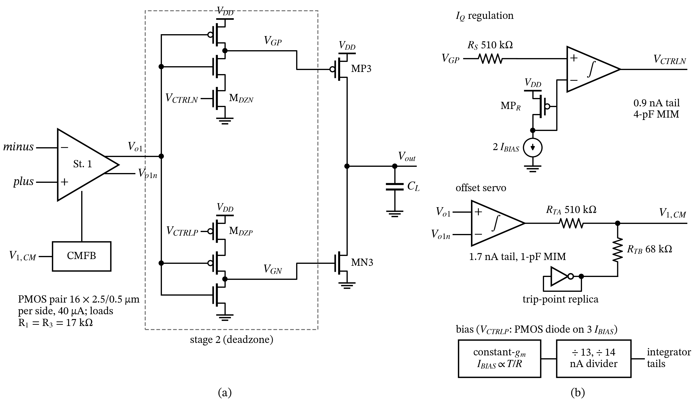</p>
<p align="center"><b>Fig. 16.</b> Architecture of RAMP_V2. (a) Signal path: PMOS-input stage 1 with differential outputs
<i>V<sub>o1</sub></i>/<i>V<sub>o1n</sub></i> and a diode CMFB referenced to <i>V<sub>1,CM</sub></i>; stage 2 as in
RAMP_LR, with <i>V<sub>CTRLN</sub></i> from the regulation integrator and a fixed <i>V<sub>CTRLP</sub></i>; output stage
MP3/MN3. (b) The two slow loops: the I<sub>Q</sub> regulation integrates the difference between the MP3 gate
(through <i>R<sub>S</sub></i>) and the gate of MP<sub>R</sub>; the offset servo integrates
<i>V<sub>o1</sub></i> − <i>V<sub>o1n</sub></i> and trims <i>V<sub>1,CM</sub></i> around the trip-point replica.
Both integrators run on nanoampere tails from a divider of the constant-<i>g<sub>m</sub></i> reference.</p>

<p align="center">TABLE V<br>CHANGES FROM RAMP_LR TO RAMP_V2</p>

| RAMP_LR | RAMP_V2 | Reason / effect |
|:--|:--|:--|
| NMOS input pair 2 × 1.56/0.5 µm, 10 µA, 100-kΩ loads | PMOS pair 16 × 2.5/0.5 µm, 40 µA, NMOS loads ∥ 17-kΩ rhigh | matching and headroom; stage-1 pole and gain set for stability (Section V-D) |
| replica of stage 2, two error amplifiers, 2-pF caps | two-stage Miller integrator on the MP3 gate vs. MP_R, 4-pF MIM; fixed $V_{CTRLP}$ | regulates the signal path, not a replica; saves the replica current |
| — | offset servo: integrator of $V_{o1}-V_{o1n}$, 1-pF MIM, trims $V_{1,CM}$ | offset σ 8–9 → 1.53 mV (Monte Carlo) |
| trip-point replica (47 µA) | one third of the VDZN inverter (12 µA) | its mismatch is removed by the servo |
| constant $I_{BIAS}$ = 1 µA | constant-$g_m$ $I_{BIAS} \propto T/R$ (ideal input) | UGF spread over PVT 6× → 2.4× |
| MN3 4 × 2.3/1 µm (v1); 1.15/0.5 µm in early v2 trials | MN3 4 × 1.15/1.0 µm | +5 dB of fast-loop DC gain, half the MN3 gate capacitance of RAMP_LR |
| NMOS mirror of 0.5/8-µm units | + nA divider: 13 hv PMOS 1/1 µm, 14 hv NMOS 0.3/2 µm units | integrator tails of 0.84 and 1.7 nA that track $I_{BIAS}$ within ± 8 % |

### B. Why the bias loops must be slow

Every continuous-time bias loop of a ringamp that acts on the deadzone or on the offset is disturbed by the signal: the
regulation integrator sees the swing of the MP3 gate during each step, the servo the stage-1 output. The correction
that follows moves the deadzone or the offset and appears at the output as a slow tail after the fast settling. A first
transistor-level regulation integrator with a tail of several tens of nanoamperes crossed over at 86–386 kHz; it was stable, but it left a
tail of 85 µV — 2 % — after a 4-mV SC step at TT, decaying over microseconds (Fig. 17(b)). The tail is a pole–zero
doublet of the main loop at the crossover $f_{loop}$ of the bias loop. Its amplitude is about
$\Delta V_{out}\, f_{loop}/(\beta f_{UGF})$ while $f_{loop}$ lies above the dominant pole of the fast loop, and it cannot fall
below $\Delta V_{out}/(\beta A_{fast})$, where $A_{fast}$ is the DC gain of the main loop with the bias loops frozen
(`sim/redesign/fastgain.py`: 68 dB at FF, 125 °C, 77 dB at TT, 82 dB at SS, −40 °C). Fig. 17(a) confirms both limits
by changing only the tail current of the regulation integrator: at TT, 27 °C the tail falls from 395 µV with a 222-kHz loop to 3.8 µV at the 2.3 kHz of RAMP_V2, and at FF, 125 °C from 1699 µV to 15 µV, where the slow small-signal settling of the main loop ($A_{fast}$ = 67 dB, UGF 8.5 MHz) dominates; slowing the loop further gains nothing (23 µV at 1.6 kHz). The design target is therefore a
crossover of a few kilohertz for both loops; below that the fast-loop gain, not the bias loop, limits the accuracy.

<p align="center">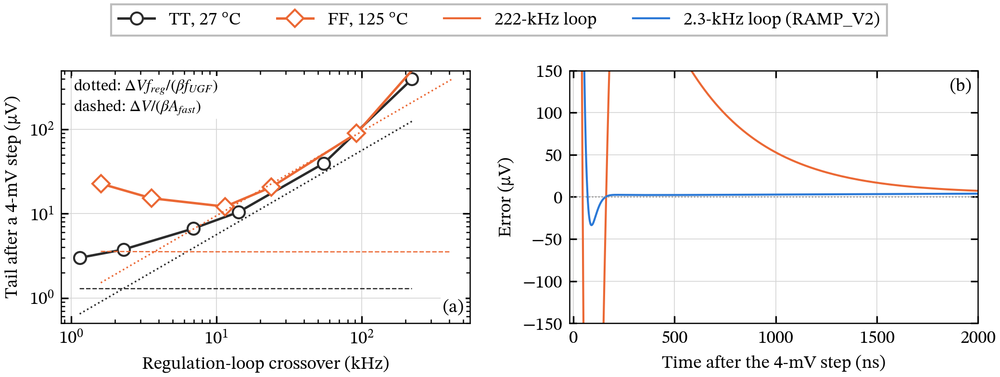</p>
<p align="center"><b>Fig. 17.</b> (a) Largest error 0.2–1.9 µs after a 4-mV SC step versus the crossover of the
I<sub>Q</sub> regulation loop, set by the tail current of its integrator (4-pF Miller capacitor), at TT,
27 °C and FF, 125 °C (85 to 0.46 nA; prototype with parasitic proxy, <code>sim/redesign/tail_study.py</code>). Dotted: doublet estimate
Δ<i>V</i>·<i>f<sub>reg</sub></i>/(β<i>f<sub>UGF</sub></i>); dashed: floor Δ<i>V</i>/(β<i>A<sub>fast</sub></i>).
(b) Error after the 4-mV step at TT, 27 °C with the fastest integrator (85-nA tail) and with that of RAMP_V2.</p>

### C. Nanoampere integrators

A crossover of a few kilohertz with a 4-pF Miller capacitor and a control path from $V_{CTRLN}$ to the MP3 gate with a
gain of about 12 needs an integrator transconductance of a few nanosiemens, i.e. tail currents of about 1 nA. Two
effects decide how such currents can be made. First, the ratio of a current mirror at nanoampere level must not depend
on the corner: at FF, 125 °C an lv NMOS passes 4 nA at $V_{GS}$ = 45 mV, so a diode-connected unit has $V_{DS}$ ≈
$1.3\,U_T$ and its output copy, in saturation, carries 1.7 times as much; the thick-oxide (hv) devices need
$V_{GS}$ ≈ 0.4 V at the same current and stay within ± 8 % over all corners and drain voltages. The divider therefore
uses hv units: $I_{BIAS}$ feeds 13 PMOS diodes of 1/1 µm, one more unit copies $I_{BIAS}/13$ into 14 NMOS diodes of 0.3/2 µm
(5.3 nA each at TT, 27 °C), and the integrator tails are series stacks of six (0.84 nA, regulation) and three (1.7 nA,
servo) of these units. Second, the integrators themselves (pairs, mirrors and output devices) are hv: with lv devices at sub-nanoampere
current the leakage of the first-stage nodes at 125 °C shifts the regulated $I_Q$ at FF, 125 °C by 15–25 % and the
servo offset by ± 0.5 mV. Table VI summarises the two loops.

<p align="center">TABLE VI<br>THE TWO SLOW LOOPS OF RAMP_V2 (PROTOTYPE, 5 CORNER/TEMPERATURE POINTS; <code>sim/redesign/rl_scan.py</code>)</p>

| | $I_Q$ regulation | Offset servo |
|:--|:--:|:--:|
| senses | MP3 gate (via $R_S$ = 510 kΩ) − MP_R gate | $V_{o1} - V_{o1n}$ |
| acts on | $V_{CTRLN}$ (starve of the MP3 driver) | $V_{1,CM}$ (CMFB reference), divider 510 kΩ / 68 kΩ |
| input pair (hv) / tail at TT, 27 °C | 4/4 µm / 0.84 nA (6 series units) | 3/3 µm / 1.7 nA (3 series units) |
| Miller capacitor / zero resistor | 4-pF MIM / 34 kΩ | 1-pF MIM / 34 kΩ |
| crossover (SF −40 °C … FS 125 °C) | 0.96 – 4.0 kHz | 0.54 – 1.26 kHz |
| phase margin | ≥ 88.7° | ≥ 89.9° |
| contribution to the mismatch σ | $I_Q$: 7.9 % (input pair) | offset: 0.9 mV (input pair) |

### D. Stage gains and stability rules

Two rules came out of the prototype study (`sim/redesign/NOTES.md`). **The worst-case gain margin must stay above about
15 dB**, measured with the parasitic proxy: below it the gain enhancement of the output stage outside the deadzone, the
mechanism of the RAMP_LR limit cycle, sustains an oscillation. **The stage-1 gain must stay below about 10.** A higher
stage-1 gain shrinks the input-referred deadzone (the deadzone at the stage-3 gates divided by $A_1A_2$), and every
variant with $A_1 \gtrsim 10$ — with or without cascodes, and longer stage-1 loads — ended in a large-signal limit cycle at
the cold corners even with 70° of phase margin. The 17-kΩ loads keep the single-ended stage-1 gain at 3–4 (differential
6–8) with the wide input pair; a high-gain CMFB was also rejected, because its loop shares the stage-1 output with the
main loop and was unstable in every variant tried.

Within these rules the fast-loop DC gain is the product of a low stage-1 gain, a stage-2 gain of 15–28 dB that falls at
hot corners (short-channel inverters), and the output-stage gain; with MN3 at 0.5 µm it was only 63 dB at FF, 125 °C,
which left 0.15 % of a 200-mV SC step unsettled until the slow loops caught up. Doubling the MN3 length adds 5 dB at
every corner (68 dB at FF, 125 °C) with half the gate capacitance of the RAMP_LR output NMOS; the gate pole of MN3 has
margin, unlike that of MP3. The stage-1 pair was enlarged to 16 fingers for matching with the loads reduced from 25 to
17 kΩ, which keeps $A_1$ and moves the stage-1 pole up; the result is a worst-case schematic gain margin of 17.6 dB over
all 45 PVT points.

---

## VI. Simulation Results

All results in this section are for the schematic of RAMP_V2 (the xschem netlist, `sim/v2_sim.py`) at
$C_L$ = 50 pF with the constant-$g_m$ reference, over the five MOS corners (TT, SS, FF, SF, FS; resistors and capacitors
in their typical, worst or best section with the matching MOS corner), −40, 27 and 125 °C and $V_{DD}$ = 1.5675, 1.65
and 1.7325 V. The RAMP_LR numbers quoted for comparison come from the same test benches with its 1-µA reference
(Section IV-E). Data: `sim/results/v2/pvt_summary.csv` (45 rows). Table VII summarises the comparison.

<p align="center">TABLE VII<br>SUMMARY OVER ALL 45 PVT POINTS (5 CORNERS × −40/27/125 °C × V<sub>DD</sub> = 1.5675/1.65/1.7325 V, SCHEMATIC)</p>

| Quantity | RAMP_LR (replica regulation) | RAMP_V2 |
|:--|:--:|:--:|
| $I_Q$ (µA) | 3.99 – 5.82 | 2.04 – 8.16 (by design ∝ $T/R$) |
| Unity-gain frequency (MHz) | 5.4 – 32.4 (6.0×) | 8.0 – 19.2 (2.4×) |
| Phase margin (deg) | 34.9 – 85.2 | **59.1 – 83.2** |
| Gain margin (dB) | 15.5 – 38.4 | 17.6 – 34.6 |
| Systematic offset of the buffer (mV) | −43.5 – +0.1 | **−0.23 – −0.06** |
| DC supply rejection (dB) | 1.7 – 54.7 | **84.8 – 93.6** |
| Buffer, 200-mV step, settling to 0.1 % (ns) | 37 – 428 | 64 – 180 |
| SC error 250 ns after a 200-mV step (%) | 0.019 – 0.47 | 0.008 – 0.17 |
| SC error 250 ns after a 4-mV step (%) | 0.019 – 1.6 | 0.027 – 0.26 |
| points with 4-mV error > 0.1 % at 250 ns | 12 of 45 (all 125 °C) | 8 of 45 (all 125 °C) |
| limit cycle in the buffer step test (±10…±200 mV) | not tested in the schematic | none (ripple ≤ 7.2 µV) |
| Supply current (µA) | 84 – 252 (156 at TT, 27 °C) | 64 – 278 (133 at TT, 27 °C) |

### A. Loop gain over PVT

Fig. 18 overlays the loop gain of the five corners at each temperature. The magnitude has two parts: below a few
kilohertz the two integrators add gain (114–127 dB at 1 Hz), and from about 10 kHz up the fast loop falls with
−20 dB/decade to its crossover; the step between them, at 1–5 kHz, is the doublet of Section V-B. At a given temperature
the five corners lie on top of each other — the UGF varies by at most 1.3× (17.8–18.6 MHz at −40 °C, 13.4–14.4 MHz at
27 °C, 8.5–10.8 MHz at 125 °C) — because the regulation removes the process dependence of $I_Q$ and the constant-$g_m$
reference most of its temperature dependence. Fig. 19 compares the margins with those of RAMP_LR over all 45 points.
The smallest phase margin rises from 35° to 59° and the smallest gain margin is 17.6 dB (SS, −40 °C, 1.7325 V). The
cold corners have the least margin in both designs, because the stage gains are highest there.

<p align="center">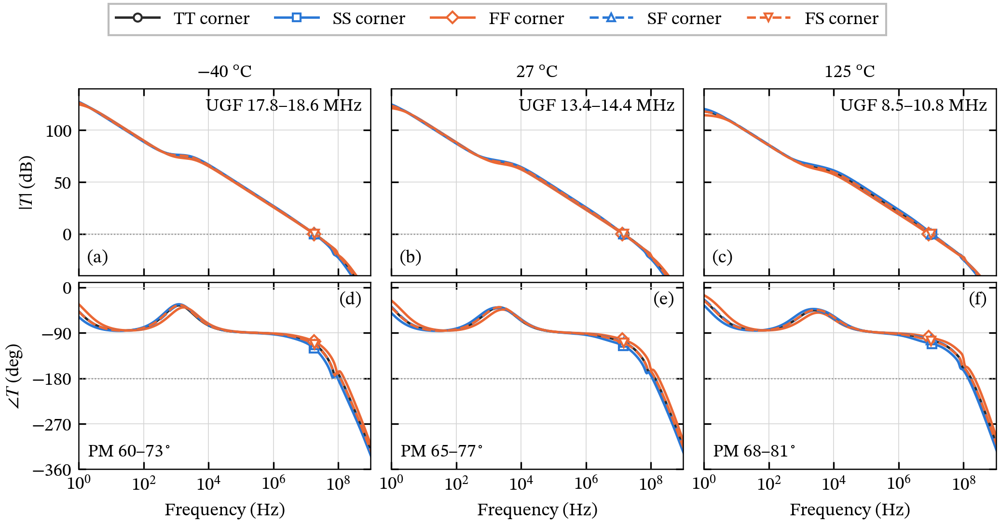</p>
<p align="center"><b>Fig. 18.</b> RAMP_V2, loop gain of the unity-gain buffer for the five process corners at −40, 27
and 125 °C, 1.65 V: (a)–(c) magnitude, (d)–(f) phase. Markers: unity-gain frequency and the phase there; the ranges
printed in each panel are over the five corners.</p>

<p align="center">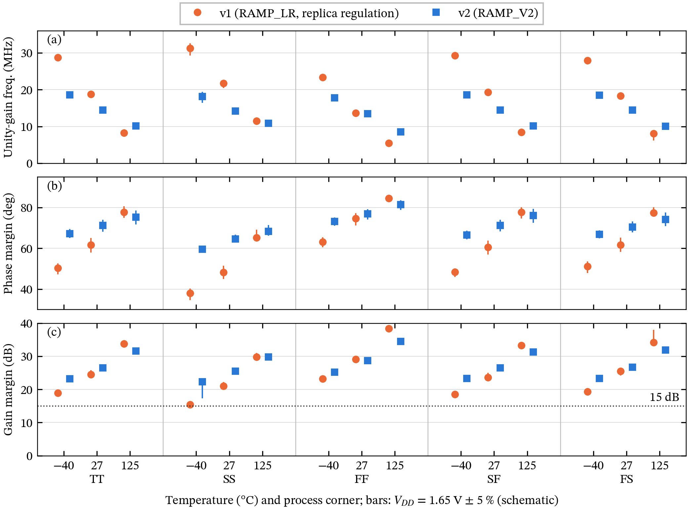</p>
<p align="center"><b>Fig. 19.</b> (a) Unity-gain frequency, (b) phase margin and (c) gain margin over process corner and
temperature, RAMP_LR (orange circles, replica regulation, 1-µA reference) and RAMP_V2 (blue squares); markers at
1.65 V, bars over 1.5675–1.7325 V (schematic). Dotted: 15-dB gain-margin rule (Section V-D).</p>

### B. Quiescent current and bandwidth over temperature

Fig. 20(a) shows that the regulation holds $I_Q$ at its target $4\,I_{BIAS}$ at every corner and temperature, within
a few percent (3.84 µA against 3.66 µA at TT, 27 °C, the difference being the drain-voltage difference between MP3 and
the diode MP_R). $I_Q$ itself rises with temperature, from 2.1 µA (SS, −40 °C) to 7.9 µA (FF, 125 °C), because the
constant-$g_m$ reference makes $I_{BIAS}$ proportional to $T/R$; this is what keeps the transconductance of the
weak-inversion output stage, $g_{m3} = I_Q/(nU_T)$, approximately constant. The UGF nevertheless still falls by about 2×
from −40 °C to 125 °C (Fig. 20(b)): the gains of stages 1 and 2 fall with temperature, and the bias compensates only
the output stage. The same was observed in RAMP_LR with an ideal PTAT reference, where the UGF still fell 2.2× at TT.

<p align="center">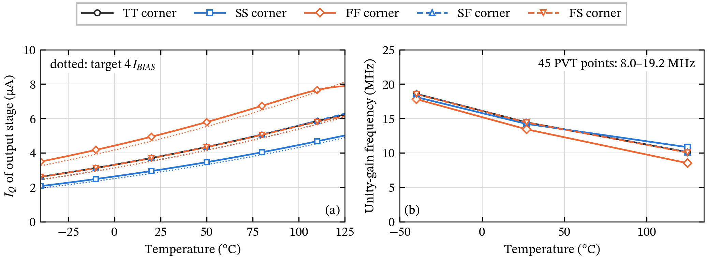</p>
<p align="center"><b>Fig. 20.</b> RAMP_V2 over temperature, five process corners, 1.65 V: (a) output-stage quiescent
current from a DC temperature sweep (solid) and its target 4 <i>I<sub>BIAS</sub></i> (dotted); (b) unity-gain frequency.</p>

### C. Step response and settling

The switched-capacitor test (`sc_deck`) is an inverting charge-transfer amplifier with $C_S = C_F$ = 5 pF,
$C_L$ = 50 pF and a 1-GΩ DC feedback resistor, with the amplifier inputs at the virtual ground; it applies two 4-mV
steps (small signal, inside the deadzone) and then two 200-mV steps. Errors are measured against the *ideal* charge
transfer $-\frac{C_S}{C_F}\Delta V_{in}$, so a response that stops inside the deadzone, a finite loop gain or a bias-loop
tail all count as error. Fig. 21 shows the 200-mV and 4-mV responses of all corners: every corner reaches 1 % within
about 70 ns and 0.1 % within 70–250 ns; at TT, 27 °C the error 250 ns after the step is 0.054 % (200 mV) and 0.058 %
(4 mV). Fig. 22 compares the error at 250 ns with RAMP_LR. At −40 °C and 27 °C both designs stay below 0.07 %; RAMP_V2 is
slightly slower there (0.054 % against 0.033 % at TT, 27 °C), because its UGF at 27 °C is 14 MHz instead of 19 MHz.
At 125 °C, where RAMP_LR had its worst points, the error falls at every corner: the large-step error at FF, 125 °C from
0.47 to 0.14 %, the small-step error from 1.6 to 0.18 %, and the worst small-step error over all 45 points is now
0.26 %. What remains above 0.1 % — the 4-mV step at
125 °C and the 200-mV step at FF, 125 °C — is the floor $\Delta V/(\beta A_{fast})$ of Section V-B: the fast loop has
68 dB of DC gain at FF, 125 °C, which leaves about 0.08 % until the slow loops take over. The slow rise of the error over
the 2-µs window of the small steps is the 1-GΩ feedback resistor discharging $C_F$, as in RAMP_LR.

<p align="center">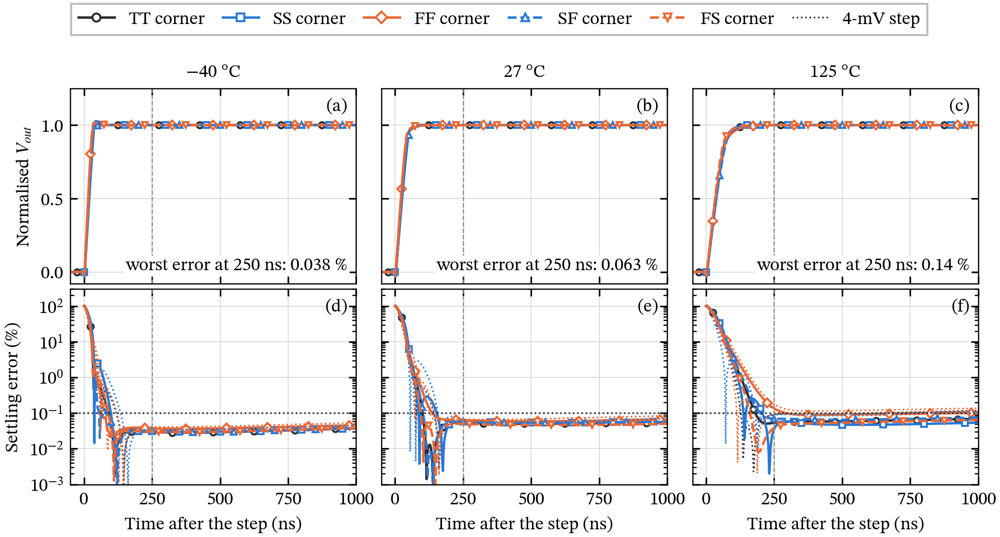</p>
<p align="center"><b>Fig. 21.</b> RAMP_V2, SC response at five process corners and −40, 27 and 125 °C, 1.65 V:
(a)–(c) normalised output after a 200-mV input step; (d)–(f) settling error against the ideal charge transfer after the
200-mV step (solid) and the 4-mV step (dotted). Grey dashed: 250 ns.</p>

<p align="center">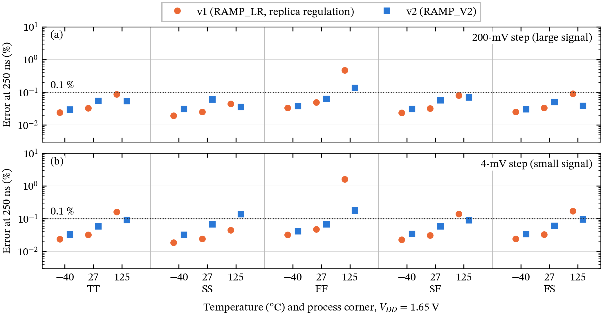</p>
<p align="center"><b>Fig. 22.</b> Error of the SC amplifier 250 ns after (a) a 200-mV and (b) a 4-mV step over process
corner and temperature at 1.65 V: RAMP_LR (orange) and RAMP_V2 (blue). Dotted: 0.1 %.</p>

The unity-gain buffer settles to 0.1 % of a 200-mV step in 64–124 ns (rising) and 66–180 ns (falling) at all 45 points,
with 4–11 % overshoot. Its *static* transfer is exact — the DC output follows the input within −0.09 mV from 0.625 to
1.025 V at TT, 27 °C (`sim/redesign/dcsw2.py`) — but after a common-mode step the fast loop alone leaves an error of
0.9–3.4 mV for a 200-mV step (0.5–1.7 %), which the servo removes with its millisecond time constant: the input pair's
tail and the CMFB shift the stage-1 output common mode, and only the servo corrects it. In the SC configuration the input
common mode does not move and this error does not occur.

### D. Limit-cycle test and start-up

The RAMP_LR limit cycle appeared after layout, at the cold slow corner, for every step above 10 mV. The limit-cycle test
(`lc_deck`) therefore applies buffer steps of ±10, ±20, ±50, ±100 and ±200 mV, 500 ns each, at all 45 points and
measures the peak-to-peak ripple over the last 100 ns of every step. RAMP_V2 shows none: the largest ripple is 7.2 µV,
the numerical noise of the transient, and every step settles to 1 % of its size within 104 ns (Fig. 23; the
post-layout curve is discussed in Section VII-D).

<p align="center">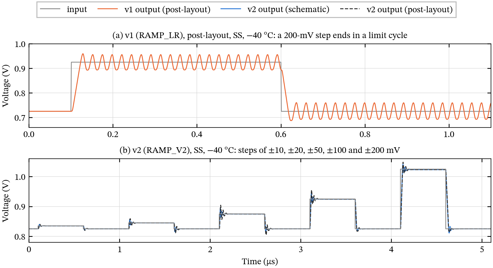</p>
<p align="center"><b>Fig. 23.</b> (a) RAMP_LR after layout at SS, −40 °C: a 200-mV buffer step ends in a 43-MHz limit
cycle. (b) RAMP_V2 at SS, −40 °C, schematic and post-layout: buffer steps of ±10 to ±200 mV settle without
oscillation.</p>

Because the integrators are slow, the bias settles slowly after power-up. Fig. 24 shows a supply ramp of 1 µs followed
by 3 ms at five corners (`startup_deck`, Gear integration). The integrator outputs start high, so $I_Q$ is initially
20–300 µA; the regulation pulls $V_{CTRLN}$ down at the slew rate of its 0.84-nA, 4-pF integrator, and both loops reach
their operating point after about 1.2 ms at every corner, with the output within a few millivolts of the input after
0.3 ms. A start-up circuit that presets $V_{CTRLN}$ would shorten this; it was not needed for the SC application.

<p align="center">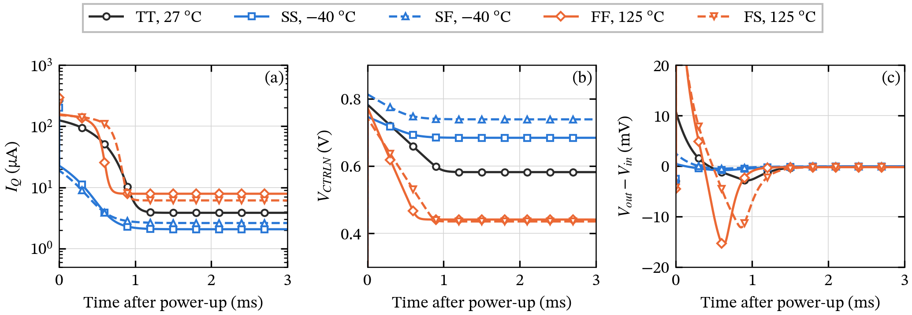</p>
<p align="center"><b>Fig. 24.</b> Power-up of RAMP_V2 (unity-gain buffer, input at 0.825 V, supply ramp 0 → 1.65 V in
1 µs) at five corner/temperature points: (a) output-stage current, (b) regulation output <i>V<sub>CTRLN</sub></i>,
(c) output error.</p>

### E. Monte Carlo: process variation and mismatch

`sim/v2_montecarlo.py` runs 300 samples for each of three sets of the PDK's statistical models — global process
variation (`*_stat`), local mismatch (`*_mismatch`, $1/\sqrt{WL}$-scaled per device [23]) and both — at TT, 27 °C,
1.65 V. Every sample is a separate ngspice process with its own seed and runs the operating point, the loop gain, the
buffer step and the SC test. The constant-$g_m$ reference is built around a dummy rhigh, so it varies with the
resistor. Table VIII compares the results with those of RAMP_LR (500 samples per set, replica regulation).

<p align="center">TABLE VIII<br>MONTE CARLO, TT, 27 °C, 1.65 V (RAMP_V2: <code>sim/results/v2/mc_summary.csv</code>, 300 SAMPLES PER SET)</p>

| Variation | Design | offset mean / σ (mV) | offset ± 3σ (mV) | $I_Q$ 5th–95th pct. (µA) | $I_Q$ σ/mean | UGF median (5th pct.) (MHz) | PM 5th pct. / min | GM min | SC 200-mV error at 250 ns, 95th pct. | samples |
|:--|:--|:--:|:--:|:--:|:--:|:--:|:--:|:--:|:--:|:--:|
| global | RAMP_LR | -1.42 / 1.04 | -4.5 … +1.7 | 4.18 – 4.26 | 1 % | 18.6 (17) | 57° / 54° | 21.7 dB | 0.037 % | 500 |
| global | **RAMP_V2** | -0.11 / 0.01 | -0.1 … -0.1 | 3.42 – 4.42 | 8 % | 14.4 (14) | 68° / 67° | 25.4 dB | 0.069 % | 300 |
| local | RAMP_LR | -0.88 / 8.02 | -24.9 … +23.2 | 0.00032 – 153 | 177 % | 19.0 (0.00097) | 17° / 15° | 6.8 dB | 8.2 % | 500 |
| local | **RAMP_V2** | +0.04 / 1.49 | -4.4 … +4.5 | 3.24 – 4.56 | 11 % | 14.5 (12) | 68° / 65° | 16.1 dB | 0.083 % | 300 |
| both | RAMP_LR | -0.86 / 9.04 | -28.0 … +26.2 | 0.000356 – 155 | 185 % | 14.2 (0.0012) | 17° / 11° | 4.5 dB | 8.4 % | 500 |
| both | **RAMP_V2** | +0.24 / 1.53 | -4.4 … +4.8 | 3.11 – 4.71 | 15 % | 14.6 (12) | 67° / 65° | 22.2 dB | 0.086 % | 300 |

Local mismatch dominates the offset of RAMP_V2: σ = 1.49 mV for mismatch alone, 0.01 mV for global process variation, 1.53 mV for both, so ±3σ of the combined case lies within -4.4 … +4.8 mV, inside the ±5-mV target and 6× below RAMP_LR (σ = 9.0 mV, Fig. 25(a)–(c)). A run with mismatch enabled in one device group at a time (`sim/redesign/mc_attr2.py`) attributes the remainder to the stage-1 input pair, its NMOS loads and the input pair of the servo integrator, in about equal parts; stage 2, the trip-point replica and the CMFB no longer contribute, because the servo nulls the stage-1 outputs. The quiescent current, which spread over five decades in RAMP_LR, has σ/mean = 11 % under mismatch and 15 % under both (5th–95th percentile 3.11–4.71 µA, Fig. 25(d)–(f)): it is now set by the offset of the regulation integrator and the mismatch between MP3 and MP_R, not by the deadzone of a replica. Global variation alone moves $I_Q$ by 8 % because the constant-$g_m$ reference follows the rhigh sheet resistance — by design. Every sample is stable (Fig. 26, Fig. 27): over the process + mismatch set the phase margin is at least 65° and the gain margin at least 22.2 dB, the UGF stays within 3.4–19.7 MHz, and the SC error 250 ns after a 200-mV step is below 0.086 % in 95 % of the samples (maximum 0.28 %).

<p align="center">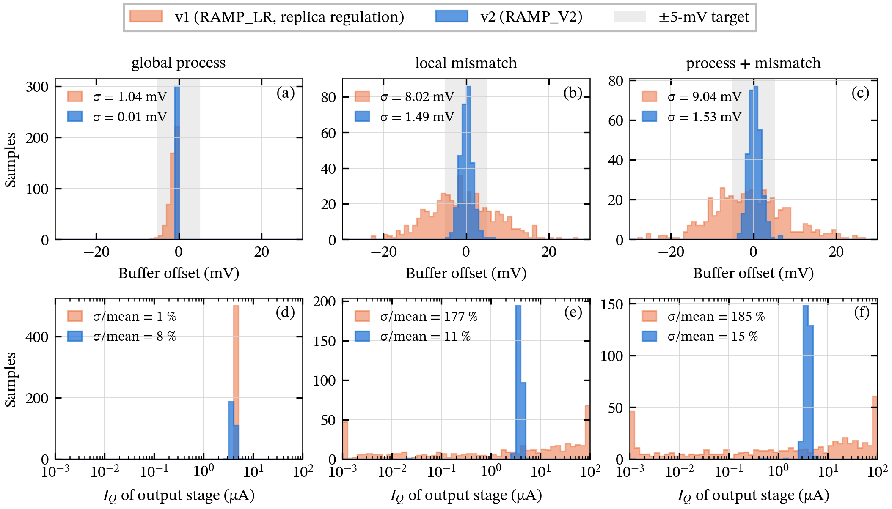</p>
<p align="center"><b>Fig. 25.</b> Monte Carlo of RAMP_LR (orange, replica regulation, 500 samples) and RAMP_V2 (blue,
300 samples): (a)–(c) offset of the unity-gain buffer, (d)–(f) output-stage quiescent current, for global process
variation, local mismatch and both. Grey band: ±5-mV target; legends: σ of the offset and σ/mean of
<i>I<sub>Q</sub></i>.</p>

<p align="center">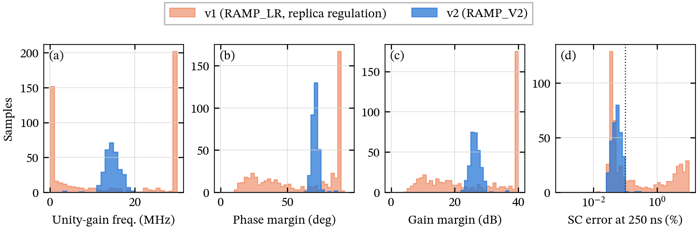</p>
<p align="center"><b>Fig. 26.</b> Process + mismatch Monte Carlo of RAMP_LR (orange) and RAMP_V2 (blue): (a) unity-gain
frequency, (b) phase margin, (c) gain margin, (d) error of the SC amplifier 250 ns after a 200-mV step (dotted: 0.1 %).
Values outside the axis range are counted in the end bins.</p>

<p align="center">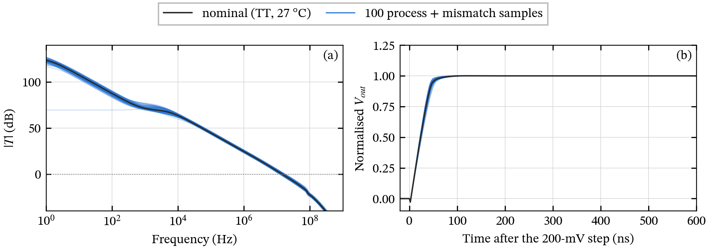</p>
<p align="center"><b>Fig. 27.</b> RAMP_V2, the first 100 process + mismatch samples: (a) loop gain, (b) SC response to
a 200-mV step. Black: nominal (TT, 27 °C).</p>

### F. Supply rejection

The DC supply rejection of the buffer is 84.8–93.6 dB over all 45 points (Fig. 28), against 1.7–54.7 dB in RAMP_LR,
whose 35-dB transistor CMFB let a supply change shift the stage-1 common mode, and with it the offset. In RAMP_V2 the
servo removes that shift at DC. Above the servo crossover the rejection falls to 14–36 dB at 1 MHz.

<p align="center">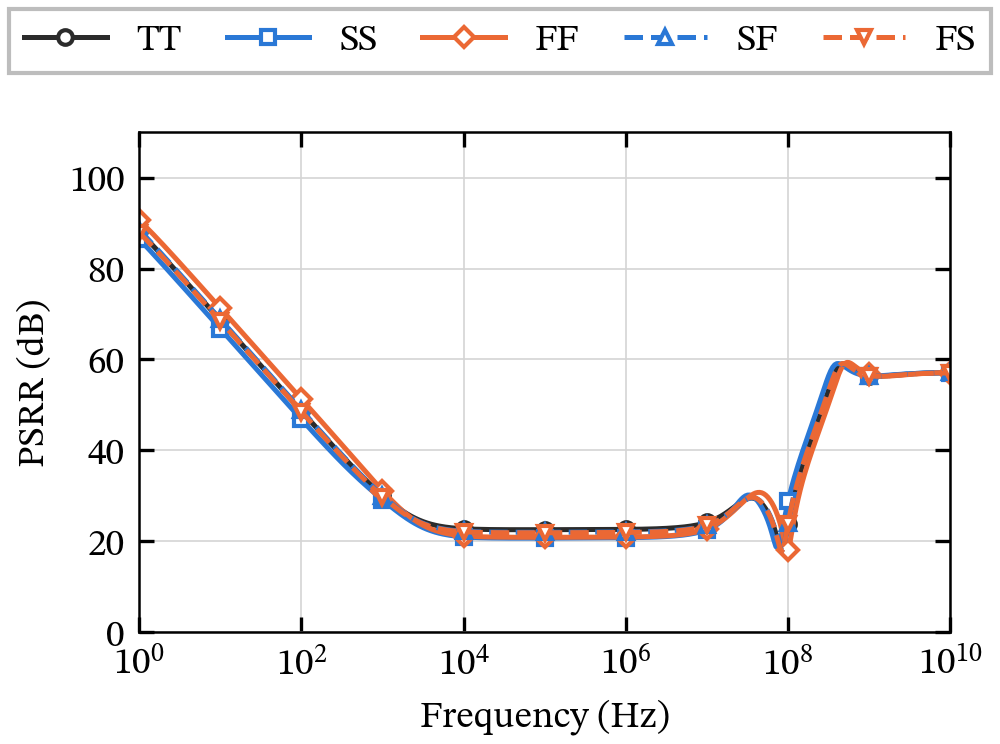</p>
<p align="center"><b>Fig. 28.</b> Power-supply rejection of the closed-loop RAMP_V2 buffer at 27 °C for the five
corners.</p>

### G. Power

RAMP_V2 draws 133 µA (219 µW) at TT, 27 °C, 15 % less than RAMP_LR (156 µA), although its first stage takes 2.3 times
the current (Fig. 29). The replica of stage 2 and its two error amplifiers (41 µA in RAMP_LR) are gone, the trip-point
replica takes 12 µA instead of 47 µA, and the two integrators take less than 4 µA. Stage 2 remains the largest consumer (58 µA): its inverters sit at their switching point, and their
size sets the stage-2 gain and the MP3-gate pole. Because $I_{BIAS} \propto T/R$, the supply current rises with
temperature, to 278 µA at FF, 125 °C, 1.7325 V.

<p align="center">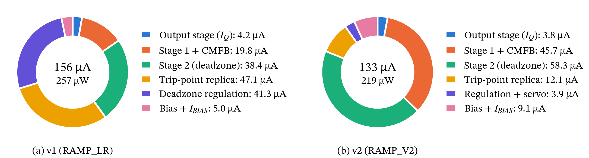</p>
<p align="center"><b>Fig. 29.</b> Supply current by block at TT, 27 °C, 1.65 V, amplifier at rest: (a) RAMP_LR,
(b) RAMP_V2 (total in the centre). The stage-1 and CMFB tails of RAMP_V2 (50 <i>I<sub>BIAS</sub></i>) are counted
with stage 1.</p>

---

## VII. Layout and Post-Layout Simulation

### A. Floor plan and routing

The layout (`layout/RAMP_V2.gds`, Fig. 30) is generated by `layout/gen_layout.py` in KLayout from the IHP PCells [17],
[20], with the placement of `layout/ramp_v2_design.py`; the generator, written for RAMP_LR, takes the design file as a
parameter. It measures 92.0 µm × 67.6 µm (0.0062 mm²). The circuit is built from 19 *strips* — rows of transistor
fingers of one kind and W/L, made of multi-finger PCells whose fingers share their source and drain diffusions (which
diffusion carries which net is solved from the device pins) — and three rhigh arrays: 230 fingers, 40 of them dummies,
in 50 PCells, and 70 resistor segments of 5.73 µm (17 kΩ each; $R_S$ and $R_{TA}$ are 30 segments in series). The rows
run in eight bands, from bottom to top: two rows of the NMOS bias mirror (0.5/8-µm units), the nA divider, the
integrator input pairs and the $R_S$/$R_Z$ array, the integrator PMOS devices and the trim-divider array, the NMOS signal
row (stage-1 loads, stage-2 NMOS, MN3) and the PMOS signal row (stage-1 input pair, stage-2 PMOS, MP3 with MP_R), with
the PMOS tail mirror, the CMFB pair and the trip-point replica on top. Neighbouring bands share a routing channel; a
constrained left-edge router assigns Metal2 tracks (53 tracks in nine channels), and nets that change channel get a
Metal3 column (28 columns). The two MIM capacitors (4 pF, 51.6 µm square, and 1 pF, 25.8 µm square) sit on
Metal5/TopMetal1 over the circuit. Both of their plates are signal nets: the bottom plate (Metal5) is reached from the
net's Metal3 column by a Metal4 route and a via stack inside the plate, the top plate (TopMetal1) by a Metal4 route to a
via stack in the gap between the two capacitors and a TopMetal1 strap; the generator keeps different Metal4 nets 1.5 µm
and the TopMetal1 pads 4 µm apart. The bottom plate of each capacitor is on the low-impedance side of its integrator
(behind $R_Z$), so the coupling of the circuit underneath into the plate does not load the high-impedance first-stage
output of the integrator.

<p align="center">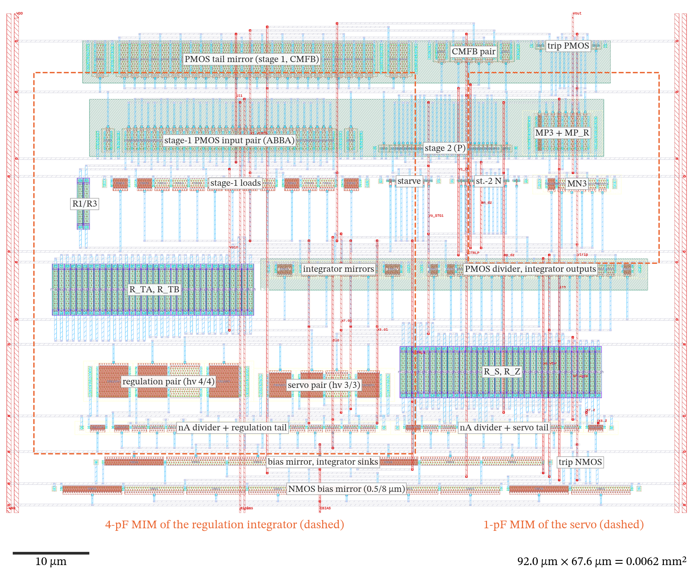</p>
<p align="center"><b>Fig. 30.</b> Layout of RAMP_V2 in IHP SG13G2 with Metal4 and above hidden; the dashed outlines are
the 4-pF and 1-pF MIM capacitors over the circuit. Ports on Metal3 at the bottom (IBIAS, minus, plus, GND) and top
(Vout, VDD) edges.</p>

### B. Matching

Fig. 31 shows the matched groups. The stage-1 input pair is ABBA × 8 in one shared diffusion with the tail between A
and B, and the stage-1 loads are ABBA with the CMFB diodes beside them, so linear gradients cancel to first order. MP3
surrounds its reference MP_R (M M R R M M), whose gate voltage the regulation copies onto MP3; the reference unit of
the regulation current ($I_{irn}$, Q × 2) sits next to the $I_{BIAS}$ diode R. The nA divider places the diode units U
and the series tail units T of the regulation integrator in one diffusion. Every group ends in dummy fingers, all
fingers of a strip have the same orientation, and every strip ends in a substrate or well tie. The mismatch that
remains is set by device area, which Section VI-E quantifies.

<p align="center">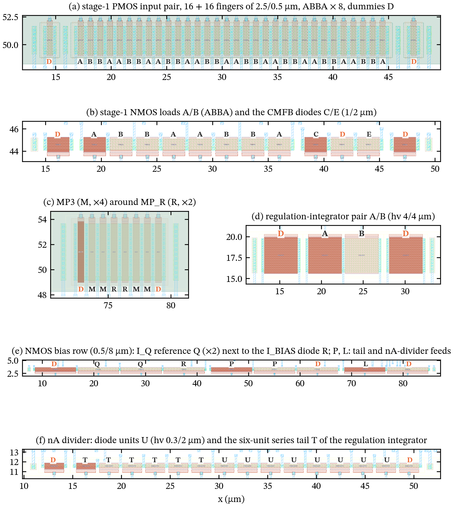</p>
<p align="center"><b>Fig. 31.</b> Matched structures of RAMP_V2 (Metal2 and above hidden). (a) Stage-1 PMOS input pair
A/B, ABBA × 8; (b) stage-1 NMOS loads A/B and CMFB diodes C/E; (c) MP3 (M) around MP_R (R); (d) regulation-integrator
pair; (e) NMOS bias row: I<sub>Q</sub> reference Q next to the I<sub>BIAS</sub> diode R, P and L feed the tail mirror and
the nA divider; (f) nA divider: diode units U and the six-unit series tail T. D: dummy.</p>

### C. Physical verification

<p align="center">TABLE IX<br>PHYSICAL VERIFICATION OF RAMP_V2 WITH THE IHP SG13G2 DECKS (<code>TOP=RAMP_V2 layout/run_checks.sh</code>, <code>layout/run_pex.sh</code>)</p>

| Check | Deck / option | Result | Report |
|:--|:--|:--|:--|
| DRC | KLayout main deck incl. extended rules, `--no_density` | **0 violations** | `layout/reports/RAMP_V2_drc_main.txt` |
| Antenna | `--antenna_only` | **0 violations** | `layout/reports/RAMP_V2_drc_antenna.txt` |
| Density | `--density_only` | global densities not met (block not filled; fill is inserted at chip level) | `layout/reports/RAMP_V2_drc_density.txt` |
| LVS | `run_lvs.py` vs. flat xschem netlist | **match**: 62 device pairs, 43 nets, 0 mismatches | `layout/reports/RAMP_V2_lvs.txt` |
| LVS of the extraction | magic netlist vs. xschem netlist, netgen | **match** | `layout/reports/RAMP_V2_pex.txt` |

The first layout had six DRC violations, all in the MIM wiring: two Metal3 stubs below the minimum area (a column that
touches a single channel) and four TopMetal1 spacings between the two top-plate via stacks; the generator now draws a
minimum-area stub and keeps the TopMetal1 pads apart. LVS matched at the first attempt, as for RAMP_LR, because the
layout is generated from the same device list as the schematic.

### D. Post-layout simulation

The layout was extracted with magic [21] and the IHP SG13G2 extraction rules: all devices as drawn, plus the area,
fringe and coupling capacitance of every net above 0.01 fF — 2238 capacitors, 0.69 pF in total — and a netgen [22] LVS of
the extracted netlist matches. Wire resistance was not extracted. For simulation (`sim/v2_postlayout.py`) the I_Q
ammeter is inserted in the source of the four MP3 fingers and the 70 nodes that touch only capacitors (rhigh bodies)
are tied to ground through 1 TΩ, as for RAMP_LR; both views then run the test benches of Section VI at the five corners
and three temperatures. The extracted netlist has a second DC solution with MP3 fully on, into which the operating
point of two SC decks (TT and SF, 27 °C) converged with the initial guess of the schematic runs; these two were re-run
with an operating-point guess that also includes the stage-3 gates and the servo node, now the default of
`sim/v2_sim.py`. Table X summarises the comparison.

<p align="center">TABLE X<br>RAMP_V2, SCHEMATIC VERSUS POST-LAYOUT (1.65 V; <code>sim/results/v2/postlayout_summary.csv</code>)</p>

| Quantity | Schematic | Post-layout |
|:--|:--:|:--:|
| $I_Q$ / supply current at TT, 27 °C (µA) | 3.84 / 133.0 | 3.84 / 133.0 |
| offset / DC PSRR at TT, 27 °C | -0.10 mV / 88.2 dB | -0.10 mV / 88.2 dB |
| unity-gain frequency at TT, 27 °C (MHz) | 14.4 | 12.8 |
| phase / gain margin at TT, 27 °C | 71.1° / 26.5 dB | 65.8° / 24.3 dB |
| phase / gain margin at SS, −40 °C | 59.6° / 22.3 dB | 50.4° / 16.3 dB |
| phase margin over the 15 corner/temperature points | 60–81° | 50–78° |
| gain margin, minimum over the 15 points | 22.3 dB | 16.3 dB |
| unity-gain frequency over the 15 points (MHz) | 8.5–18.6 | 7.9–16.3 |
| buffer, 200-mV step: overshoot / settling to 0.1 % at TT, 27 °C | 8.3 % / 91 ns | 11.0 % / 136 ns |
| buffer settling to 0.1 %, worst of the 15 points (ns) | 158 | 217 |
| SC error at 250 ns, 200-mV / 4-mV step, worst of the 15 points | 0.14 % / 0.18 % | 0.34 % / 0.20 % |
| limit-cycle test: largest ripple (µV) | 7.2 | 9.4 |

The DC behaviour is unchanged — bias currents, offset and supply rejection agree to three or four digits — and the extracted capacitances cost 2–9° of phase margin and up to 15 % of UGF (Figs. 32 and 34), most at the cold corners. The smallest post-layout phase margin is 50.4° and the smallest gain margin 16.3 dB, both at SS, −40 °C, where RAMP_LR had 16° and 4.8 dB and oscillated. The limit-cycle test of Section VI-D, repeated on the extracted netlist at all 15 points, shows no oscillation (largest ripple 9.4 µV; Fig. 23(b)), and the steps of Fig. 33 ring slightly longer than in the schematic but settle; the slowest post-layout corner is SS, 125 °C, where the SC error 250 ns after a 200-mV step rises from 0.04 % to 0.34 %. The sensitivity run (Fig. 35) removes the extracted capacitances of one net group at a time: at SS, −40 °C the stage-2 outputs `mp_dz`/`mn_dz` cost 8.7° and the stage-1 outputs 5.5°, the control voltages 1.3°, while the integrator nets and the output do not matter. The 17-kΩ stage-1 loads (100 kΩ in RAMP_LR) are what makes the stage-1 routing harmless; the stage-2 outputs, driven by minimum-size inverters, are now the most sensitive nodes.

<p align="center">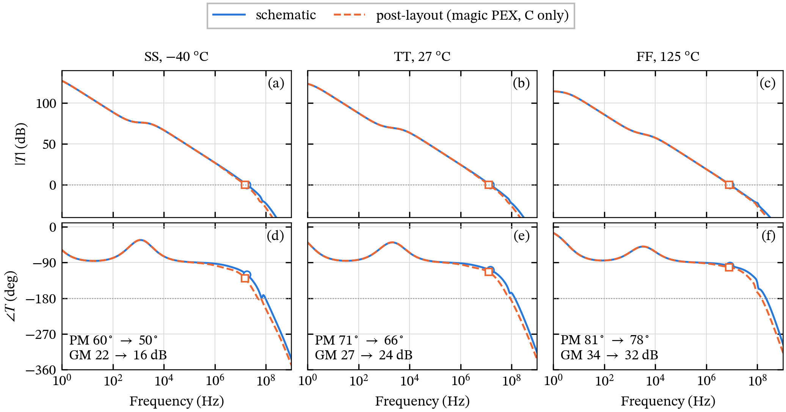</p>
<p align="center"><b>Fig. 32.</b> RAMP_V2, loop gain of the buffer, schematic (blue) and post-layout (orange, dashed),
at SS, −40 °C, TT, 27 °C and FF, 125 °C: (a)–(c) magnitude, (d)–(f) phase, with the phase and gain margins of both views.</p>

<p align="center">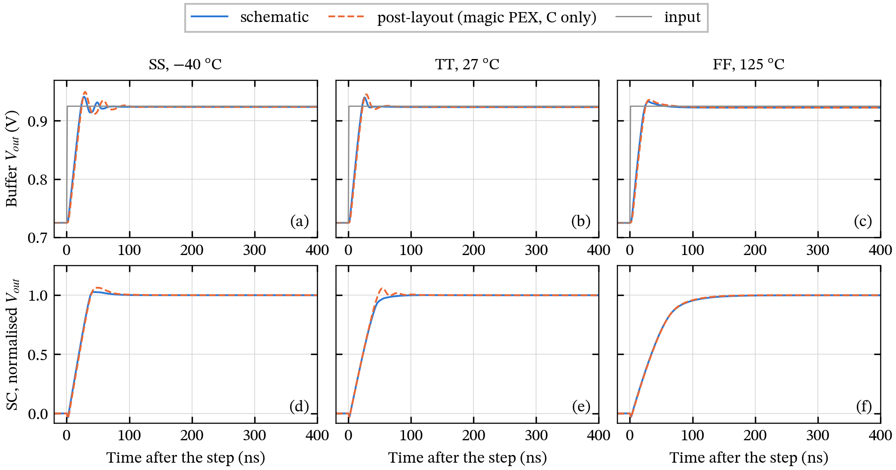</p>
<p align="center"><b>Fig. 33.</b> Schematic versus post-layout step responses at the same three points: (a)–(c) buffer,
200-mV input step (grey: input); (d)–(f) SC amplifier, normalised response to a 200-mV step.</p>

<p align="center">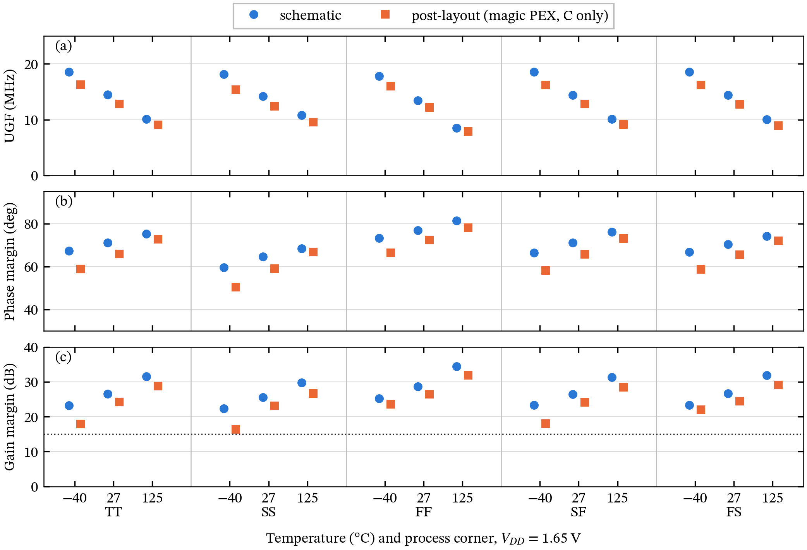</p>
<p align="center"><b>Fig. 34.</b> (a) Unity-gain frequency, (b) phase margin and (c) gain margin of the schematic and
the post-layout netlist of RAMP_V2 over process corner and temperature at 1.65 V (dotted: 15 dB).</p>

<p align="center">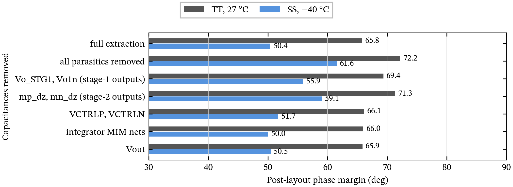</p>
<p align="center"><b>Fig. 35.</b> Post-layout phase margin of RAMP_V2 with the extracted capacitances of one net group
removed, at TT, 27 °C and SS, −40 °C.</p>

---

## VIII. Comparison with Prior Art

<p align="center">TABLE XI<br>DEADZONE BIASING SCHEMES</p>

| | [1] | [4] | [6] | [12] | [2], [3] | RAMP_LR (this work) | **RAMP_V2 (this work)** |
|:--|:--:|:--:|:--:|:--:|:--:|:--:|:--:|
| Deadzone set by | external voltage $V_{DZ}$ | on-chip resistor | current-starved inverters | P/V-insensitive dead-zone (mechanism not in abstract) | current-starved + replica feedback | current-starved + replica feedback | current-starved + feedback on the output device itself |
| $I_Q$ independent of $V_{th}$ shifts |  |  |  |  claimed |  |  |  |
| $I_Q$ held under device mismatch (Monte Carlo) |  n/r |  n/r |  n/r |  n/r |  n/r |  five decades |  σ/mean 15 % |
| Offset removed |  n/r |  n/r |  n/r |  n/r |  n/r |  σ = 8–9 mV |  servo, σ = 1.53 mV |
| Verified over temperature and supply |  n/r |  n/r |  n/r |  supply |  no |  −40…125 °C, ± 5 % |  −40…125 °C, ± 5 % |
| Stable after layout at all corners |  n/r |  silicon |  silicon |  n/r |  no layout |  limit cycle at SS, −40 °C |  PM ≥ 50°, GM ≥ 16 dB |
| Evidence |  not checked |  silicon (ADC) |  silicon (ADC) |  simulation |  simulation |  simulation, post-layout, Monte Carlo |  simulation, post-layout, Monte Carlo |
| Design data and scripts public |  |  |  |  |  |  |  |

<p align="center">TABLE XII<br>FIGURES OF MERIT OF THE DEADZONE-REGULATION STUDIES</p>

| | [2], [3] | RAMP_LR (this work) | **RAMP_V2 (this work)** |
|:--|:--:|:--:|:--:|
| Technology ($L_{min}$ of the core devices) | 65-nm CMOS | IHP SG13G2 130 nm (lv 0.13 µm, hv 0.40/0.45 µm) | IHP SG13G2 130 nm |
| Supply | 1.2 V | 1.65 V | 1.65 V |
| Configuration, load | SC, gain 4, $C_L$ = 0.7 pF, 125 MS/s | buffer and SC (gain 1), $C_L$ = 50 pF | buffer and SC (gain 1), $C_L$ = 50 pF |
| Bias reference | constant current (not specified) | 1 µA, constant | constant-$g_m$, $\propto T/R$ (ideal) |
| PVT space | SS/TT/FF | 5 corners × −40/27/125 °C × ± 5 % | 5 corners × −40/27/125 °C × ± 5 % |
| GBW/UGF spread, regulated, process only | 380–475 MHz (1.25×) | 13.7–21.7 MHz (1.59×) at 27 °C | 13.4–14.4 MHz (1.08×) at 27 °C |
| UGF spread, full PVT | n/r | 5.4–32.4 MHz (6×) | 8.0–19.2 MHz (2.4×) |
| Phase margin, full PVT (schematic / post-layout) | 61–72° (SS/TT/FF) | 35–85° / 16–80° at 1.65 V | 59–83° / 50–78° at 1.65 V |
| Offset under mismatch (σ) | n/r | 8–9 mV | 1.53 mV |
| $I_Q$ under global / global + local variation | n/r | 4.18–4.26 µA / five decades | σ/mean 8 % / 15 % |
| SC error at 250 ns, 200-mV / 4-mV step, full PVT | ≤ 0.05 % (800-mV step) | ≤ 0.47 % / ≤ 1.6 % | ≤ 0.17 % / ≤ 0.26 % |
| DC supply rejection | n/r | 1.7–54.7 dB | 84.8–93.6 dB |
| Power at TT / area | n/r / no layout | 257 µW / 0.0037 mm² | 219 µW / 0.0062 mm² |

*n/r: not reported in the abstract or the text consulted for this report; not checked: the paper itself was not
consulted for this row.* The comparison with [2], [3] is not apples-to-apples: they use a 65-nm process with about half
the minimum channel length of the SG13G2 core devices, a much smaller load and a GBW twenty times higher; their figures
are from schematic simulation at three process corners. RAMP_V2 pays for its robustness with area (the two MIM
capacitors and the larger input pair, 1.7× RAMP_LR) and with millisecond-scale bias loops.

---

## IX. Conclusion, Limitations and Next Steps

The replica-based deadzone regulation of [2], [3] carries over to IHP SG13G2: it holds the quiescent current of a
current-starved ringamp within 3.99–5.82 µA over five corners, −40 °C to 125 °C and ± 5 % supply, where a fixed
deadzone allows 0.003–32.7 µA. Verifying the layout-ready design to the end — after layout, under mismatch and in the
time domain — showed what the regulation does not cover: a large-signal limit cycle after layout at the cold slow
corner, an offset of σ = 8–9 mV, and an $I_Q$ that mismatch between the replica and the signal path spreads over five
decades. RAMP_V2 addresses all three. It regulates the deadzone at the gate of the output device itself, removes the
offset with a servo on the first-stage outputs, takes a constant-$g_m$ bias, and follows two stability rules found on
the way (worst-case gain margin ≥ 15 dB, first-stage gain ≲ 10). The two bias loops are nanoampere integrators on
thick-oxide devices, because a continuous-time loop that acts on the deadzone or the offset leaves a tail of about
$\Delta V f_{loop}/(\beta f_{UGF})$ in every step. Over 45 PVT points the schematic keeps 59–83° of phase margin and no
limit cycle, the UGF spread falls from 6× to 2.4×, the systematic offset stays below 0.23 mV and the supply rejection
above 84 dB; Monte Carlo gives an offset of σ = 1.53 mV and an $I_Q$ spread of 15 %; the matched
layout of 0.0062 mm² is DRC-, antenna- and LVS-clean and keeps at least 50° of phase margin after extraction.

**Limitations.**

1. *Reference.* The constant-$g_m$ bias is an ideal current source that tracks the rhigh sheet resistance and absolute
   temperature; an on-chip reference, its own spread and its start-up are not part of this work.
2. *Verification.* Simulation only, no silicon. The post-layout netlist has no wire resistance; Monte Carlo was run on
   the schematic, not on the extracted netlist; the SC test uses a 1-GΩ DC feedback resistor instead of switches and
   clock phases.
3. *Slow bias loops.* The loops settle in about 1.2 ms after power-up, and in the buffer configuration an input
   common-mode step leaves a 0.5–1.7 % error until the servo has followed (Section VI-C); the SC configuration does not
   see it.
4. *Hot corners.* The DC gain of the fast loop falls to 68 dB at FF, 125 °C, so 8 of the 45 points stay above 0.1 %
   error 250 ns after a 4-mV step (≤ 0.26 %), and the UGF still falls about 2× from −40 °C to 125 °C because only the
   output stage is temperature-compensated. The supply current rises with temperature (278 µA at FF, 125 °C).
5. *Nanoampere currents.* The integrator tails are 0.84 and 1.7 nA at TT, 27 °C; the simulation uses the PDK's leakage
   models, and lv devices were rejected for exactly this reason (Section V-C). Silicon leakage at 125 °C is a risk.
6. *Devices and scope.* The lv devices run at 1.65 V, above their 1.2-V nominal supply; reliability was not checked.
   Only the single-ended amplifier was designed.

**Next steps.** (i) An on-chip constant-$g_m$ reference with start-up, and a preset of $V_{CTRLN}$ to shorten the bias
start-up. (ii) Temperature compensation of the stage-2 gain, the dominant remaining cause of the UGF drift and of the
hot-corner settling floor. (iii) Monte Carlo of the post-layout netlist and extraction with wire resistance.
(iv) A switched-capacitor test bench with real switches and both clock phases, and large-signal damping as in
[2, Ch. 4], [14] for configurations with a feedback factor of 1. (v) A fully differential version, which would replace
the CMFB-referenced offset servo by a differential one.

---

## Acknowledgment

This work was done under the guidance of Praveen Kumar Venkatachala and starts from Chapter 3 of his dissertation [2],
which also supplied the reproduced Figs. 1–3 and 5–7 (copyright the author; see `docs/figures/thesis/INDEX.md`). The
design uses the IHP SG13G2 open-source PDK [17] and the open-source tools xschem [18], ngspice [19], KLayout [20],
magic [21] and netgen [22].

---

## References

[1] B. Hershberg, S. Weaver, K. Sobue, S. Takeuchi, K. Hamashita, and U.-K. Moon, "Ring amplifiers for switched capacitor circuits," *IEEE J. Solid-State Circuits*, vol. 47, no. 12, pp. 2928–2942, Dec. 2012, doi: [10.1109/JSSC.2012.2217865](https://doi.org/10.1109/JSSC.2012.2217865).

[2] P. K. Venkatachala, "Design considerations and circuit techniques for robust ring-amplifiers," Ph.D. dissertation, School Elect. Eng. Comput. Sci., Oregon State Univ., Corvallis, OR, USA, 2019. [Online]. Available: https://ir.library.oregonstate.edu/concern/graduate_thesis_or_dissertations/kp78gp14p (copy in this repository: [`Thesis/VenkatachalaPraveenkumar2019.pdf`](Thesis/VenkatachalaPraveenkumar2019.pdf)).

[3] P. K. Venkatachala *et al.*, "Process invariant biasing of ring amplifiers using deadzone regulation circuit," in *Proc. IEEE Int. Symp. Circuits Syst. (ISCAS)*, Florence, Italy, May 2018, pp. 1–5, doi: [10.1109/ISCAS.2018.8351242](https://doi.org/10.1109/ISCAS.2018.8351242).

[4] Y. Lim and M. P. Flynn, "A 100 MS/s, 10.5 bit, 2.46 mW comparator-less pipeline ADC using self-biased ring amplifiers," *IEEE J. Solid-State Circuits*, vol. 50, no. 10, pp. 2331–2341, Oct. 2015, doi: [10.1109/JSSC.2015.2453332](https://doi.org/10.1109/JSSC.2015.2453332).

[5] Y. Lim and M. P. Flynn, "A 1 mW 71.5 dB SNDR 50 MS/s 13 bit fully differential ring amplifier based SAR-assisted pipeline ADC," *IEEE J. Solid-State Circuits*, vol. 50, no. 12, pp. 2901–2911, Dec. 2015, doi: [10.1109/JSSC.2015.2463094](https://doi.org/10.1109/JSSC.2015.2463094).

[6] S. Leuenberger, J. Muhlestein, H. Sun, P. Venkatachala, and U.-K. Moon, "A 74.33 dB SNDR 20 MSPS 2.74 mW pipelined ADC using a dynamic deadzone ring amplifier," in *Proc. IEEE Custom Integr. Circuits Conf. (CICC)*, Austin, TX, USA, Apr. 2017, pp. 1–4, doi: [10.1109/CICC.2017.7993697](https://doi.org/10.1109/CICC.2017.7993697).

[7] A. ElShater *et al.*, "A 10mW 16b 15MS/s two-step SAR ADC with 95dB DR using dual-deadzone ring-amplifier," in *IEEE Int. Solid-State Circuits Conf. (ISSCC) Dig. Tech. Papers*, San Francisco, CA, USA, Feb. 2019, pp. 70–72, doi: [10.1109/ISSCC.2019.8662400](https://doi.org/10.1109/ISSCC.2019.8662400).

[8] J. Lagos, B. P. Hershberg, E. Martens, P. Wambacq, and J. Craninckx, "A 1-GS/s, 12-b, single-channel pipelined ADC with dead-zone-degenerated ring amplifiers," *IEEE J. Solid-State Circuits*, vol. 54, no. 3, pp. 646–658, Mar. 2019, doi: [10.1109/JSSC.2018.2889680](https://doi.org/10.1109/JSSC.2018.2889680).

[9] B. Hershberg *et al.*, "A 6-to-600MS/s fully dynamic ringamp pipelined ADC with asynchronous event-driven clocking in 16nm," in *IEEE Int. Solid-State Circuits Conf. (ISSCC) Dig. Tech. Papers*, San Francisco, CA, USA, Feb. 2019, pp. 68–70, doi: [10.1109/ISSCC.2019.8662319](https://doi.org/10.1109/ISSCC.2019.8662319).

[10] B. Xiao *et al.*, "An 80mA capacitor-less LDO with 6.5µA quiescent current and no frequency compensation using adaptive-deadzone ring amplifier," in *Proc. IEEE Asian Solid-State Circuits Conf. (A-SSCC)*, Macau, Macao, Nov. 2019, pp. 39–42, doi: [10.1109/A-SSCC47793.2019.9056970](https://doi.org/10.1109/A-SSCC47793.2019.9056970).

[11] K. M. Megawer, F. A. Hussien, M. M. Aboudina, and A. N. Mohieldin, "A systematic design methodology for class-AB-style ring amplifiers," *IEEE Trans. Circuits Syst. II, Exp. Briefs*, vol. 65, no. 9, pp. 1169–1173, Sep. 2018, doi: [10.1109/TCSII.2018.2815705](https://doi.org/10.1109/TCSII.2018.2815705).

[12] Y. Cao, Y. Chen, T. Zhang, F. Ye, and J. Ren, "An improved ring amplifier with process- and supply voltage-insensitive dead-zone," in *Proc. IEEE 60th Int. Midwest Symp. Circuits Syst. (MWSCAS)*, Boston, MA, USA, Aug. 2017, pp. 811–814, doi: [10.1109/MWSCAS.2017.8053047](https://doi.org/10.1109/MWSCAS.2017.8053047).

[13] S. Leuenberger *et al.*, "An empirical study of the settling performance of ring amplifiers for pipelined ADCs," in *Proc. IEEE Int. Symp. Circuits Syst. (ISCAS)*, Florence, Italy, May 2018, pp. 1–5, doi: [10.1109/ISCAS.2018.8351073](https://doi.org/10.1109/ISCAS.2018.8351073).

[14] P. K. Venkatachala *et al.*, "Passive compensation for improved settling and large signal stabilization of ring amplifiers," in *Proc. IEEE Int. Symp. Circuits Syst. (ISCAS)*, Florence, Italy, May 2018, pp. 1–5, doi: [10.1109/ISCAS.2018.8351557](https://doi.org/10.1109/ISCAS.2018.8351557).

[15] R. D. Middlebrook, "Measurement of loop gain in feedback systems," *Int. J. Electron.*, vol. 38, no. 4, pp. 485–512, Apr. 1975, doi: [10.1080/00207217508920421](https://doi.org/10.1080/00207217508920421).

[16] M. Tian, V. Visvanathan, J. Hantgan, and K. Kundert, "Striving for small-signal stability," *IEEE Circuits Devices Mag.*, vol. 17, no. 1, pp. 31–41, Jan. 2001, doi: [10.1109/101.900125](https://doi.org/10.1109/101.900125).

[17] IHP GmbH, *IHP Open Source PDK (SG13G2 130 nm BiCMOS)*. [Online]. Available: https://github.com/IHP-GmbH/IHP-Open-PDK (accessed Oct. 16, 2026).

[18] S. Schippers, *Xschem: Schematic capture and netlisting EDA tool*. [Online]. Available: https://xschem.sourceforge.io/stefan/index.html (accessed Oct. 16, 2026).

[19] H. Vogt, G. Atkinson, D. Warning, and P. Nenzi, *Ngspice User's Manual*. [Online]. Available: https://ngspice.sourceforge.io/docs.html (accessed Oct. 16, 2026).

[20] M. Köfferlein, *KLayout: Layout viewer and editor*. [Online]. Available: https://www.klayout.de (accessed Oct. 16, 2026).

[21] R. T. Edwards, *Magic VLSI layout tool*. [Online]. Available: http://opencircuitdesign.com/magic/ (accessed Oct. 17, 2026).

[22] R. T. Edwards, *Netgen: Netlist comparison (LVS) and format manipulation*. [Online]. Available: http://opencircuitdesign.com/netgen/ (accessed Oct. 17, 2026).

[23] M. J. M. Pelgrom, A. C. J. Duinmaijer, and A. P. G. Welbers, "Matching properties of MOS transistors," *IEEE J. Solid-State Circuits*, vol. 24, no. 5, pp. 1433–1439, Oct. 1989, doi: [10.1109/JSSC.1989.572629](https://doi.org/10.1109/JSSC.1989.572629).

---

## Appendix: Repository Structure

```
.
├── README.md                         this report
├── Design Files/
│   ├── RAMP.zip                      original archive of the schematics
│   └── RAMP/
│       ├── xschemrc                  project setup: IHP PDK + relative symbol paths
│       ├── Fully-Diff-RAMP/          original design: RAMP (single-ended), RAMP-FD (unfinished), STG1, STG1-CM, STG2, STG2_Replica
│       ├── OTA/                      error amplifiers POTA, NOTA (+ trial versions)
│       ├── RAMP-Test/                test benches; RamP_tb1_CP_FB.sch = loop-gain test bench of Fig. 11
│       ├── STG2/, STG3/              stand-alone trials of the regulation loop and the deadzone stage
│       ├── RAMP-LR/                  RAMP_LR, generated by layout/gen_schematics.py (+ tb_RAMP_LR.sch)
│       └── RAMP-V2/                  RAMP_V2, generated by layout/gen_schematics.py v2 (+ tb_RAMP_V2.sch)
├── layout/
│   ├── ramp_lr_design.py             single description of RAMP_LR: cells, devices, matched rows, floor plan
│   ├── ramp_v2_design.py             the same for RAMP_V2 (+ rhigh arrays and MIM Miller capacitors)
│   ├── gen_schematics.py             -> xschem cells (argument v2: RAMP_V2)
│   ├── gen_layout.py                 -> <TOP>.gds + <TOP>_placement.json (klayout -rd design=ramp_v2_design)
│   ├── run_checks.sh                 DRC, antenna, density, LVS -> reports/ (TOP=RAMP_V2 for RAMP_V2)
│   ├── run_drc.sh, run_lvs.sh, drc_summary.py, lvs_summary.py, render.py, make_layout_figures.py
│   ├── run_pex.sh                    magic parasitic extraction + netgen LVS -> pex/
│   ├── RAMP_LR.gds, RAMP_V2.gds      the layouts
│   ├── pex/                          extracted netlists with parasitic capacitances
│   └── reports/                      check results (Table IX: RAMP_V2_*.txt)
├── sim/
│   ├── v2_sim.py                     RAMP_V2: PVT, SC, limit-cycle, temperature sweep, power, start-up (Section VI)
│   ├── v2_montecarlo.py              RAMP_V2 Monte Carlo (Section VI-E)
│   ├── v2_postlayout.py              RAMP_V2 schematic vs. post-layout (Section VII-D)
│   ├── make_figures_v2.py            RAMP_V2 figures
│   ├── ramp_pvt.py, montecarlo.py, postlayout.py, internal_loops.py, make_figures.py   RAMP_LR (Section IV)
│   ├── redesign/                     the study from RAMP_LR to RAMP_V2: prototype v2.py, v2_final.json, NOTES.md,
│   │                                 diagnosis and parameter-study scripts, tail_study.py (Fig. 17)
│   └── results/                      RAMP_LR results; results/v2/: RAMP_V2 results and waveforms
├── docs/
│   ├── figures/                      thesis/, schematics/, diagrams/, results/ (RAMP_LR), v2/, layout/, icons/
│   ├── make_diagrams.py              Figs. 12 and 16
│   ├── export_schematics.sh, make_composites.py
│   └── audit_readme.py               report checks
└── Thesis/
    └── VenkatachalaPraveenkumar2019.pdf
```
