<h1 align="center">Process-, Voltage- and Temperature-Tolerant Biasing of a Ring Amplifier with a Deadzone Regulation Loop in IHP SG13G2: Schematic Study, Layout-Ready Redesign and a DRC/LVS-Clean Matched Layout</h1>

<p align="center">
Nithin Purushothama<br>
<a href="https://github.com/chennakeshavadasa">github.com/chennakeshavadasa</a><br>
Work carried out under the guidance of Praveen Kumar Venkatachala
</p>

---

## Abstract

Ring amplifiers (ringamps) replace the operational transconductance amplifier of switched-capacitor (SC) circuits with
three inverter-based gain stages whose output stage is biased at a very low quiescent current $I_Q$ by a *deadzone*.
Because the deadzone bias is referred to transistor threshold voltages, $I_Q$, and with it the loop
gain-bandwidth product, moves strongly with process, supply and temperature. This repository implements the
deadzone regulation circuit of Venkatachala [2], [3] — a replica of the second stage and two error amplifiers that hold
$I_Q$ at a multiple of a reference current — in the open IHP SG13G2 130-nm process with a 1.65-V supply and a 50-pF load.
The original xschem design reaches 76.7 dB loop gain, 17.5 MHz unity-gain frequency and 66° phase margin, but loop-gain
analysis of its *internal* loops shows that both regulation loops are unstable or marginal (phase margin −27° and 11°)
and that its ideal common-mode-feedback amplifier cannot be simulated in transient. A layout-ready version built only
from PDK devices and one external 1-µA reference (77.3 dB, 18.8 MHz, 61.6°) stabilises these loops (≥ 81°), and over
five process corners, −40 °C to 125 °C and $V_{DD}$ ± 5 % holds $I_Q$ within 3.99–5.82 µA, whereas the same amplifier
with the deadzone frozen at its typical value spans 0.003–32.7 µA; the unity-gain-frequency spread shrinks from 860× to
6×, and the small-signal settling error of an SC amplifier 250 ns after a step falls from up to 82 % to at most 1.6 %
(≤ 0.25 % everywhere except at 125 °C in the fast-NMOS corners). A matched layout (common-centroid input pairs and
mirrors, replica devices centred in the output-stage arrays, dummies, continuous ties) of 109 µm × 183 µm is clean in
the IHP DRC and antenna decks and matches the schematic in LVS. The remaining weaknesses — a 33-dB supply rejection
and a 1.5 % common-mode-dependent gain error caused by the transistor-level CMFB, and the residual temperature
dependence of the transconductance at constant $I_Q$ — are quantified and traced to their causes.

**Index Terms** — Ring amplifier, deadzone, PVT variation, replica biasing, switched-capacitor amplifier,
common-mode feedback, loop-gain analysis, layout matching, common centroid, DRC, LVS, IHP SG13G2, open-source PDK.

---

## How to reproduce

Everything in this report is regenerated by scripts in the repository; nothing is edited by hand after generation.

| Step | Command (from the repository root) | Output | Time* |
|---|---|---|---|
| 0 | `export PDK_ROOT=<dir containing ihp-sg13g2>` | – | – |
| 1 | `python3 layout/gen_schematics.py` | `Design Files/RAMP/RAMP-LR/*.sch, *.sym` | 1 s |
| 2 | `python3 sim/ramp_pvt.py` | `sim/results/` (all PVT data) | 3.5 min |
| 3 | `python3 sim/internal_loops.py`, `python3 sim/cmfb_experiment.py` | `sim/results/internal_loops.csv`, `cmfb_experiment.csv` | 40 s |
| 4 | `python3 sim/make_figures.py` | `docs/figures/results/` | 20 s |
| 5 | `PYTHON=<python with klayout module> layout/run_checks.sh` | `layout/RAMP_LR.gds`, `layout/reports/` | 20 s |
| 6 | `python3 layout/make_layout_figures.py` | `docs/figures/layout/` | 10 s |
| 7 | `docs/export_schematics.sh`, `python3 docs/make_diagrams.py` | `docs/figures/schematics/`, `docs/figures/diagrams/` | 30 s |

\* 16-thread desktop. Step 2 runs about 230 ngspice jobs in parallel. `python3 sim/cmfb_experiment.py` (10 s) regenerates Table VI.

**Tested environment.** Fedora Linux; IHP-Open-PDK (ciel version `22f2a25f`), xschem 3.4.8 (schematics saved by
3.4.6), ngspice-46 with the PSP103 OSDI models, KLayout 0.30.8 (layout, DRC, LVS) and the `klayout` Python module
0.30.12 for the IHP `run_drc.py`/`run_lvs.py` wrappers, Python 3.14 with NumPy 2.4 and Matplotlib 3.10.
ngspice must load the IHP OSDI models (the PDK's `.spiceinit`).

**Opening the designs.** Start xschem from `Design Files/RAMP` (it picks up the project `xschemrc`, which loads the
IHP setup and makes all symbol paths relative): `cd "Design Files/RAMP" && xschem RAMP-Test/RamP_tb1_CP_FB.sch` for the
original design or `xschem RAMP-LR/tb_RAMP_LR.sch` for the layout-ready one. Open the layout with
`klayout -e layout/RAMP_LR.gds` and the IHP technology.

**Troubleshooting.** *“ngspice did not converge: orig_ss_27”* is expected (Section IV-C). If the DRC/LVS wrappers fail
with `ModuleNotFoundError: klayout`, install it in a virtual environment (`pip install klayout docopt`) and pass that
interpreter as `PYTHON`. The IHP LVS runner prints “Status PASS” even when KLayout aborts; `layout/run_lvs.sh` therefore
reads the comparison result from the `.lvsdb` file itself.

---

## I. Introduction

The ring amplifier was introduced by Hershberg *et al.* [1] as a scalable, power-efficient replacement for the
operational transconductance amplifier (OTA) in SC circuits. In steady state it is a three-stage amplifier whose first
two stages boost the transconductance of the output stage; the output stage is biased at a very low quiescent current,
which places the dominant pole at the output and stabilises the loop (Fig. 1). When a step arrives, the first two
stages behave like digital inverters and turn the output stage fully on, so the load is charged almost like an RC
network, and the amplifier returns to its low-current state as the error vanishes [2]. Ringamps are now used for residue
amplification in pipelined and SAR-assisted ADCs [4]–[9] and as the error amplifier of fast-transient LDOs [10].

<p align="center"></p>
<p align="center" style="text-align:center"><b>Fig. 1.</b> Basic ring amplifier in an SC feedback loop: two inverter stages with a deadzone
voltage <i>V<sub>DZ</sub></i> drive the output inverter MP3/MN3, which conducts a small quiescent current <i>I<sub>Q</sub></i> at rest and a large
slewing current <i>I<sub>slew</sub></i> during a step. Reproduced from [2, Fig. 1.1].</p>

The first concern about ringamps listed in [2] is their sensitivity to process, voltage and temperature (PVT): the
deadzone that sets $I_Q$ is a voltage, $I_Q$ depends exponentially or quadratically on the threshold voltage of the
output devices, and the loop bandwidth follows $I_Q$. In a 65-nm design example, a deadzone tuned at the typical corner
gives a gain-bandwidth product of 9 MHz at the slow corner and 1500 MHz at the fast corner [2], [3]. The remedy proposed
in [2], [3] is a *deadzone regulation circuit*: a replica of the second stage and two error amplifiers servo the
deadzone control voltages so that the output-stage gate voltages equal those of diode-connected replicas of the output
devices biased by a constant current.

This work studies that technique in an open process, where the whole flow — schematics, simulation, layout and
physical verification — can be shared and reproduced. Its contributions are:

1. a portable xschem implementation of the current-starved ringamp with deadzone regulation in IHP SG13G2 (Section IV),
   and a loop-gain analysis of its *internal* loops, which finds that the regulation loops and the ideal
   common-mode-feedback (CMFB) loop of the original schematic are unstable (Section IV-C);
2. a layout-ready redesign that keeps the topology but uses only PDK devices and one external reference current, with
   stable internal loops (Section IV-D);
3. a PVT characterisation — five corners, −40 °C to 125 °C, $V_{DD}$ ± 5 % — of the regulated amplifier against the same
   amplifier with a fixed deadzone, including an SC charge-transfer test and settling measured against the true final
   value (Section V);
4. a matched, DRC-, antenna- and LVS-clean layout generated from the same design description as the schematics
   (Section VI), and a comparison with the published deadzone biasing schemes (Section VII).

Section II reviews ringamp operation, Section III the deadzone biasing problem and prior art, and Section VIII
concludes with the limitations of this work.

---

## II. Background

### A. Operation and the deadzone

Fig. 2(a) shows the single-ended ringamp with deadzone control voltages $V_{DZP}$ and $V_{DZN}$ at the second stage.
The first two stages map the virtual-ground voltage $V_X$ to the output-stage gate voltages $V_{GP}$ and $V_{GN}$
(Fig. 2(c)); around $V_X = 0$ both output devices are nearly off, which produces the flat region of the overall I–V
characteristic in Fig. 2(b) — the input-referred deadzone. Its slope sets the small-signal transconductance; outside it
the large-signal transconductance $G_m$ rises steeply [2].

<p align="center">
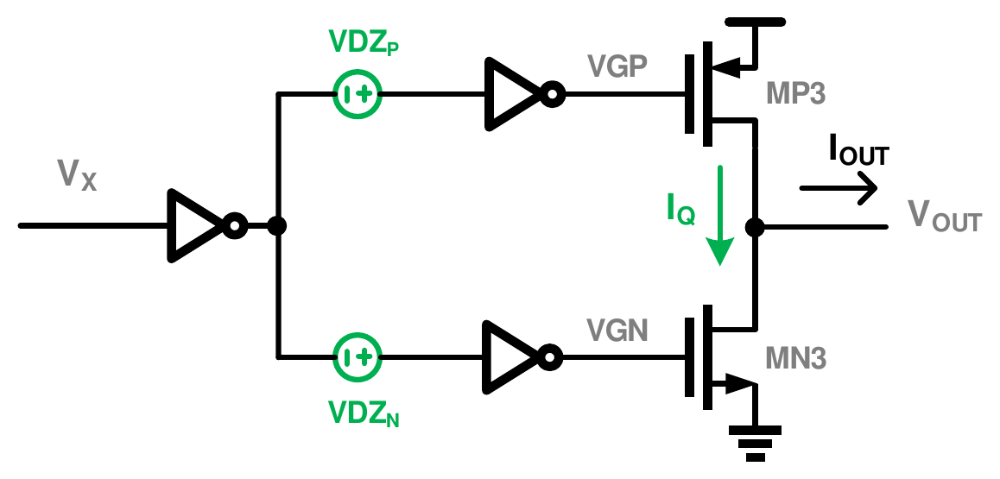
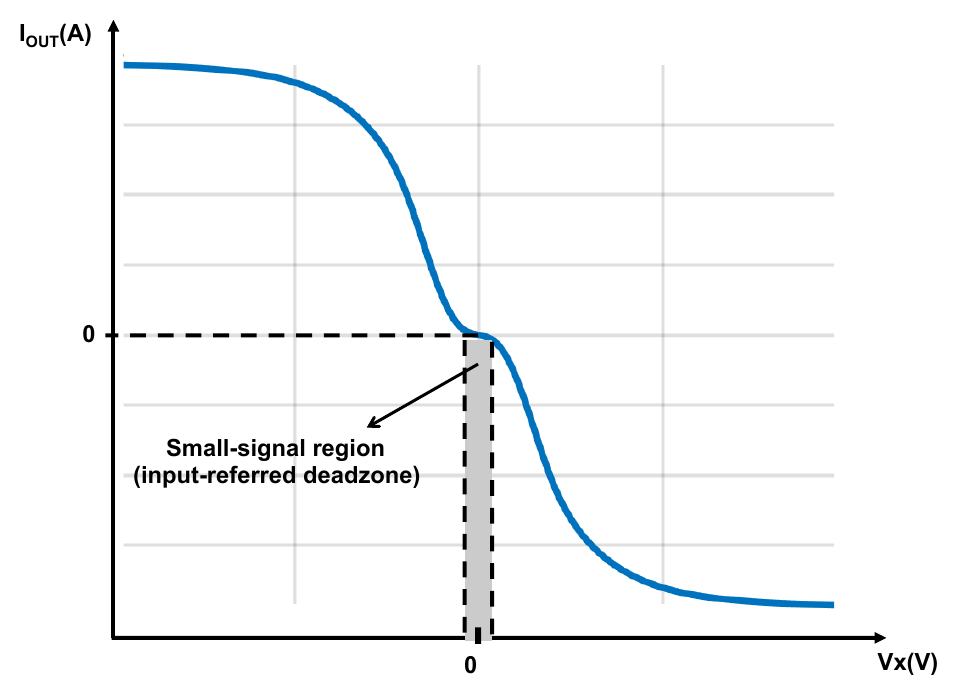
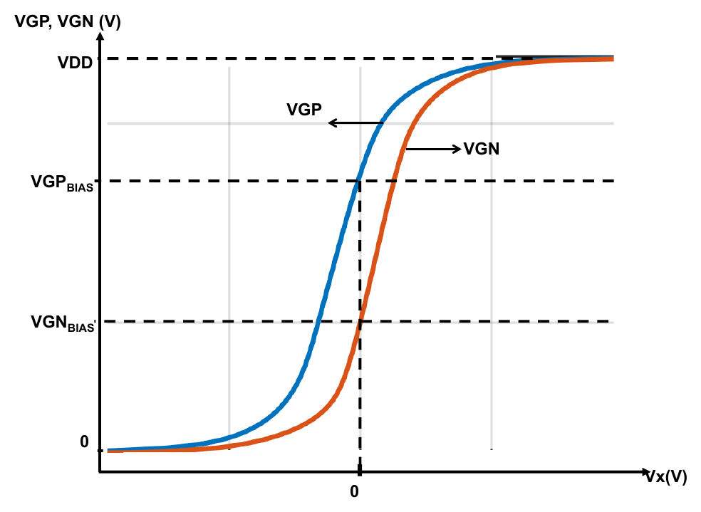
</p>
<p align="center" style="text-align:center"><b>Fig. 2.</b> (a) Single-ended ringamp with deadzone control voltages <i>V<sub>DZP</sub></i>,
<i>V<sub>DZN</sub></i>; (b) I–V characteristic of the whole amplifier, with the input-referred deadzone around
<i>V<sub>X</sub></i> = 0; (c) transfer characteristic of the first two stages to <i>V<sub>GP</sub></i>, <i>V<sub>GN</sub></i>.
Reproduced from [2, Figs. 2.9–2.11].</p>

### B. Three settling phases

A large step drives $V_{GP}$ or $V_{GN}$ close to a rail, so the output device behaves like a resistor $R_{ON}$ and the
load is charged with a decaying, RC-like current (time constant $\tau_L = R_{ON} C_{out}$). When the output approaches
its final value the feedback pulls the gate back and a large-signal phase governed by $G_m$ follows; the last part of
the settling is linear, at the small-signal time constant $\tau_S = 1/\mathrm{GBW}$ (Fig. 3) [2]. Fig. 4 is the same
sequence measured in the IHP design of this work; an empirical study of
ringamp settling in pipelined ADCs is given in [13].

<p align="center"></p>
<p align="center" style="text-align:center"><b>Fig. 3.</b> Ringamp step response: (a) virtual ground, (b) second-stage output
<i>V<sub>GP</sub></i>, (c) output current, (d) output voltage, divided into initial RC settling, large-signal settling and
small-signal linear settling. Reproduced from [2, Fig. 2.12] (the thesis caption labels the panels a, b, b, c).</p>

<p align="center"></p>
<p align="center" style="text-align:center"><b>Fig. 4.</b> The three phases in the layout-ready IHP design (TT, 27 °C, 200-mV step,
50 pF): a cursor walks through the simulated output, the stage-3 gate voltages and the load current
<i>C<sub>L</sub></i>·d<i>V<sub>out</sub></i>/d<i>t</i>. The phase boundaries are detected from the data (a gate within
0.25 V of a rail; |<i>I<sub>out</sub></i>| &gt; 20 <i>I<sub>Q</sub></i>).</p>

### C. Small-signal model and design equations

With the non-dominant poles neglected, the closed-loop response of the ringamp in an SC amplifier of gain
$G = C_S/C_F$ is that of a single-pole system [2, eqs. (2.23)–(2.28)]:

$$A_{CL}(s) = -G\,\frac{L(0)}{1+L(0)}\,\frac{1-s/z}{1+s/p},\qquad L(0)=\beta A_1A_2A_3,\qquad \beta=\frac{C_S}{C_S+C_{in1}+C_F},$$

$$\mathrm{GBW}=\beta\,\frac{A_1A_2\,g_{m3}}{C_{out}},\qquad C_{out}=C_L+(1-\beta)C_F,\qquad z=\frac{g_{m3}}{c_{gd3}}.$$

The output-stage transconductance $g_{m3}$ is set by $I_Q$, so the GBW follows the deadzone bias; the right-half-plane
zero $z$ lies close to the GBW because $g_{m3}$ is small, and it costs phase margin. To keep the noise at or below that
of a single-stage OTA, the first stage must satisfy $g_{m1} \ge A_1A_2\,g_{m3}$ [2, eq. (2.55)], and the dynamic error
after a time $t$ is $\varepsilon = e^{-t/\tau}$, i.e. 1.44 bits per time constant [2, eq. (2.18)]. Fig. 5 is the
three-stage small-signal model behind these expressions.

<p align="center"></p>
<p align="center" style="text-align:center"><b>Fig. 5.</b> Small-signal model of a ringamp during the charge-transfer phase of an SC
amplifier. Reproduced from [2, Fig. 2.18] (the thesis prints the caption of its Fig. 2.19 under this figure).</p>

### D. Ways of setting the deadzone

The original ringamp applies an external deadzone voltage at the input of the second stage (Fig. 6(a)) [1]; later
designs use an on-chip resistor at the second-stage output [4], [5] (Fig. 6(b)) or current-starved second-stage
inverters whose starving devices are driven by control voltages $V_{CTRLP}$, $V_{CTRLN}$ (Fig. 6(c)) [6]. In all three
the steady-state gate voltages of MP3/MN3, and therefore $I_Q$, are set relative to threshold voltages [2]. The design
in this repository uses the current-starved structure.

<p align="center">
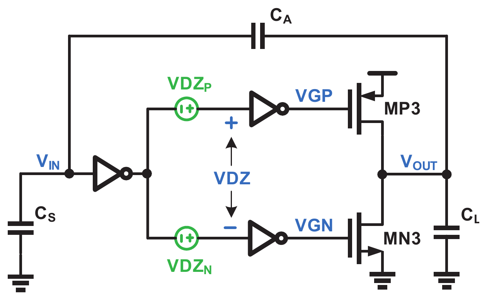
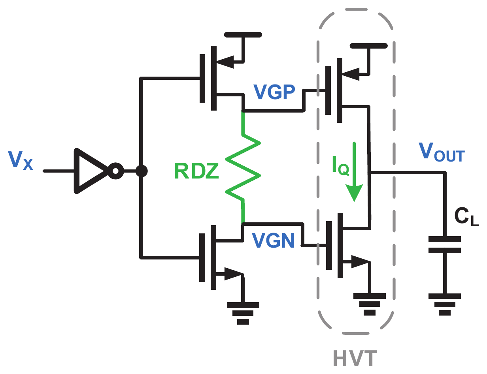
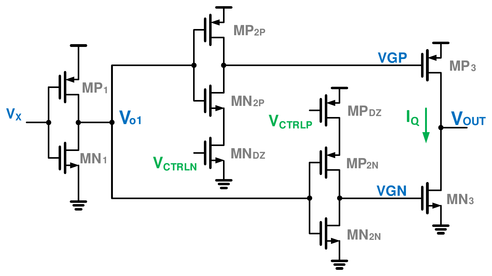
</p>
<p align="center" style="text-align:center"><b>Fig. 6.</b> Deadzone biasing structures: (a) external deadzone voltage <i>V<sub>DZ</sub></i>
[1]; (b) resistor <i>R<sub>DZ</sub></i> at the second-stage output [4]; (c) current-starved inverters controlled by
<i>V<sub>CTRLP</sub></i>, <i>V<sub>CTRLN</sub></i> [6]. Reproduced from [2, Figs. 3.1–3.3].</p>

---

## III. Prior Art and Motivation

**The PVT problem.** In the 65-nm, 1.2-V design example of [2], [3] — a current-starved ringamp in an SC amplifier with
gain 4, $C_S$ = 2 pF, $C_F$ = 0.5 pF, $C_L$ = 0.7 pF, 125 MS/s and a 0.05 % settling target — the deadzone voltages that
give $I_Q$ = 3.5 µA at TT ($V_{CTRLP}$ = 795 mV, $V_{CTRLN}$ = 390 mV) give the GBW and phase margins in the upper half of
Table I; at the slow corner the amplifier misses the settling target by more than an order of magnitude.

**Deadzone regulation.** The circuit of Fig. 7(a) [2], [3] generates reference gate voltages $V_{GP,REF}$ and
$V_{GN,REF}$ with diode-connected replicas of MP3/MN3 carrying a constant current $I_{BIAS}$, so the references track the
threshold voltages. A replica of the second stage, driven at the same input common-mode voltage as the real one, is
placed in a feedback loop with two error amplifiers that adjust $V_{CTRLP}$ and $V_{CTRLN}$ until the replica outputs
equal the references; the same control voltages bias the real second stage, so the real output stage carries
$I_Q = k\,I_{BIAS}$ for an output stage $k$ times wider than the replicas. Because the loop is a DC bias network outside
the signal path, an error-amplifier gain of about 30 dB is enough [2]. The lower half of Table I and Fig. 7(b), (c) show
the result in 65 nm.

<p align="center">
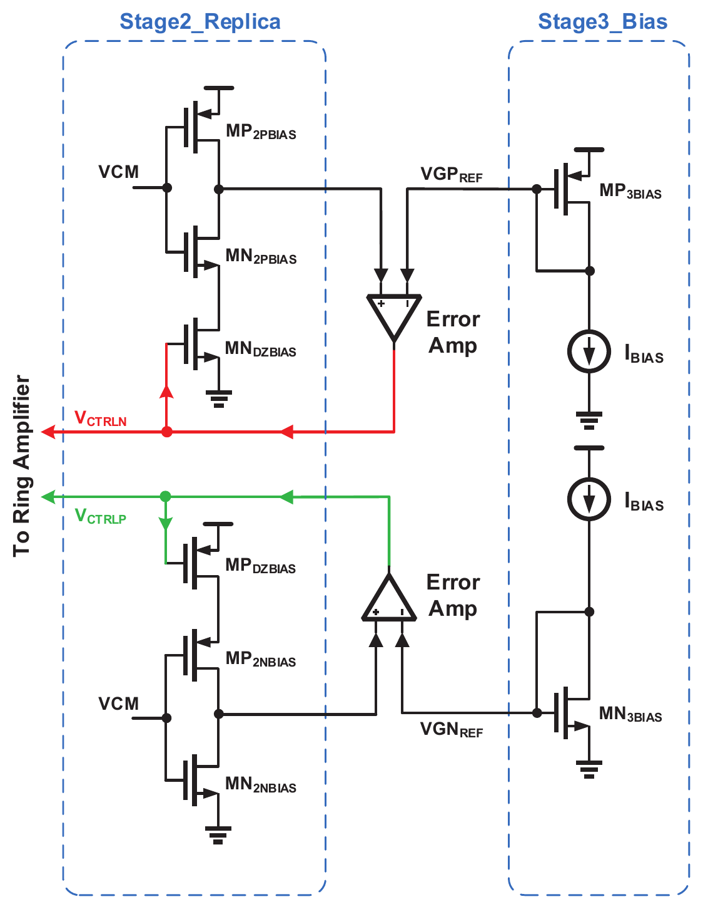
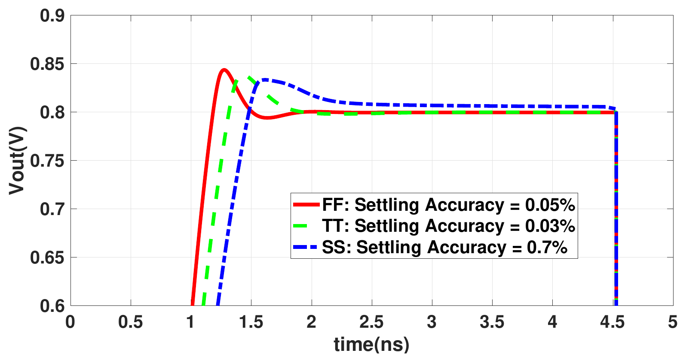
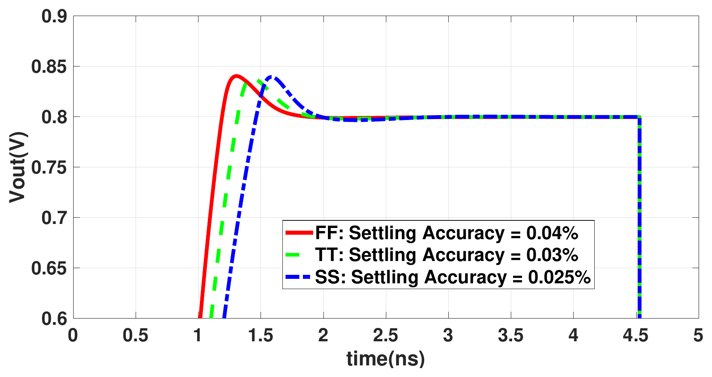
</p>
<p align="center" style="text-align:center"><b>Fig. 7.</b> (a) Deadzone regulation circuit for the current-starved ringamp;
transient response of the 65-nm design with (b) the deadzone fixed at its TT value and (c) the regulation circuit
(800-mV output step; settling accuracy at FF/TT/SS 0.05/0.03/0.7 % and 0.04/0.03/0.025 %). Reproduced from
[2, Figs. 3.6, 3.5, 3.7].</p>

<p align="center">TABLE I<br>GBW AND PHASE MARGIN OF THE 65-nm DESIGN EXAMPLE OF [2], [3]</p>

| Deadzone bias | | SS | TT | FF |
|:--|:--|--:|--:|--:|
| fixed at the TT values [2, Table 3.1] | GBW (MHz) | 9 | 415 | 1500 |
| | PM (deg) | 85 | 68 | 53 |
| deadzone regulation [2, Table 3.2] | GBW (MHz) | 475 | 415 | 380 |
| | PM (deg) | 61 | 68 | 72 |

**Other approaches and their limits.** Lim and Flynn bias the deadzone with an on-chip resistor (self-biased ringamps)
[4], [5]; Leuenberger *et al.* use current-starved inverters with a dynamic deadzone [6]; ElShater *et al.* combine low-
and high-threshold devices in a dual-deadzone output stage for smooth large-signal behaviour [7]; Lagos *et al.*
degenerate the deadzone [8]; Megawer *et al.* give a gm/Id design procedure for class-AB ringamps [11]; Cao *et al.*
propose a dead-zone that is insensitive to process and supply voltage and verify it in simulation [12]. The quiescent
point of the resistor and current-starved structures is a function of the output-stage threshold voltages [2]; [12] does
not describe its mechanism in the abstract; [2], [3] report the regulation technique in simulation at three process
corners only, without temperature or supply variation, and without a layout. The questions this work answers are
therefore: does the technique carry over to a different (open) process, how does it behave over temperature and supply,
what does a buildable implementation look like, and what does it cost in area and power?

---

## IV. Circuit Implementation in IHP SG13G2

### A. Original design

The design (`Design Files/RAMP`) uses the 1.2-V low-voltage (lv, $L_{min}$ = 0.13 µm) and 3.3-V high-voltage (hv,
thick-oxide, $L_{min}$ = 0.45/0.40 µm) MOS devices of SG13G2 [17] at $V_{DD}$ = 1.65 V. The top level (Fig. 8) is the
single-ended current-starved ringamp of Fig. 6(c): a resistively loaded first stage with local CMFB (Fig. 9(a)), whose
common-mode reference $V_{1,CM}$ is the switching point of a replica of the second-stage inverters (`STG1-CM`, Fig. 9(b));
the current-starved second stage (Fig. 9(c)); the hv output stage MP3/MN3 (4 × 4.5/0.5 µm and 4 × 2.3/1 µm); and the
regulation loop (`STG2_Replica`, Fig. 10), whose reference diodes MP_R/MN_R are single units of the output devices fed by
1 µA, so that $I_Q \approx$ 4 µA. Note that the pin named `plus` is the *inverting* input of the amplifier (the output is
fed back to it).

<p align="center"></p>
<p align="center" style="text-align:center"><b>Fig. 8.</b> Top level of the original single-ended ring amplifier
(<code>Fully-Diff-RAMP/RAMP.sch</code>): stage-1 CM reference, stage 1, stage-2 replica (regulation loop), stage 2 and the
output stage MP3 (M2) / MN3 (M1).</p>

<p align="center">
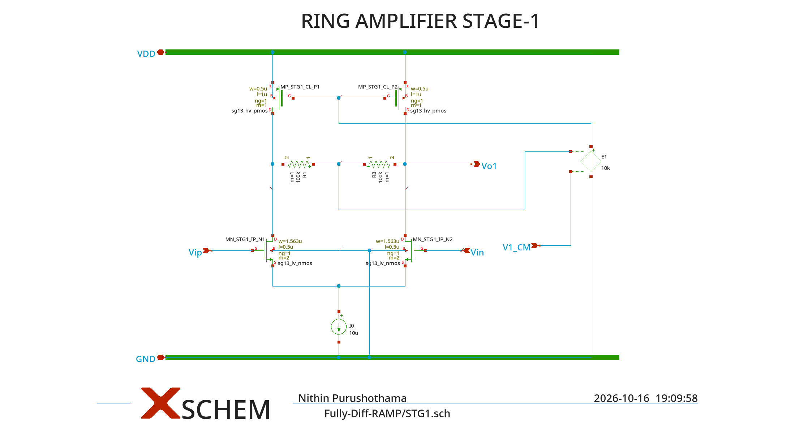
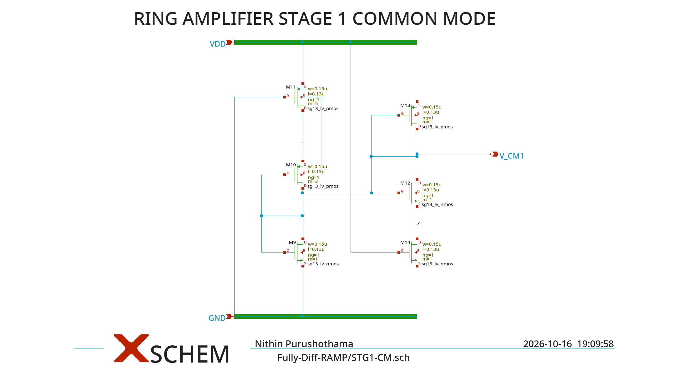
</p>
<p align="center">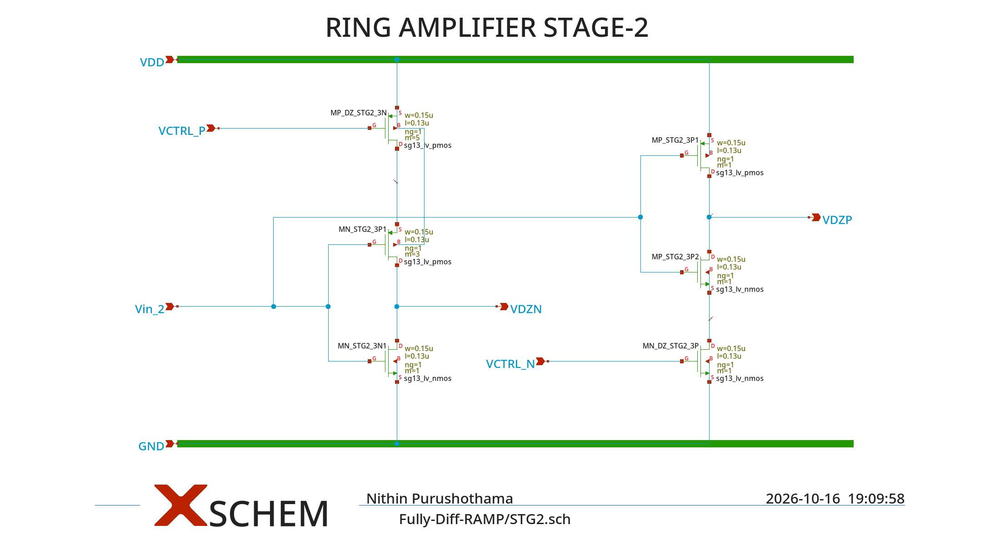</p>
<p align="center" style="text-align:center"><b>Fig. 9.</b> (a) Stage 1: lv NMOS pair (2 × 1.563/0.5 µm per side), hv PMOS loads,
100-kΩ common-mode sensing resistors, an ideal 10-µA tail and an ideal CMFB amplifier E1 (gain 10⁴); (b) trip-point
replica that generates <i>V<sub>1,CM</sub></i>; (c) stage 2: two current-starved inverters of minimum-size lv devices,
starved by MP_DZ (×5, <i>V<sub>CTRL_P</sub></i>) and MN_DZ (<i>V<sub>CTRL_N</sub></i>).</p>

<p align="center">
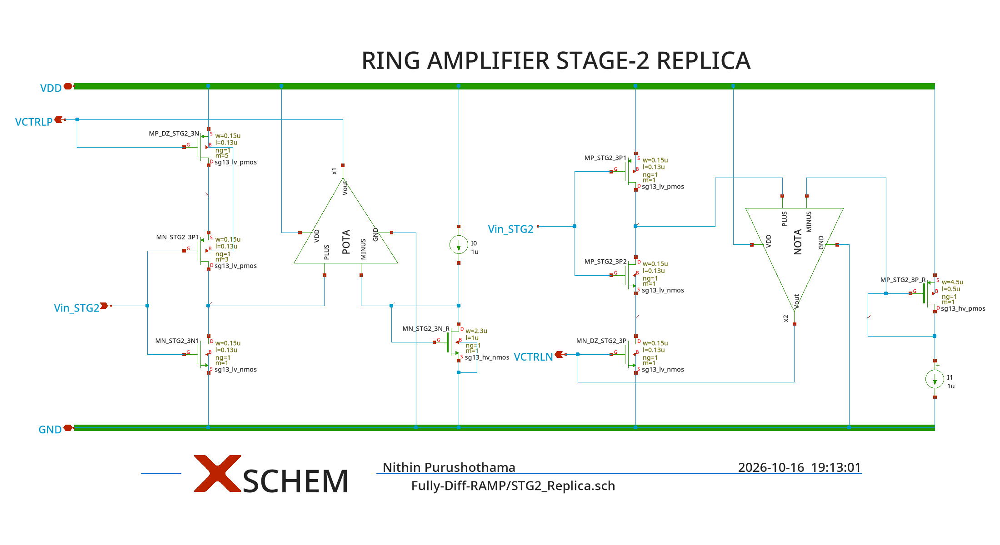
</p>
<p align="center">
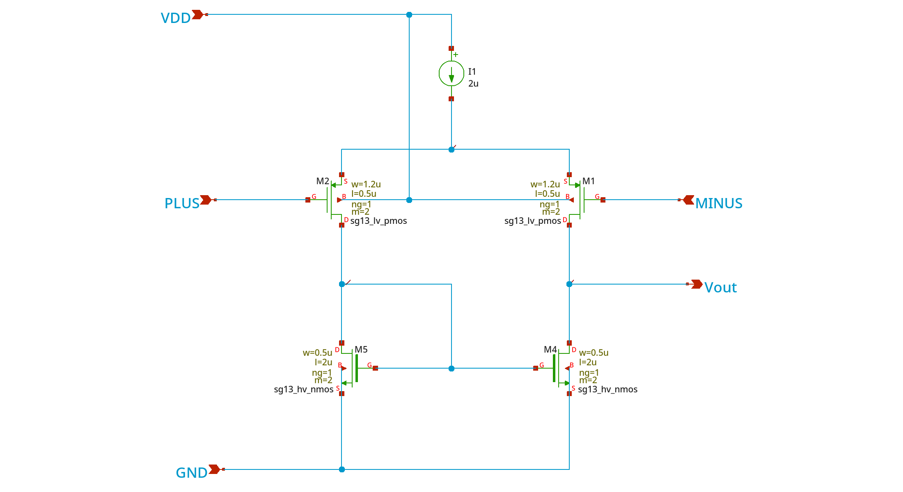
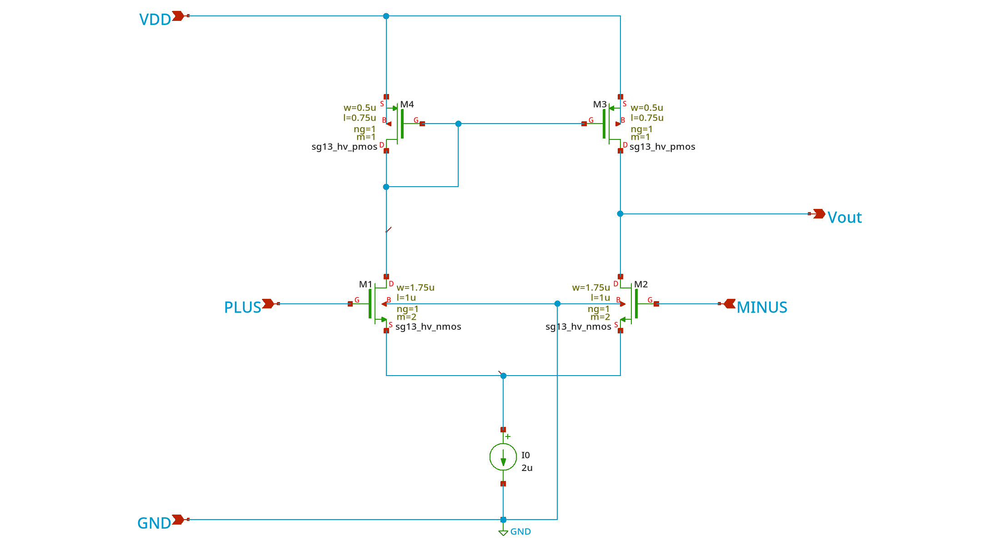
</p>
<p align="center" style="text-align:center"><b>Fig. 10.</b> Deadzone regulation loop (<code>STG2_Replica.sch</code>): stage-2 replica
driven at <i>V<sub>1,CM</sub></i>, reference diodes MN_STG2_3N_R and MP_STG2_3P_R with ideal 1-µA sources, and the error
amplifiers POTA (for <i>V<sub>CTRLP</sub></i>) and NOTA (for <i>V<sub>CTRLN</sub></i>), shown below with their ideal 2-µA tails.</p>

### B. Test bench and loop-gain measurement

The test bench (Fig. 11) is a unity-gain buffer with a 50-pF load at an input common mode of 0.825 V, the configuration
in which the design was sized for a 20-MHz bandwidth and a settling time below 250 ns. The loop gain is measured by
breaking the feedback with a series voltage source and a shunt current source and running two AC analyses
(Middlebrook's double injection [15], [16]); with the injected-voltage response $v_1$ at the break point and the
current-injection response $i_2$ through the break, $T = 1/(v_1 + i_2) - 1$, which is exact for a unilateral loop and
independent of where the break sits. The same probe is used for every loop in this report.

<p align="center"></p>
<p align="center" style="text-align:center"><b>Fig. 11.</b> Loop-gain test bench <code>RAMP-Test/RamP_tb1_CP_FB.sch</code>:
<i>V<sub>probe1</sub></i> (voltage injection), <i>I<sub>probe1</sub></i> (current injection) and <i>V<sub>probe2</sub></i>
(current sense) break the feedback from the output to the inverting input.</p>

### C. Stability of the internal loops

The main loop of the original design is well behaved: 76.7 dB loop gain, 17.5-MHz unity-gain frequency (UGF) and 66.0°
phase margin at TT (Table V). But the circuit contains three more loops that the main-loop measurement does not break:
the two deadzone regulation loops (error amplifier → starving-device gate in the replica → replica output → error
amplifier) and the stage-1 CMFB loop. Their loop gains, measured with the same probe, are listed in Table II.

<p align="center">TABLE II<br>LOOP GAIN OF THE INTERNAL LOOPS AT 27 °C (<code>sim/internal_loops.py</code>)</p>

| Design | Loop | Corner | DC gain (dB) | UGF (MHz) | PM (deg) |
|:--|:--|:--:|--:|--:|--:|
| original | regulation, $V_{CTRLN}$ | TT / FF | 54.3 / 52.2 | 531 / 596 | **−27.1 / −24.7** |
| original | regulation, $V_{CTRLP}$ | TT / FF | 43.8 / 38.7 | 376 / 398 | **10.6 / 19.9** |
| original | stage-1 CMFB, ideal E1 | TT / FF | 115.3 / 115.8 | > 100 GHz (66.7 dB left at 100 GHz) | – |
| original | all | SS | no operating point found | | |
| layout-ready | regulation, $V_{CTRLN}$ | TT / SS / FF | 53.5 / 54.9 / 51.3 | 7.9 / 7.1 / 7.9 | 83.2 / 81.5 / 84.9 |
| layout-ready | regulation, $V_{CTRLP}$ | TT / SS / FF | 43.4 / 45.8 / 38.7 | 3.8 / 3.6 / 3.8 | 88.2 / 88.0 / 88.7 |
| layout-ready | stage-1 CMFB, transistor | TT / SS / FF | 35.1 / 33.1 / 36.5 | 106 / 84 / 133 | 68.4 / 74.2 / 62.6 |

The error-amplifier outputs of the original regulation loop see only the gate capacitance of the minimum-size starving
devices (a few fF), so there is no dominant pole and the $V_{CTRLN}$ loop has a negative phase margin. In a transient
simulation at constant input, $V_{CTRLN}$ oscillates with 580 mV peak-to-peak at 275 MHz; the main loop suppresses most
of it, which is why the AC analysis of the main loop looked healthy. The ideal CMFB amplifier E1 has no bandwidth limit,
and its feed-forward through the gate–drain capacitance of the PMOS loads leaves the CMFB loop with 66.7 dB of gain at
100 GHz: in transient, E1's output runs away to kilovolts within 10–20 ns and ngspice aborts. At the SS corner ngspice finds no
operating point for the original design at all. The ringamp itself is not at fault — these are bias loops — but the
deadzone regulation cannot be demonstrated in the time domain with the original schematic.

### D. Layout-ready redesign (RAMP_LR)

The redesign keeps the topology and the device sizes of the signal path and changes what cannot be built or does not
work (Table III). It is described once, in `layout/ramp_lr_design.py`, from which both the xschem cells
(`Design Files/RAMP/RAMP-LR`) and the layout are generated, so the LVS netlist and the simulated netlist are the same
file. Fig. 12 shows the resulting architecture.

<p align="center"></p>
<p align="center" style="text-align:center"><b>Fig. 12.</b> Architecture of the layout-ready ring amplifier RAMP_LR. Signal path
(top): stage 1 with transistor CMFB referenced to <i>V<sub>1,CM</sub></i>, current-starved stage 2, output stage MP3/MN3.
Deadzone regulation loop (bottom right): stage-2 replica, error amplifiers NOTA/POTA, reference diodes MP_R/MN_R and
2-pF MIM decoupling of <i>V<sub>CTRLN</sub></i>/<i>V<sub>CTRLP</sub></i>. Bias (bottom left): one external
<i>I<sub>BIAS</sub></i> = 1 µA mirrored to all branches.</p>

<p align="center">TABLE III<br>CHANGES FROM THE ORIGINAL SCHEMATIC TO RAMP_LR</p>

| Original | RAMP_LR | Reason / effect |
|:--|:--|:--|
| ideal current sources (10 µA, 2 × 2 µA, 2 × 1 µA) | one external $I_{BIAS}$ = 1 µA, NMOS/PMOS mirrors of 0.5/8-µm units | buildable; with 2-µm-long units the 1-µA branches were 24–28 % off (DIBL in weak inversion), with 8 µm ≤ 4 % ($I_Q$ = 4.22 µA vs 4.10 µA) |
| ideal CMFB amplifier E1 (gain 10⁴, no pole) | NMOS pair MC1/MC2 with diode loads MPC1/MPC2 mirrored 1:1 into the loads; loads m = 2 instead of 1 | stable (Table II); the loads needed more width for headroom |
| ideal 100-kΩ resistors | rhigh poly, 0.5 × 33.7 µm (4 series segments in layout) | buildable |
| — | 2-pF MIM capacitors on $V_{CTRLP}$ (to $V_{DD}$) and $V_{CTRLN}$ (to GND) | dominant pole of the regulation loops: PM −27°/11° → 83°/88° |
| — | MOS gate capacitors MCN/MCP on $V_{CTRLN}$/$V_{CTRLP}$ | antenna rule: MIM plate area / gate area of the 0.15 × 0.13-µm gates was ≈ 35 000 (limit 20 000) |
| body of MP_STG2_3P2 (×2) and M12 tied to their sources | body to GND | a standard SG13G2 NMOS sits in the common p-substrate |
| input pair W = 1.563 µm | 1.56 µm | 5-nm manufacturing grid |
| — | 29 dummy transistors in `DUMMY_LR` | matching; excluded from LVS with `lvs_ignore` because the IHP deck purges shorted devices on the layout side |

The single-stage transistor CMFB is the one compromise of the redesign. With the main loop closed, the stage-1 output
$V_{o1}$ is held by the feedback, so the other drain sees the 200-kΩ sensing path to a fixed node and the common-mode
"plant" has only about 35 dB of gain; the ideal E1 contributed the missing 80 dB. Cascoding the loads does not help (the
limit is the sensing path, not the load resistance), and a two-stage CMFB amplifier needs about 20 pF of compensation to
be stable; both were tried and are not used. The consequences are quantified in Section V-F.

---

## V. Simulation Results

All results below are for RAMP_LR unless stated otherwise, at $V_{DD}$ = 1.65 V, $C_L$ = 50 pF, $I_{BIAS}$ = 1 µA. The
*fixed-bias* reference is the same netlist with the regulation loop removed and $V_{CTRLP}$/$V_{CTRLN}$ held at the values
the loop produces at TT, 27 °C (0.831 V / 0.822 V) — the experiment of [2, Table 3.1]. The MOS corners are those of the
IHP models (TT, SS, FF, SF, FS); resistors and capacitors use their typical/worst/best sections with the matching MOS
corner. Data: `sim/results/pvt_summary.csv` (109 rows).

### A. Loop gain

Fig. 13 compares the main loop of the original and the layout-ready design at TT. The redesign is within 1 dB in gain,
1.3 MHz in UGF and 4.4° in phase margin of the original; the gain margin is 24.5 dB.

<p align="center"></p>
<p align="center" style="text-align:center"><b>Fig. 13.</b> Loop gain of the unity-gain buffer at TT, 27 °C: (a) magnitude,
(b) phase. Grey dashed: original design with ideal bias sources; blue: RAMP_LR. Circles mark the unity-gain
frequency.</p>

### B. Quiescent current over process and temperature

Fig. 14 is the central result. With the deadzone frozen at its TT value, $I_Q$ spans 0.03 µA (SS, −40 °C) to 29 µA
(FF, 125 °C) at nominal supply — three orders of magnitude, because the output stage sits in weak inversion where the
current depends exponentially on the threshold voltage. With the regulation loop the spread is 4.06–5.04 µA over the
same 15 corner/temperature points; the loop achieves it by moving $V_{CTRLP}$ between 0.78 and 0.92 V and $V_{CTRLN}$
between 0.74 and 0.88 V (Fig. 14(c)). Including the supply corners, the ranges are 0.003–32.7 µA (fixed) and 3.99–5.82 µA (regulated).

<p align="center"></p>
<p align="center" style="text-align:center"><b>Fig. 14.</b> Output-stage quiescent current versus temperature for the five process
corners: (a) fixed deadzone bias, (b) deadzone regulation (same logarithmic axis); (c) control voltages produced by the
regulation loop (open markers <i>V<sub>CTRLP</sub></i>, filled <i>V<sub>CTRLN</sub></i>).</p>

<p align="center">TABLE IV<br>QUIESCENT CURRENT, UGF AND PHASE MARGIN AT 27 °C, V<sub>DD</sub> = 1.65 V</p>

| Corner | $I_Q$ fixed (µA) | UGF fixed (MHz) | PM fixed (°) | $I_Q$ regulated (µA) | UGF regulated (MHz) | PM regulated (°) |
|:--:|--:|--:|--:|--:|--:|--:|
| TT | 4.22 | 18.8 | 61.6 | 4.22 | 18.8 | 61.6 |
| SS | 0.67 | 6.5 | 76.8 | 4.09 | 21.7 | 48.1 |
| FF | 15.84 | 30.7 | 54.9 | 4.40 | 13.7 | 74.6 |
| SF | 1.37 | 8.7 | 76.8 | 4.23 | 19.3 | 60.6 |
| FS | 5.17 | 20.7 | 59.1 | 4.21 | 18.3 | 61.7 |

As in [2], the regulated UGF is not perfectly constant: the slow corner is now the fastest, because $A_1A_2$ is larger
there (Section II-C), and its phase margin is the lowest — the trade-off described in [2, Sec. 3.5].

### C. Unity-gain frequency and phase margin over PVT

<p align="center"></p>
<p align="center" style="text-align:center"><b>Fig. 15.</b> (a) Unity-gain frequency and (b) phase margin over process corner and
temperature; markers at 1.65 V, bars over 1.5675–1.7325 V. Orange: fixed bias; blue: deadzone regulation; grey
triangles: regulation with an ideal PTAT reference current (Section V-E). The fixed-bias SS and SF bars at −40 °C
continue below 0.1 MHz at the low supply.</p>

Over all 45 PVT points the UGF spans 0.04–35.9 MHz with fixed bias (860×) and 5.4–32.4 MHz with regulation (6×). The
remaining spread is mostly temperature: at constant $I_Q$, $g_{m3} = I_Q/(n U_T)$ falls with absolute temperature in weak
inversion, and the stage gains $A_1A_2$ (the DC loop gain falls from 80.5 to 71.0 dB at TT) fall as well, so the UGF
drops from 28.8 MHz at −40 °C to 8.2 MHz at 125 °C (TT). The phase margin moves the other way, from 50° to 78°; the
lowest value, 35° at SS, −40 °C and low supply, is where the gain is highest.

### D. Step response and settling

**Three phases.** Fig. 16 shows the rising edge of a 200-mV step in the buffer at TT. During the first 20 ns both
second-stage outputs are pulled to ground, MP3 is fully on and the load is charged with about 0.55 mA — 130 times
$I_Q$; the gates then return, the current reverses briefly (6 % overshoot) and the output settles linearly.

<p align="center"></p>
<p align="center" style="text-align:center"><b>Fig. 16.</b> Rising 200-mV step of the unity-gain buffer, TT, 27 °C: (a) input and
output, (b) stage-3 gate voltages, (c) load current <i>C<sub>L</sub></i>·d<i>V<sub>out</sub></i>/d<i>t</i>; shading marks the
RC, large-signal (LS) and small-signal phases.</p>

**Switched-capacitor test.** In the application of [2] the amplifier inputs sit at a virtual ground. The SC test
(`sc_deck` in `sim/ramp_pvt.py`) therefore uses an inverting charge-transfer amplifier with $C_S = C_F$ = 5 pF,
$C_L$ = 50 pF and a 1-GΩ DC feedback resistor; it applies two 4-mV steps (small signal, inside the deadzone) and then two
200-mV steps (large signal). Errors are measured against the *ideal* charge transfer $-\frac{C_S}{C_F}\Delta V_{in}$,
so a response that stops inside the deadzone, or a finite loop gain, counts as error.

<p align="center"></p>
<p align="center" style="text-align:center"><b>Fig. 17.</b> Normalised SC step responses: (a) 200-mV and (b) 4-mV input step, for the
fixed-bias and the regulated amplifier at SS, −40 °C, and the regulated amplifier at TT, 27 °C.</p>

Fig. 17 reproduces, in IHP, the failure mode of Fig. 7(b): with fixed bias at SS, −40 °C ($I_Q$ = 0.03 µA) the 4-mV
step is still 28 % short of its final value after 250 ns and has not settled after 2 µs, while the regulated amplifier
settles in 80 ns. The 200-mV step hides the problem — it drives the amplifier out of the deadzone, where the speed is set
by the RC phase and not by $I_Q$ — which is why a large-signal test alone is not a sufficient check of the deadzone bias.

<p align="center"></p>
<p align="center" style="text-align:center"><b>Fig. 18.</b> Error 250 ns after (a) a 200-mV and (b) a 4-mV step in the SC test, over
process corner and temperature at 1.65 V.</p>

<p align="center">TABLE V<br>SUMMARY OVER ALL 45 PVT POINTS (5 CORNERS × −40/27/125 °C × V<sub>DD</sub> = 1.5675/1.65/1.7325 V)</p>

| Quantity | Fixed bias | Deadzone regulation | Regulation + PTAT $I_{BIAS}$ (1.65 V only) |
|:--|:--:|:--:|:--:|
| $I_Q$ (µA) | 0.003 – 32.7 | 3.99 – 5.82 | 3.20 – 6.08 |
| Unity-gain frequency (MHz) | 0.04 – 35.9 | 5.4 – 32.4 | 6.1 – 26.1 |
| Phase margin (deg) | 50.5 – 89.5 | 34.9 – 85.2 | 43.7 – 83.8 |
| DC loop gain (dB) | 66.0 – 85.4 | 65.3 – 83.2 | 66.2 – 82.4 |
| SC error at 250 ns, 4-mV step (%) | 0.02 – **82** | 0.02 – **1.6** | 0.02 – 1.2 |
| SC error at 250 ns, 200-mV step (%) | 0.008 – 2.0 | 0.02 – 0.47 | 0.02 – 0.51 |
| points with small-step error > 0.1 % | 16 of 45 | 12 of 45 (all at 125 °C) | 3 of 15 (all at 125 °C) |
| Supply current (µA) | 56 – 201 | 84 – 252 | 97 – 222 |

At TT, 27 °C the SC amplifier settles to 0.1 % of a 200-mV step in 40 ns and of a 4-mV step in 70 ns; the error after
250 ns is 0.033 %. With regulation, every corner at −40 °C and 27 °C stays below 0.1 % after 250 ns; the points above it
are all at 125 °C, where the UGF has dropped to 5–12 MHz, with the worst case FF, 125 °C (1.6 %), whose DC loop gain of
66 dB also leaves a 0.1-% static error at the feedback factor of 0.5.

### E. Temperature: constant current is not constant transconductance

Regulating $I_Q$ to a constant current fixes the process dependence but not the temperature dependence of $g_{m3}$; [2]
notes that a constant-gm reference would be the natural $I_{BIAS}$. As a first test, $I_{BIAS}$ was made ideally
proportional to absolute temperature (1 µA at 27 °C, `ptat` rows of the results). This narrows the temperature spread of
the UGF at TT from 3.5× to 2.2× and the total spread from 6× to 4.3× (grey triangles in Fig. 15), but the hot corners
remain the slowest because $A_1A_2$ also falls with temperature, and the small-step error at 125 °C is not
reduced (up to 1.2 %, Table V). A complete solution must compensate the first two stages as well.

### F. Supply rejection, common-mode error and headroom

Table VI lists the figures that the layout-ready redesign made worse; all three follow from the 35-dB transistor CMFB
(Section IV-D) and the 1.2-V source-gate drop of the hv PMOS loads of stage 1.

<p align="center">TABLE VI<br>FIGURES DEGRADED BY THE TRANSISTOR-LEVEL CMFB (TT, 27 °C, 1.65 V UNLESS NOTED; <code>sim/cmfb_experiment.py</code>)</p>

| Quantity | Original (ideal E1) | RAMP_LR | Same, ideal CMFB in RAMP_LR |
|:--|:--:|:--:|:--:|
| DC PSRR of the buffer (dB) | 93.0 | 32.9 | 89.6 |
| buffer gain error over a ±100-mV input step | 0.016 % | 1.46 % | 0.014 % |
| output offset of the buffer | −0.02 mV | −1.13 mV | 0.00 mV |
| output offset at 125 °C, 1.5675 V, worst corner | – | 44 mV (FS) | – |

In the buffer the input common mode moves with the signal; the CMFB lets the second stage-1 drain drift by 19 mV over the
±100-mV range while the main loop holds $V_{o1}$, and this drift, divided by the low first-stage gain (≈ 7.6, set by the
100-kΩ loads), appears as input-referred error. A supply change shifts the common mode in the same way. In the SC test
the inputs stay at the virtual ground and the effect disappears from the settling results above, but the supply
rejection applies to every configuration. At 125 °C and low supply the CMFB also runs out of headroom and the buffer
gains only 0.67–0.92 across the corners. Fig. 19 shows the PSRR versus frequency.

<p align="center"></p>
<p align="center" style="text-align:center"><b>Fig. 19.</b> Power-supply rejection of the closed-loop buffer (RAMP_LR, regulated,
27 °C) for the five corners.</p>

### G. Power

The amplifier draws 156 µA (257 µW) at TT, 27 °C (Fig. 20). The output stage itself takes only 4.2 µA; most of the
current flows through the minimum-size inverters biased at their switching point — stage 2 (38 µA), its replica in the
regulation loop (≈ 38 µA of the 41 µA of that block) and the trip-point replica that generates $V_{1,CM}$ (47 µA). The
regulation loop as a whole costs 27 % of the supply current. Scaling the replica inverters down (longer channels) is the
largest available power saving; the signal-path inverters of stage 2 set the second-stage gain and pole and need to be
traded against them.

<p align="center"></p>
<p align="center" style="text-align:center"><b>Fig. 20.</b> Supply current by block at TT, 27 °C, 1.65 V, amplifier at rest; the
deadzone regulation loop is highlighted.</p>

---

## VI. Layout

### A. Floor plan and routing

The layout (`layout/RAMP_LR.gds`, Fig. 21) is generated by `layout/gen_layout.py` in KLayout from the IHP PCells
[17], [20]. Every transistor is placed as unit devices with one finger (a device with multiplier *m* becomes *m* units)
in rows of identical W/L and orientation. The rows form two columns with a Metal3 routing spine between them; each
horizontal band holds one left and one right row, which share a gate channel below and a source/drain channel above.
Gates are contacted below each unit and sources/drains above it on Metal1 stubs; each channel holds one horizontal
Metal2 track per net, and nets that appear in more than one channel get a vertical Metal3 column in the spine (27
columns). The two 2-pF MIM capacitors sit on Metal5/TopMetal1 above the spine, where they take no extra area. The block
measures 109 µm × 183 µm (0.020 mm²).

<p align="center"></p>
<p align="center" style="text-align:center"><b>Fig. 21.</b> Layout of RAMP_LR in IHP SG13G2 (all layers). Left column: the 6 × 5 NMOS
bias array, the 2 × 3 PMOS bias array and the minimum-size stage-2/replica rows; right column: output stage, error
amplifiers, stage-1 pairs, loads and the rhigh sensing resistors; centre: Metal3 spine under the two MIM capacitors.</p>

### B. Matching

Fig. 22 shows the matched groups. The techniques used are:

- **Common centroid for differential pairs.** The stage-1 pair, the CMFB pair and both error-amplifier input pairs and
  load mirrors are placed ABBA, so linear gradients in threshold voltage, oxide thickness or stress cancel to first
  order (Fig. 22(b), (c)).
- **Common-centroid current mirrors.** The 25 units of the NMOS bias mirror form a 6 × 5 array in which every
  multi-unit device occupies point-symmetric positions about the array centre, where the reference sits (Fig. 22(a)); the
  PMOS mirror is a 2 × 3 array with the diode in the centre.
- **Replica next to the device it copies.** The reference diodes MN_R and MP_R, which set $I_Q$ through a 1:4 ratio, are
  units of the same rows as MN3 and MP3, in the middle of them (Fig. 22(d), (e)); the stage-2 replica and the trip-point
  replica devices are interleaved with the stage-2 devices of the same role.
- **Dummies and identical surroundings.** Every row ends with dummy devices (29 in total, gates and diffusions tied to
  the rail), all units of a row have the same orientation (source left, drain right, so drain currents flow the same
  way), and each row has a continuous substrate or well tie strip.
- **Resistors.** Each 100-kΩ rhigh resistor is split into four series segments placed ABBAABBA.

<p align="center"></p>
<p align="center" style="text-align:center"><b>Fig. 22.</b> Matched groups (upper metals hidden). (a) NMOS bias mirror, 6 × 5 common
centroid: R reference (MB0), T stage-1 tail (×10), C CMFB tail (×10), N NOTA tail (×2), Q and P the 1-µA branches for the
replica references, D dummy. (b) Stage-1 pair A/B and CMFB pair C/E, ABBA, with the antenna capacitor K. (c) Stage-1
loads A/B and CMFB diodes C/E. (d), (e) Output devices M around their replica R.</p>

The layout is not optimised for parasitics: the tracks of a differential pair have different lengths to their spine
columns, and no post-layout extraction has been simulated (Section VIII).

### C. Physical verification

<p align="center">TABLE VII<br>PHYSICAL VERIFICATION WITH THE IHP SG13G2 KLAYOUT DECKS (<code>layout/run_checks.sh</code>)</p>

| Check | Deck / option | Result | Report |
|:--|:--|:--|:--|
| DRC | main deck incl. extended rules, `--no_density` (862 rule categories) | **0 violations** | `layout/reports/drc_main.txt` |
| Antenna | `--antenna_only` | **0 violations** | `layout/reports/drc_antenna.txt` |
| Density | `--density_only` | global Activ/GatPoly/metal density not met (block not filled; fill is inserted at chip level) | `layout/reports/drc_density.txt` |
| LVS | `run_lvs.py` vs. flat xschem netlist | **match**: 53 device pairs, 33 nets, 0 mismatches | `layout/reports/lvs.txt` |

Three details were needed for a clean LVS: the MIM terminal order (bottom plate on the control voltage), grid-aligned
widths, and the dummies, which the IHP deck removes from the layout netlist (`purge_devices` on devices whose terminals
share one net) and which are therefore marked `lvs_ignore` in the schematic.

---

## VII. Comparison with Prior Art

<p align="center">TABLE VIII<br>DEADZONE BIASING SCHEMES</p>

| | [1] | [4] | [6] | [12] | [2], [3] | **This work** |
|:--|:--:|:--:|:--:|:--:|:--:|:--:|
| Deadzone set by | external voltage $V_{DZ}$ | on-chip resistor | current-starved inverters | P/V-insensitive dead-zone (mechanism not in abstract) | current-starved + replica feedback | current-starved + replica feedback |
| $I_Q$ independent of $V_{th}$ shifts |  |  |  |  claimed |  |  |
| Verified over temperature |  n/r |  n/r |  n/r |  n/r |  no |  −40…125 °C |
| Verified over supply |  n/r |  n/r |  n/r |  |  no |  ± 5 % |
| Evidence |  not checked |  silicon (ADC) |  silicon (ADC) |  simulation |  simulation |  simulation + DRC/LVS-clean layout |
| Design data and scripts public |  |  |  |  |  |  |

<p align="center">TABLE IX<br>FIGURES OF MERIT OF THE TWO DEADZONE-REGULATION STUDIES</p>

| | [2], [3] | **This work** |
|:--|:--:|:--:|
| Technology ($L_{min}$ of the core devices) | 65-nm CMOS | IHP SG13G2 130-nm BiCMOS (lv 0.13 µm, hv 0.40/0.45 µm) |
| Supply | 1.2 V | 1.65 V |
| Configuration, load | SC, gain 4, $C_L$ = 0.7 pF, 125 MS/s | buffer and SC (gain 1), $C_L$ = 50 pF, 20-MHz target |
| Bias generation | constant current source (not specified) | external 1 µA, transistor mirrors |
| PVT space | SS/TT/FF | 5 corners × −40/27/125 °C × ± 5 % $V_{DD}$ |
| GBW/UGF spread, fixed bias, process only | 9–1500 MHz (167×) | 6.5–30.7 MHz (4.7×) at 27 °C |
| GBW/UGF spread, regulated, process only | 380–475 MHz (1.25×) | 13.7–21.7 MHz (1.59×) at 27 °C |
| UGF spread, regulated, full PVT | n/r | 5.4–32.4 MHz (6×; fixed bias 860×) |
| $I_Q$ spread, regulated, full PVT | n/r | 3.99–5.82 µA (fixed bias 0.003–32.7 µA) |
| Phase margin, regulated | 61–72° | 48–75° at 27 °C, 35–85° full PVT |
| Settling, regulated | ≤ 0.05 % (800-mV step, 4 ns) | ≤ 0.1 % at 250 ns for −40/27 °C; ≤ 1.6 % at 125 °C (4-mV step, SC) |
| Power / area | n/r / no layout | 257 µW / 0.020 mm² |

*n/r: not reported in the abstract or the text consulted for this report; not checked: the paper itself was not consulted for this row.* The two studies are not an apples-to-apples
comparison: [2], [3] use a 65-nm process with about half the minimum channel length of the SG13G2 core devices and a
GBW twenty times higher, and their fixed-bias spread is larger mainly because their output stage is more sensitive to
the threshold voltage at its bias point. The comparable figure is the *ratio* between the fixed-bias and the regulated
spread, which is large in both, and which this work extends to temperature and supply.

---

## VIII. Conclusion, Limitations and Next Steps

The deadzone regulation of [2], [3] carries over to IHP SG13G2: over five process corners, −40 °C to 125 °C and ± 5 %
supply it holds the output-stage quiescent current of a current-starved ringamp within 3.99–5.82 µA where a fixed
deadzone allows 0.003–32.7 µA, cuts the unity-gain-frequency spread from 860× to 6× and removes the cold, slow-corner
settling failure (small-step error after 250 ns 28 % → 0.02 % at SS, −40 °C). The study also showed that the bias loops
of a ringamp need the same stability analysis as the signal loop: in the original schematic, the regulation loops had
−27° and 11° of phase margin and the ideal CMFB loop could not be simulated, while the main-loop AC analysis looked
healthy. A layout-ready version with stable internal loops has a matched, DRC-, antenna- and LVS-clean layout of
0.020 mm².

**Limitations.**

1. *Simulation only.* No silicon; no post-layout (parasitic-extracted) simulation; no Monte Carlo mismatch analysis.
2. *Transistor CMFB.* DC PSRR 33 dB instead of 93 dB, 1.5 % common-mode-dependent gain error in the buffer, and loss of
   headroom at 125 °C and low supply (Section V-F).
3. *Temperature.* Constant $I_Q$ is not constant $g_{m3}$; the regulated UGF still falls 3.5× from −40 °C to 125 °C at TT
   and the small-step settling exceeds 0.1 % at 125 °C (Section V-E).
4. *Supply and devices.* The low-voltage devices run at 1.65 V, above their 1.2-V nominal supply; reliability limits were
   not checked.
5. *Scope.* Only the single-ended design was characterised; the fully differential variant `Fully-Diff-RAMP/RAMP-FD.sch`
   is unfinished (its two output stages differ: MN3 is m = 1 on one side and m = 4 on the other).

**Next steps.** (i) A two-stage, properly compensated CMFB, or a fully differential first stage, to recover the supply
rejection; lower-threshold or wider loads for headroom. (ii) A constant-gm or PTAT reference combined with
temperature-compensated first stages. (iii) Smaller replica inverters to cut the 85 µA spent in the two replicas.
(iv) Parasitic extraction and post-layout simulation, Monte Carlo mismatch, and the passive compensation of
[2, Ch. 4], [14] for the large-signal ringing. (v) A switched-capacitor test bench with real switches and both clock phases.

---

## Acknowledgment

This work was done under the guidance of Praveen Kumar Venkatachala and implements Chapter 3 of his dissertation [2],
which also supplied the reproduced Figs. 1–3 and 5–7 (copyright the author; see `docs/figures/thesis/INDEX.md`). The
design uses the IHP SG13G2 open-source PDK [17] and the open-source tools xschem [18], ngspice [19] and KLayout [20].

---

## References

[1] B. Hershberg, S. Weaver, K. Sobue, S. Takeuchi, K. Hamashita, and U.-K. Moon, "Ring amplifiers for switched capacitor circuits," *IEEE J. Solid-State Circuits*, vol. 47, no. 12, pp. 2928–2942, Dec. 2012, doi: [10.1109/JSSC.2012.2217865](https://doi.org/10.1109/JSSC.2012.2217865).

[2] P. K. Venkatachala, "Design considerations and circuit techniques for robust ring-amplifiers," Ph.D. dissertation, School Elect. Eng. Comput. Sci., Oregon State Univ., Corvallis, OR, USA, 2019. [Online]. Available: https://ir.library.oregonstate.edu/concern/graduate_thesis_or_dissertations/kp78gp14p (copy in this repository: [`Thesis/VenkatachalaPraveenkumar2019.pdf`](Thesis/VenkatachalaPraveenkumar2019.pdf)).

[3] P. K. Venkatachala *et al.*, "Process invariant biasing of ring amplifiers using deadzone regulation circuit," in *Proc. IEEE Int. Symp. Circuits Syst. (ISCAS)*, Florence, Italy, May 2018, pp. 1–5, doi: [10.1109/ISCAS.2018.8351242](https://doi.org/10.1109/ISCAS.2018.8351242).

[4] Y. Lim and M. P. Flynn, "A 100 MS/s, 10.5 bit, 2.46 mW comparator-less pipeline ADC using self-biased ring amplifiers," *IEEE J. Solid-State Circuits*, vol. 50, no. 10, pp. 2331–2341, Oct. 2015, doi: [10.1109/JSSC.2015.2453332](https://doi.org/10.1109/JSSC.2015.2453332).

[5] Y. Lim and M. P. Flynn, "A 1 mW 71.5 dB SNDR 50 MS/s 13 bit fully differential ring amplifier based SAR-assisted pipeline ADC," *IEEE J. Solid-State Circuits*, vol. 50, no. 12, pp. 2901–2911, Dec. 2015, doi: [10.1109/JSSC.2015.2463094](https://doi.org/10.1109/JSSC.2015.2463094).

[6] S. Leuenberger, J. Muhlestein, H. Sun, P. Venkatachala, and U.-K. Moon, "A 74.33 dB SNDR 20 MSPS 2.74 mW pipelined ADC using a dynamic deadzone ring amplifier," in *Proc. IEEE Custom Integr. Circuits Conf. (CICC)*, Austin, TX, USA, Apr. 2017, pp. 1–4, doi: [10.1109/CICC.2017.7993697](https://doi.org/10.1109/CICC.2017.7993697).

[7] A. ElShater *et al.*, "A 10mW 16b 15MS/s two-step SAR ADC with 95dB DR using dual-deadzone ring-amplifier," in *IEEE Int. Solid-State Circuits Conf. (ISSCC) Dig. Tech. Papers*, San Francisco, CA, USA, Feb. 2019, pp. 70–72, doi: [10.1109/ISSCC.2019.8662400](https://doi.org/10.1109/ISSCC.2019.8662400).

[8] J. Lagos, B. P. Hershberg, E. Martens, P. Wambacq, and J. Craninckx, "A 1-GS/s, 12-b, single-channel pipelined ADC with dead-zone-degenerated ring amplifiers," *IEEE J. Solid-State Circuits*, vol. 54, no. 3, pp. 646–658, Mar. 2019, doi: [10.1109/JSSC.2018.2889680](https://doi.org/10.1109/JSSC.2018.2889680).

[9] B. Hershberg *et al.*, "A 6-to-600MS/s fully dynamic ringamp pipelined ADC with asynchronous event-driven clocking in 16nm," in *IEEE Int. Solid-State Circuits Conf. (ISSCC) Dig. Tech. Papers*, San Francisco, CA, USA, Feb. 2019, pp. 68–70, doi: [10.1109/ISSCC.2019.8662319](https://doi.org/10.1109/ISSCC.2019.8662319).

[10] B. Xiao *et al.*, "An 80mA capacitor-less LDO with 6.5µA quiescent current and no frequency compensation using adaptive-deadzone ring amplifier," in *Proc. IEEE Asian Solid-State Circuits Conf. (A-SSCC)*, Macau, Macao, Nov. 2019, pp. 39–42, doi: [10.1109/A-SSCC47793.2019.9056970](https://doi.org/10.1109/A-SSCC47793.2019.9056970).

[11] K. M. Megawer, F. A. Hussien, M. M. Aboudina, and A. N. Mohieldin, "A systematic design methodology for class-AB-style ring amplifiers," *IEEE Trans. Circuits Syst. II, Exp. Briefs*, vol. 65, no. 9, pp. 1169–1173, Sep. 2018, doi: [10.1109/TCSII.2018.2815705](https://doi.org/10.1109/TCSII.2018.2815705).

[12] Y. Cao, Y. Chen, T. Zhang, F. Ye, and J. Ren, "An improved ring amplifier with process- and supply voltage-insensitive dead-zone," in *Proc. IEEE 60th Int. Midwest Symp. Circuits Syst. (MWSCAS)*, Boston, MA, USA, Aug. 2017, pp. 811–814, doi: [10.1109/MWSCAS.2017.8053047](https://doi.org/10.1109/MWSCAS.2017.8053047).

[13] S. Leuenberger *et al.*, "An empirical study of the settling performance of ring amplifiers for pipelined ADCs," in *Proc. IEEE Int. Symp. Circuits Syst. (ISCAS)*, Florence, Italy, May 2018, pp. 1–5, doi: [10.1109/ISCAS.2018.8351073](https://doi.org/10.1109/ISCAS.2018.8351073).

[14] P. K. Venkatachala *et al.*, "Passive compensation for improved settling and large signal stabilization of ring amplifiers," in *Proc. IEEE Int. Symp. Circuits Syst. (ISCAS)*, Florence, Italy, May 2018, pp. 1–5, doi: [10.1109/ISCAS.2018.8351557](https://doi.org/10.1109/ISCAS.2018.8351557).

[15] R. D. Middlebrook, "Measurement of loop gain in feedback systems," *Int. J. Electron.*, vol. 38, no. 4, pp. 485–512, Apr. 1975, doi: [10.1080/00207217508920421](https://doi.org/10.1080/00207217508920421).

[16] M. Tian, V. Visvanathan, J. Hantgan, and K. Kundert, "Striving for small-signal stability," *IEEE Circuits Devices Mag.*, vol. 17, no. 1, pp. 31–41, Jan. 2001, doi: [10.1109/101.900125](https://doi.org/10.1109/101.900125).

[17] IHP GmbH, *IHP Open Source PDK (SG13G2 130 nm BiCMOS)*. [Online]. Available: https://github.com/IHP-GmbH/IHP-Open-PDK (accessed Oct. 16, 2026).

[18] S. Schippers, *Xschem: Schematic capture and netlisting EDA tool*. [Online]. Available: https://xschem.sourceforge.io/stefan/index.html (accessed Oct. 16, 2026).

[19] H. Vogt, G. Atkinson, D. Warning, and P. Nenzi, *Ngspice User's Manual*. [Online]. Available: https://ngspice.sourceforge.io/docs.html (accessed Oct. 16, 2026).

[20] M. Köfferlein, *KLayout: Layout viewer and editor*. [Online]. Available: https://www.klayout.de (accessed Oct. 16, 2026).

---

## Appendix: Repository Structure

```
.
├── README.md                         this report
├── Design Files/
│   ├── RAMP.zip                      original archive of the schematics (also contains filter experiments)
│   └── RAMP/
│       ├── xschemrc                  project setup: IHP PDK + relative symbol paths
│       ├── Fully-Diff-RAMP/          original design: RAMP (single-ended, characterised), RAMP-FD (unfinished),
│       │                             STG1, STG1-CM, STG2, STG2_Replica
│       ├── OTA/                      error amplifiers POTA, NOTA (+ trial versions)
│       ├── RAMP-Test/                test benches; RamP_tb1_CP_FB.sch = loop-gain test bench of Fig. 11
│       ├── STG2/, STG3/              stand-alone trials of the regulation loop and the deadzone stage
│       └── RAMP-LR/                  layout-ready design, generated by layout/gen_schematics.py (+ tb_RAMP_LR.sch)
├── layout/
│   ├── ramp_lr_design.py             single description of RAMP_LR: cells, devices, matched rows, floor plan
│   ├── gen_schematics.py             -> xschem cells in Design Files/RAMP/RAMP-LR
│   ├── gen_layout.py                 -> RAMP_LR.gds (+ RAMP_LR_placement.json)
│   ├── run_checks.sh                 DRC, antenna, density, LVS -> reports/
│   ├── run_drc.sh, run_lvs.sh, drc_summary.py, lvs_summary.py, render.py, make_layout_figures.py
│   ├── RAMP_LR.gds                   the layout
│   └── reports/                      check results quoted in Table VII
├── sim/
│   ├── ramp_pvt.py                   PVT simulations (Section V) -> results/
│   ├── internal_loops.py             loop gain of the bias loops (Table II)
│   ├── make_figures.py               result figures
│   └── results/                      pvt_summary.csv, internal_loops.csv, waveforms
├── docs/
│   ├── figures/                      thesis/, schematics/, diagrams/, results/, layout/, icons/
│   ├── export_schematics.sh          xschem -> PNG
│   └── make_diagrams.py              Fig. 12
└── Thesis/
    └── VenkatachalaPraveenkumar2019.pdf
```
